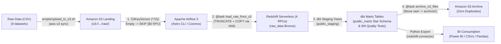
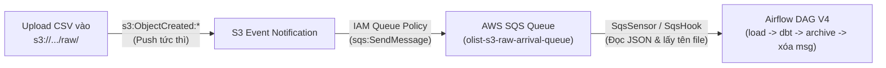

# BÁO CÁO NGHIỆM THU DỰ ÁN & ĐÁNH GIÁ CÁ NHÂN (PROJECT SIGN-OFF & RETROSPECTIVE)

---

## 📌 THÔNG TIN CHUNG DỰ ÁN (PROJECT OVERVIEW)

| Thuộc tính | Chi tiết |
| :--- | :--- |
| **Tên dự án** | **End-to-End Event-Driven AWS E-Commerce Data Pipeline & Kimball Star Schema Analytics (V3)** |
| **Kỹ sư thực hiện** | Ao Minh Tam ([@AOMINHTAM](https://github.com/AOMINHTAM)) |
| **Repository** | [github.com/AOMINHTAM/aws-data-pipeline](https://github.com/AOMINHTAM/aws-data-pipeline) |
| **Dataset sử dụng** | Olist Brazilian E-Commerce Dataset (~120MB, ~100k đơn hàng, 9 quan hệ) |
| **Công nghệ cốt lõi** | AWS (S3, Redshift Serverless, IAM), dbt Core, Apache Airflow 3 (Astro CLI & Astronomer Cosmos), Docker, Python (`redshift-connector`, `pandas`), WSL2 Ubuntu |
| **Lịch sử hoàn thành** | **V2 (Baseline):** Tháng 10/2026 • **V3 (Event-Driven Automation):** Tháng 11/2026 |
| **Trạng thái** | ✅ **HOÀN THÀNH TOÀN DIỆN (100% ACCEPTED & LIVE VERIFIED)** |

---

## 🏗️ KIẾN TRÚC HỆ THỐNG ĐÃ XÂY DỰNG (V3 EVENT-DRIVEN)



---

## ✅ BẢNG NGHIỆM THU CÁC HẠNG MỤC KỸ THUẬT (ACCEPTANCE CHECKLIST)

| STT | Hạng mục công việc | Tiêu chí nghiệm thu | Kết quả | Trạng thái |
| :---: | :--- | :--- | :--- | :---: |
| **1** | **Bảo mật & Môi trường Base** | Môi trường Linux Ubuntu WSL2, phân quyền IAM User tối thiểu (`least privilege`), AWS CLI v2, quản lý source code bằng Git. | Hoàn thành, bảo mật credentials + `AIRFLOW_CONN_AWS_DEFAULT` qua `.env` (git-ignored). | **ĐẠT** |
| **2** | **Hạ tầng AWS Cloud & Chi phí** | Thiết lập S3 Bucket bảo mật private, Amazon Redshift Serverless 4 RPU, cấu hình AWS Budget Alert kiểm soát ngưỡng \$5/tháng. | Hoàn thành, không vượt chi phí dự toán. | **ĐẠT** |
| **3** | **Data Ingestion (Data Lake -> DWH)** | Nạp 9 bảng raw qua lệnh `COPY` với IAM Role `RedshiftS3ReadOnlyRole` (STS AssumeRole). | Nạp đủ 99,441 orders, 112,650 order items; V3 nâng cấp thành `@task load_raw_from_s3` chạy `TRUNCATE + COPY` đảm bảo Idempotent. | **ĐẠT** |
| **4** | **Data Modeling (Kimball Star Schema)** | Xây dựng dbt project gồm: Staging Views (`public_staging`) và Marts Tables (`fct_orders`, `dim_customers`, `dim_products`). | Cấu trúc Star Schema chuẩn xác, tối ưu query phân tích. | **ĐẠT** |
| **5** | **Data Quality & Testing** | Viết dbt tests kiểm tra `unique`, `not_null`, `accepted_values`, `relationships`. | Vượt qua 9/9 tests (`PASS=9 WARN=0 ERROR=0`). | **ĐẠT** |
| **6** | **Pipeline Orchestration (Airflow + Cosmos)** | Triển khai Airflow bằng Astro CLI trên Docker, dùng Astronomer Cosmos parse dbt DAG thành native Airflow TaskGroup. | Toàn bộ DAG chạy thành công (18/18 tasks xanh lá trên UI). | **ĐẠT** |
| **7** | **Event-Driven Automation & FinOps (V3)** | Tự động quét `raw/*.csv` theo lịch `*/15 * * * *` (`S3KeySensor` `reschedule` + `soft_fail=True`), chỉ move sang `archive/<ts>/` sau khi dbt & test pass. | Nghiệm thu live 2 nhịp liên tiếp: nhịp `23:30:00` **18/18 success** + archive sạch 9 file sang `archive/20261112_165135/`; nhịp `23:45:00` khi `raw/` rỗng tự chuyển **17 tasks `skipped`** (\$0 Redshift). | **ĐẠT** |
| **8** | **Data Consumption & Export** | Viết module Python (`redshift-connector` + `pandas`) trích xuất dữ liệu marts ra các file CSV sạch phục vụ BI & Data Science. | Xuất 4 bộ dataset phân tích sạch vào `exports/` (~54 MB). | **ĐẠT** |

---

## 📊 KẾT QUẢ ĐẦU RA DỮ LIỆU ĐÃ NGHIỆM THU

Các file dữ liệu thành phẩm đã được trích xuất tại thư mục [`exports/`](file:///d:/gehihi/aws_data_pipeline/exports/):

1. **`1_master_orders_analytics.csv`** (24.5 MB | 99,441 dòng): Tổng hợp đơn hàng, khách hàng, doanh thu, thời gian giao hàng, độ trễ và review score.
2. **`2_dim_products.csv`** (3.2 MB | 32,951 dòng): Danh mục sản phẩm đã dịch chuẩn tiếng Anh, kích thước và khối lượng.
3. **`3_dim_customers.csv`** (15.2 MB | 99,441 dòng): Khách hàng, phân khúc One-time vs Returning, Customer Lifetime Value (LTV).
4. **`4_order_items_product_sales.csv`** (11.3 MB | 112,650 dòng): Chi tiết từng item bán ra kết nối với sản phẩm.

---

## ✍️ PHẦN DÀNH CHO BẠN: ĐÁNH GIÁ & CẢM NHẬN CÁ NHÂN (RETROSPECTIVE)

> *(Hãy dành 10 - 15 phút đọc các câu hỏi gợi ý bên dưới và tự do viết lại cảm nhận, bài học và suy nghĩ thật của bạn vào các khung bên dưới nhé!)*

### 1. Cảm xúc & Trải nghiệm tổng quan khi hoàn thành dự án
*Gợi ý: Cảm giác của bạn khi nhìn thấy Airflow DAG chuyển sang màu xanh lá cây toàn bộ, dbt test 9/9 pass, và file CSV được tải thành công từ Redshift xuống máy? Dự án này có gì khác biệt so với việc chỉ học lý thuyết?*

> **Cảm nhận của tôi:**
>
> *(Viết cảm xúc và trải nghiệm của bạn tại đây...)*
> 

---

### 2. Thử thách kỹ thuật lớn nhất đã vượt qua (Troubleshooting Journey)
*Gợi ý: Trong quá trình làm, có những "con bug" nào khiến bạn nhớ nhất?*
*(Ví dụ: Lỗi dính Cloudflare WARP chặn Port 5439 của Redshift; Lỗi Power BI bị crash khi gõ kèm port `:5439` vào ô Server; Lỗi nhân 4 lần dữ liệu khi chạy COPY nhiều lần; Lỗi môi trường Ubuntu WSL2 và phân quyền; Port UI động trên Astro Runtime 3.3 hay hành vi Scheduler tự trigger...)*
*Bạn đã học được cách debug và tư duy xử lý vấn đề như thế nào qua những lần vấp ngã đó?*

> **Những khó khăn và bài học gỡ lỗi:**
>
> *(Viết lại các lỗi nhớ đời và cách bạn đã vượt qua tại đây...)*
> 

---

### 3. Kiến thức & Kỹ năng cốt lõi bạn tâm đắc nhất
*Gợi ý: Điều gì khiến bạn thấy mình tiến bộ rõ rệt nhất về tư duy Data Engineering?*
- *Mô hình hoá dữ liệu (Dimensional Modeling - Kimball Star Schema) thay vì để dữ liệu thô?*
- *Tư duy Data Lake (`raw/` vs `archive/`) + Event-Driven Sensor (`S3KeySensor` + FinOps Skip) vs Data Warehouse (Redshift Serverless)?*
- *Sức mạnh của dbt (viết SQL dưới dạng modular, version control, tự động sinh lineage & testing)?*
- *Điều phối tự động Idempotent bằng Airflow 3 & Docker?*

> **Kiến thức tâm đắc nhất:**
>
> *(Ghi lại những khái niệm hoặc công cụ bạn thấy giá trị nhất tại đây...)*
> 

---

### 4. Điểm bạn hài lòng nhất về sản phẩm hoàn thiện
*Gợi ý: Sự sạch sẽ của code? Repository GitHub chỉn chu? Pipeline chạy mượt mà từ đầu đến cuối? Hay việc kiểm soát tốt chi phí không tốn một đồng lãng phí nào trên AWS?*

> **Điểm tự hào nhất:**
>
> *(Viết điểm bạn hài lòng nhất tại đây...)*
> 

---

### 5. Kế hoạch phát triển tiếp theo (Next Steps & Future Improvements)
*Gợi ý: Nếu có thêm thời gian hoặc làm dự án tiếp theo ở quy mô công ty lớn hơn, bạn sẽ bổ sung thêm những gì?*
*(Ví dụ: Xây dựng Dashboard Power BI hoàn chỉnh trực quan hóa các chart doanh thu; Chuyển sang Data Ingestion Streaming với Apache Kafka/Kinesis hoặc S3 EventBridge + SQS Deferred Trigger; Thêm Data Quality Framework như Soda/Great Expectations; Triển khai CI/CD bằng GitHub Actions...)*

> **Định hướng tiếp theo:**
>
> *(Viết kế hoạch hoặc mục tiêu tương lai của bạn tại đây...)*
> 

---

## 📝 XÁC NHẬN ĐÓNG DỰ ÁN V2 & V3 (SIGN-OFF)

- **Đánh giá tổng thể dự án:** ⭐⭐⭐⭐⭐ (5/5)
- **Ngày nghiệm thu:** V2: 31 / 10 / 2026  •  V3 (Event-Driven): 12 / 11 / 2026
- **Xác nhận bởi Kỹ sư dự án:** 
  *(Ký tên hoặc điền Ao Minh Tam)*

---

## 🚀 LỘ TRÌNH NÂNG CẤP V4 & BÀN GIAO CONTEXT SANG CONVERSATION MỚI (V4 ROADMAP & HANDOFF)

> **Mục đích tài liệu này:** Ghi lại đầy đủ trạng thái hạ tầng hiện tại, lý do kiến trúc, cơ chế hoạt động bên dưới (under-the-hood) và giá trị kiến thức của 3 bước nâng cấp V4 để khi mở Conversation mới chỉ cần đọc file này là tiếp tục triển khai ngay không mất ngữ cảnh.

### 0. Trạng thái Bàn giao Hiện tại (Current Workspace & Cloud State)
* **Git Branch đang đứng:** `feat/v4-sqs-event-driven` (tách ra từ `main` tại commit `ffcdac2` sau khi đã hoàn tất và push V3).
* **Tài khoản & Quyền AWS IAM:**
  * IAM User: `arn:aws:iam::205506434601:user/de-ecommerce-dev` (Region: `us-east-1`).
  * Đã gắn đủ 4 Managed Policies: `AmazonS3FullAccess`, `AmazonRedshiftFullAccess`, `IAMFullAccess`, và **`AmazonSQSFullAccess`** (vừa cấp thêm và đã verify `wsl aws sqs list-queues --region us-east-1` thành công).
* **Trạng thái S3 (`olist-raw-data-amt-us-east-1-205506434601-us-east-1-an`):**
  * Folder `raw/` hiện đang trống (`[]`).
  * 9 file CSV gốc đang nằm trong `archive/20261112_165135/` (có thể copy ngược 1 hoặc vài file từ `archive/` về `raw/` trên S3 để test V4 mà không cần upload lại từ máy local).
  * S3 Event Notification hiện đang trống (chưa cấu hình).
* **Trạng thái Docker / Astro CLI:**
  * Đang tắt (`astro dev stop`) để tiết kiệm RAM.
  * File `.env` (git-ignored) đã cấu hình sẵn `DBT_REDSHIFT_PASSWORD`, `AWS_DEFAULT_REGION`, `AWS_ACCESS_KEY_ID`, `AWS_SECRET_ACCESS_KEY`, `S3_BUCKET_NAME`, `AIRFLOW_CONN_AWS_DEFAULT=aws://`.

---

### Tại sao lại đi theo thứ tự: Bước 1 (SQS Push) → Bước 2 (dbt Incremental) → Bước 3 (Alerting)?
Ba bước này có **quan hệ nhân quả chặt chẽ về mặt kiến trúc**:
1. **Bước 1 (S3 → SQS → Airflow)** giải quyết bài toán **"Khi nào chạy và độ trễ bao lâu?"** — chuyển từ *Polling định kỳ 15 phút* sang *Push-based Event-Driven* (file vừa chạm S3 là bắn event vào hàng đợi SQS để xử lý ngay).
2. **Bước 2 (dbt Incremental Modeling)** giải quyết bài toán **"Khi event nổ liên tục theo từng lô nhỏ (micro-batch), xử lý dữ liệu thế nào để không mất dữ liệu cũ và không đốt tiền Redshift?"** — khi đã chạy theo sự kiện thực tế, ta không thể `TRUNCATE` toàn bảng raw hay `CREATE TABLE AS` dựng lại toàn bộ bảng Fact hàng triệu dòng mỗi lần có 1 file mới được nữa, mà bắt buộc phải dùng cơ chế **Incremental (Upsert / Merge)**.
3. **Bước 3 (Webhook Alerting)** là lớp giám sát ngoại vi (Observability) — không bắt buộc cho pet project nhưng làm thử một kịch bản gọn nhẹ ở cuối để nắm trọn vẹn luồng báo động tự động khi pipeline thành công/thất bại.

---

### BƯỚC 1: Pure Event-Driven Ingestion với AWS S3 Event Notification & AWS SQS



#### 1. Cái gì chuẩn bị làm (What to build)
1. Tạo Standard Queue trên AWS SQS: `olist-s3-raw-arrival-queue` (Region `us-east-1`, chi phí \$0 vì Free Tier miễn phí 1 triệu requests/tháng).
2. Gắn **Resource-based Queue Policy** cho phép dịch vụ `s3.amazonaws.com` thực hiện quyền `sqs:SendMessage` từ đúng ARN của bucket `olist-raw-data-amt-us-east-1-205506434601-us-east-1-an`.
3. Bật **S3 Bucket Notification Configuration**: Lắng nghe sự kiện `s3:ObjectCreated:*` với bộ lọc `prefix = raw/` và `suffix = .csv` để đẩy message thẳng vào SQS.
4. Nâng cấp `dags/ecommerce_pipeline_dag.py`: Dùng `SqsSensor` (hoặc `@task` với `SqsHook`) lắng nghe queue, bóc tách chính xác danh sách `bucket_key` từ JSON payload của SQS, nạp vào Redshift, chạy dbt, archive file và xóa message khỏi queue.

#### 2. Mục đích — Vì sao phải làm (Why)
* **Loại bỏ độ trễ Polling (Zero Polling Latency):** Ở V3 (`S3KeySensor` chạy mỗi 15 phút), nếu file lên S3 lúc `12:01` thì phải đợi tới `12:15` mới được xử lý. Với S3 → SQS, sự kiện được đẩy đi ngay lập tức (dưới 1–2 giây).
* **Không cần quét (List) toàn bộ S3:** Lệnh `LIST` trên S3 khi bucket có hàng trăm ngàn object rất chậm và tốn phí API. Trong khi đó, message trong SQS chứa sẵn tên file vừa tạo (`Records[0].s3.object.key`), Airflow biết chính xác cần nạp file nào mà không cần quét thư mục.
* **Chống mất mát sự kiện (Buffering & Decoupling):** Nếu Airflow container đang bảo trì hoặc tắt, các sự kiện upload file lên S3 vẫn nằm an toàn trong hàng đợi SQS (lưu giữ tới 4–14 ngày). Khi Airflow bật lại, nó đọc hàng đợi và xử lý bù không sót một file nào!

#### 3. Cơ chế hoạt động bên dưới (Under-the-hood Mechanism)
* **JSON Event Payload:** Khi có file `raw/olist_orders_dataset.csv` được upload, S3 sinh ra một gói JSON chuẩn và đẩy vào SQS:
  ```json
  {
    "Records": [
      {
        "eventName": "ObjectCreated:Put",
        "s3": {
          "bucket": { "name": "olist-raw-data-amt-..." },
          "object": { "key": "raw/olist_orders_dataset.csv", "size": 17654914 }
        }
      }
    ]
  }
  ```
* **Visibility Timeout & At-Least-Once Delivery:**
  * Khi Airflow đọc một message từ SQS (`ReceiveMessage`), message đó **chưa bị xóa ngay** mà chỉ tạm thời "tàng hình" với các worker khác trong khoảng thời gian `VisibilityTimeout` (ví dụ 300 giây).
  * Nếu Airflow nạp Redshift + chạy dbt **thành công**, Airflow dùng `ReceiptHandle` gọi `DeleteMessage` để xóa hẳn message khỏi SQS.
  * Nếu giữa chừng Redshift bị lỗi mạng khiến task **thất bại**, Airflow không xóa message → hết 300 giây, message tự động hiện lại trong SQS để lượt chạy sau xử lý lại. Đây chính là cơ chế đảm bảo **không bao giờ mất dữ liệu (Fault-Tolerant Message Queue)**.

#### 4. Học được gì từ Bước 1 (Engineering Takeaways)
* Phân biệt sâu sắc hai mô hình kiến trúc kinh điển: **Pull/Polling (`S3KeySensor`)** vs. **Push/Event-Driven (`S3 Event -> SQS`)**.
* Hiểu cách hai dịch vụ AWS giao tiếp bảo mật với nhau qua **Resource-based Policy** (khác với Identity-based Policy của IAM User).
* Nắm vững cơ chế hàng đợi phân tán (**Message Queue**): `VisibilityTimeout`, `ReceiptHandle`, `Idempotent Consumer`, và cách **tách rời (Decouple)** tầng Storage (S3) khỏi tầng Compute/Orchestration (Airflow).

#### 5. Kết quả Nghiệm thu Live Bước 1 (Live Verified & Accepted)
> [!NOTE]
> **Trạng thái:** ✅ **ĐẠT 100% (LIVE VERIFIED TRÊN AWS & AIRFLOW 3)**
> - **Cấu hình AWS:** Đã tạo SQS queue `olist-s3-raw-arrival-queue`, gắn SQS Access Policy cấp quyền cho S3, và bật S3 Bucket Notification trên prefix `raw/` và suffix `.csv`.
> - **Airflow V4:** Nâng cấp `dags/ecommerce_pipeline_dag.py` dùng `SqsSensor` (timeout 45s, `soft_fail=True`, `delete_message_on_reception=False`) kết hợp module [include/sqs_parser.py](file:///d:/gehihi/aws_data_pipeline/include/sqs_parser.py).
> - **Kiểm thử thực tế 2 nhịp liên tiếp:**
>   - **Nhịp 1 (`14:20:00` - Happy Path):** SQS nhận event `product_category_name_translation.csv` → Airflow tự động nạp Redshift → chạy dbt 9/9 tests PASS → archive S3 → gọi `✉️ SQS ACK` xóa message khỏi queue.
>   - **Nhịp 2 (`14:25:00` - FinOps Zero-Cost):** SQS rỗng → `SqsSensor` timeout sau 45s chuyển toàn bộ task sang **màu hồng (`SKIPPED`)**, bảo toàn ngân sách $0 Redshift RPU.
> - **Bằng chứng hình ảnh nghiệm thu:**
>   - Graph View V4: [`images/airflow_v4_dag_graph.png`](file:///d:/gehihi/aws_data_pipeline/images/airflow_v4_dag_graph.png)
>   - Grid View Event-Driven & FinOps: [`images/airflow_v4_grid_event_driven.png`](file:///d:/gehihi/aws_data_pipeline/images/airflow_v4_grid_event_driven.png)
>   - SQS ACK & S3 Archive Task Logs: [`images/airflow_v4_sqs_ack_log.png`](file:///d:/gehihi/aws_data_pipeline/images/airflow_v4_sqs_ack_log.png)


---

### BƯỚC 2: dbt Incremental Modeling (`materialized='incremental'` & Upsert/Merge)

#### 1. Cái gì chuẩn bị làm (What to build)
1. Thay đổi cơ chế nạp dữ liệu và cấu hình các model lớn trong `dbt/models/marts/` (đặc biệt là `fct_orders.sql` và `dim_customers.sql`) từ `materialized='table'` sang **`materialized='incremental'`** với `unique_key='order_id'` (hoặc chiến lược `merge` / `delete+insert` trên Redshift).
2. Bổ sung khối logic jinja `` trong câu SQL của dbt để chỉ lọc các bản ghi mới hoặc vừa được cập nhật.
3. Kiểm thử thực tế: Chạy lần 1 (Full Load) → Nạp thêm một batch đơn hàng mới/cập nhật trạng thái đơn cũ → Chạy lần 2 (Incremental Load) và kiểm tra SQL mà dbt sinh ra trong log của Redshift.

#### 2. Mục đích — Vì sao phải làm (Why)
* **Giải bài toán Chi phí & Hiệu năng ở quy mô lớn (Scale):** Với `materialized='table'`, mỗi lần chạy dbt sẽ thực hiện `DROP TABLE` và `CREATE TABLE AS SELECT ...` quét lại toàn bộ 100% lịch sử. Nếu bảng có 100 triệu đơn hàng mà mỗi 5 phút chỉ có thêm 500 đơn mới, việc dựng lại cả bảng 100 triệu dòng là sự lãng phí tài nguyên không thể chấp nhận trong thực tế.
* **Bảo toàn dữ liệu lịch sử khi nạp theo từng lô nhỏ (Micro-batch):** Khi kết hợp với SQS ở Bước 1, mỗi lần chỉ có một vài file/lô dữ liệu mới đi vào. Cơ chế Incremental giúp **cộng dồn và cập nhật (Upsert)** vào bảng đích thay vì xóa trắng dữ liệu cũ.

#### 3. Cơ chế hoạt động bên dưới (Under-the-hood Mechanism)
* **Lần chạy đầu tiên (khi bảng đích chưa tồn tại hoặc chạy `--full-refresh`):**
  * Hàm `is_incremental()` trả về `False`.
  * dbt bỏ qua điều kiện `WHERE` và chạy `CREATE TABLE public_marts.fct_orders AS SELECT ...` nạp toàn bộ lịch sử.
* **Các lần chạy tiếp theo (khi bảng `public_marts.fct_orders` đã tồn tại):**
  * Hàm `is_incremental()` trả về `True`.
  * dbt kích hoạt bộ lọc **High-Water Mark (Cột mốc thời gian lớn nhất)**:
    ```sql
    
      WHERE order_purchase_timestamp >= (SELECT MAX(order_purchase_timestamp) FROM {{ this }})
    
    ```
    *(Biến `{{ this }}` chính là tên bảng đích `public_marts.fct_orders` hiện tại trong Redshift).*
* **Cơ chế Upsert (`delete+insert` / `merge`) trên Redshift:**
  * Để tránh bị nhân đôi dòng (duplicate) khi một đơn hàng cũ thay đổi trạng thái (ví dụ từ `shipped` sang `delivered`), dbt tạo một bảng tạm (`fct_orders__dbt_tmp`) chỉ chứa các dòng mới/thay đổi.
  * Sau đó trong **1 Transaction nguyên tử (Atomic Transaction)**, Redshift thực hiện:
    1. `DELETE FROM public_marts.fct_orders WHERE order_id IN (SELECT order_id FROM fct_orders__dbt_tmp);` (Xóa bản ghi cũ của những đơn vừa cập nhật).
    2. `INSERT INTO public_marts.fct_orders SELECT * FROM fct_orders__dbt_tmp;` (Chèn bản ghi mới nhất vào).

#### 4. Học được gì từ Bước 2 (Engineering Takeaways)
* Nắm vững kỹ thuật **Incremental Data Modeling** — câu hỏi phỏng vấn bắt buộc ở mọi vị trí Data Engineer / Analytics Engineer.
* Hiểu rõ khái niệm **High-Water Mark**, cách xử lý **Late-Arriving Data** (dữ liệu đến muộn bằng khoảng lùi thời gian `lookback window`), và sự khác biệt giữa **Append-only** vs. **Upsert (`unique_key`)**.
* Đọc hiểu được mã DDL/DML thực tế mà `dbt-redshift` biên dịch ra phía sau lớp macro Jinja.

---

### BƯỚC 3: Lightweight Observability & Webhook Alerting (Trải nghiệm Cơ chế Giám sát)

#### 1. Cái gì chuẩn bị làm (What to build)
* Viết một hàm callback gọn nhẹ trong Python (`send_pipeline_notification(context)`) gắn vào `on_success_callback` / `on_failure_callback` của DAG Airflow.
* Bắn thông báo định dạng Markdown qua **Telegram Bot API** hoặc **Slack/Discord Incoming Webhook** (chỉ dùng thư viện chuẩn `urllib`/`requests` gọi HTTP POST).

#### 2. Mục đích — Vì sao phải làm (Why)
* Trong môi trường thực tế, kỹ sư không bao giờ ngồi canh màn hình Airflow 24/7. Hệ thống phải tự động báo tin khi có sự cố (`Task Failed` / `dbt Test Failed`) hoặc gửi báo cáo tóm tắt sau mỗi batch nạp thành công.

#### 3. Cơ chế hoạt động bên dưới (Under-the-hood Mechanism)
* **Airflow Execution Context (`context` dictionary):** Khi bất kỳ task hoặc DAG nào kết thúc, Airflow tự động truyền một biến `context` chứa toàn bộ metadata của lượt chạy (`dag_run`, `task_instance`, `logical_date`, `exception`, `ti.xcom_pull(...)`).
* Hàm callback trích xuất các thông số này (ví dụ: đã nạp bao nhiêu file từ XCom, tốn bao nhiêu giây, link log ở đâu) và đóng gói thành HTTP POST payload gửi tới Webhook URL.

#### 4. Học được gì từ Bước 3 (Engineering Takeaways)
* Hiểu cơ chế **Event Hook / Callback Lifecycle** bên trong Airflow State Machine (khi một Task chuyển trạng thái sang `SUCCESS` hoặc `FAILED`).
* Biết cách lấy dữ liệu xuyên task qua `xcom_pull` để tạo thông báo giàu ngữ cảnh (Rich Context Alerting) thay vì chỉ báo lỗi chung chung.

