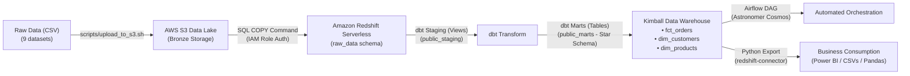

# BÁO CÁO NGHIỆM THU DỰ ÁN & ĐÁNH GIÁ CÁ NHÂN (PROJECT SIGN-OFF & RETROSPECTIVE)

---

## 📌 THÔNG TIN CHUNG DỰ ÁN (PROJECT OVERVIEW)

| Thuộc tính | Chi tiết |
| :--- | :--- |
| **Tên dự án** | **End-to-End AWS E-Commerce Data Pipeline & Kimball Star Schema Analytics** |
| **Kỹ sư thực hiện** | Ao Minh Tam ([@AOMINHTAM](https://github.com/AOMINHTAM)) |
| **Repository** | [github.com/AOMINHTAM/aws-data-pipeline](https://github.com/AOMINHTAM/aws-data-pipeline) |
| **Dataset sử dụng** | Olist Brazilian E-Commerce Dataset (~120MB, ~100k đơn hàng, 9 quan hệ) |
| **Công nghệ cốt lõi** | AWS (S3, Redshift Serverless, IAM), dbt Core, Apache Airflow (Astronomer Cosmos), Docker, Python (`redshift-connector`, `pandas`), WSL2 Ubuntu |
| **Thời gian hoàn thành**| Tháng 10/2026 |
| **Trạng thái** | ✅ **HOÀN THÀNH TOÀN DIỆN (100% ACCEPTED)** |

---

## 🏗️ KIẾN TRÚC HỆ THỐNG ĐÃ XÂY DỰNG

---

## ✅ BẢNG NGHIỆM THU CÁC HẠNG MỤC KỸ THUẬT (ACCEPTANCE CHECKLIST)

| STT | Hạng mục công việc | Tiêu chí nghiệm thu | Kết quả | Trạng thái |
| :---: | :--- | :--- | :--- | :---: |
| **1** | **Bảo mật & Môi trường Base** | Môi trường Linux Ubuntu WSL2, phân quyền IAM User tối thiểu (`least privilege`), AWS CLI v2 cấu hình bảo mật `chmod 600`, quản lý source code bằng Git. | Hoàn thành, bảo mật credentials tuyệt đối qua `.env`. | **ĐẠT** |
| **2** | **Hạ tầng AWS Cloud & Chi phí** | Thiết lập S3 Bucket bảo mật private, Amazon Redshift Serverless 4 RPU, cấu hình AWS Budget Alert kiểm soát ngưỡng \$5/tháng. | Hoàn thành, không vượt chi phí dự toán. | **ĐẠT** |
| **3** | **Data Ingestion (Data Lake -> DWH)** | Viết kịch bản tự động upload S3, tạo DDL schema `raw_data` và nạp 9 bảng raw qua lệnh `COPY`. | Nạp đủ 99,441 orders, 112,650 order items, không trùng lặp. | **ĐẠT** |
| **4** | **Data Modeling (Kimball Star Schema)** | Xây dựng dbt project gồm: Staging Views (chuẩn hoá kiểu dữ liệu, đổi tên) và Marts Tables (`fct_orders`, `dim_customers`, `dim_products`). | Cấu trúc Star Schema chuẩn xác, tối ưu query phân tích. | **ĐẠT** |
| **5** | **Data Quality & Testing** | Viết dbt tests kiểm tra `unique`, `not_null`, `accepted_values`, `relationships`. | Vượt qua 9/9 tests (`PASS=9 WARN=0 ERROR=0`). | **ĐẠT** |
| **6** | **Pipeline Orchestration (Airflow)** | Triển khai Airflow bằng Astronomer CLI trên Docker, sử dụng Astronomer Cosmos để parse dbt DAG thành native Airflow task group. | Toàn bộ DAG chạy thành công (All-Green status) trên UI. | **ĐẠT** |
| **7** | **Data Consumption & Export** | Viết module Python (`redshift-connector` + `pandas`) trích xuất dữ liệu marts ra các file CSV sạch để phục vụ BI & Data Science. | Xuất 4 bộ dataset phân tích sạch vào `exports/` (~54 MB). | **ĐẠT** |

---

## 📊 KẾT QUẢ ĐẦU RA DỮ LIỆU ĐÃ NGHIỆM THU

Các file dữ liệu thành phẩm đã được trích xuất tại thư mục [`exports/`](file:///d:/gehihi/aws_data_pipeline/exports/):

1. **`1_master_orders_analytics.csv`** (24.5 MB | 99,441 dòng): Tổng hợp đơn hàng, khách hàng, doanh thu, thời gian giao hàng, độ trễ và review score.
2. **`2_dim_products.csv`** (3.2 MB | 32,951 dòng): Danh mục sản phẩm đã dịch chuẩn tiếng Anh, kích thước và khối lượng.
3. **`3_dim_customers.csv`** (15.2 MB | 99,441 dòng): Khách hàng, phân khúc One-time vs Returning, Customer Lifetime Value (LTV).
4. **`4_order_items_product_sales.csv`** (11.3 MB | 112,650 dòng): Chi tiết từng item bán ra kết nối với sản phẩm.

---

## ✍️ PHẦN DÀNH CHO BẠN: ĐÁNH GIÁ & CẢM NHẬN CÁ NHÂN (RETROSPECTIVE)

> *(Hãy dành 10 - 15 phút đọc các câu hỏi gợi ý bên dưới và tự do viết lại cảm nhận, bài học và suy nghĩ thật của bạn vào các khung bên dưới nhé!)*

### 1. Cảm xúc & Trải nghiệm tổng quan khi hoàn thành dự án
*Gợi ý: Cảm giác của bạn khi nhìn thấy Airflow DAG chuyển sang màu xanh lá cây toàn bộ, dbt test 9/9 pass, và file CSV được tải thành công từ Redshift xuống máy? Dự án này có gì khác biệt so với việc chỉ học lý thuyết?*

> **Cảm nhận của tôi:**
>
> *(Viết cảm xúc và trải nghiệm của bạn tại đây...)*
> 

---

### 2. Thử thách kỹ thuật lớn nhất đã vượt qua (Troubleshooting Journey)
*Gợi ý: Trong quá trình làm, có những "con bug" nào khiến bạn nhớ nhất?*
*(Ví dụ: Lỗi dính Cloudflare WARP chặn Port 5439 của Redshift; Lỗi Power BI bị crash khi gõ kèm port `:5439` vào ô Server; Lỗi nhân 4 lần dữ liệu khi chạy COPY nhiều lần; Lỗi môi trường Ubuntu WSL2 và phân quyền...)*
*Bạn đã học được cách debug và tư duy xử lý vấn đề như thế nào qua những lần vấp ngã đó?*

> **Những khó khăn và bài học gỡ lỗi:**
>
> *(Viết lại các lỗi nhớ đời và cách bạn đã vượt qua tại đây...)*
> 

---

### 3. Kiến thức & Kỹ năng cốt lõi bạn tâm đắc nhất
*Gợi ý: Điều gì khiến bạn thấy mình tiến bộ rõ rệt nhất về tư duy Data Engineering?*
- *Mô hình hoá dữ liệu (Dimensional Modeling - Kimball Star Schema) thay vì để dữ liệu thô?*
- *Tư duy Data Lake (S3) vs Data Warehouse (Redshift Serverless)?*
- *Sức mạnh của dbt (viết SQL dưới dạng modular, version control, tự động sinh lineage & testing)?*
- *Điều phối tự động bằng Airflow & Docker?*

> **Kiến thức tâm đắc nhất:**
>
> *(Ghi lại những khái niệm hoặc công cụ bạn thấy giá trị nhất tại đây...)*
> 

---

### 4. Điểm bạn hài lòng nhất về sản phẩm hoàn thiện
*Gợi ý: Sự sạch sẽ của code? Repository GitHub chỉn chu? Pipeline chạy mượt mà từ đầu đến cuối? Hay việc kiểm soát tốt chi phí không tốn một đồng lãng phí nào trên AWS?*

> **Điểm tự hào nhất:**
>
> *(Viết điểm bạn hài lòng nhất tại đây...)*
> 

---

### 5. Kế hoạch phát triển tiếp theo (Next Steps & Future Improvements)
*Gợi ý: Nếu có thêm thời gian hoặc làm dự án tiếp theo ở quy mô công ty lớn hơn, bạn sẽ bổ sung thêm những gì?*
*(Ví dụ: Xây dựng Dashboard Power BI hoàn chỉnh trực quan hóa các chart doanh thu; Chuyển sang Data Ingestion Streaming với Apache Kafka/Kinesis; Thêm Data Quality Framework như Soda/Great Expectations; Triển khai CI/CD bằng GitHub Actions...)*

> **Định hướng tiếp theo:**
>
> *(Viết kế hoạch hoặc mục tiêu tương lai của bạn tại đây...)*
> 

---

## 📝 XÁC NHẬN ĐÓNG DỰ ÁN (SIGN-OFF)

- **Đánh giá tổng thể dự án:** ⭐⭐⭐⭐⭐ (5/5)
- **Ngày nghiệm thu:** 31 / 10 / 2026
- **Xác nhận bởi Kỹ sư dự án:** 
  *(Ký tên hoặc điền Ao Minh Tam)*
