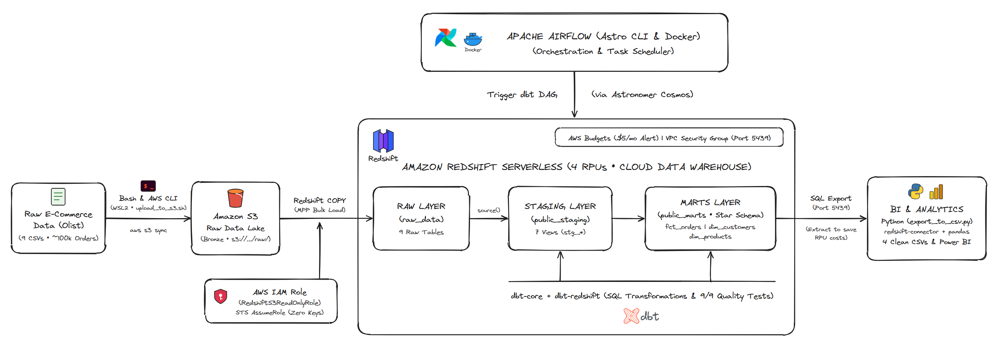
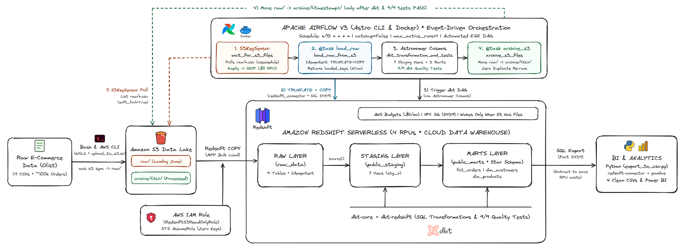
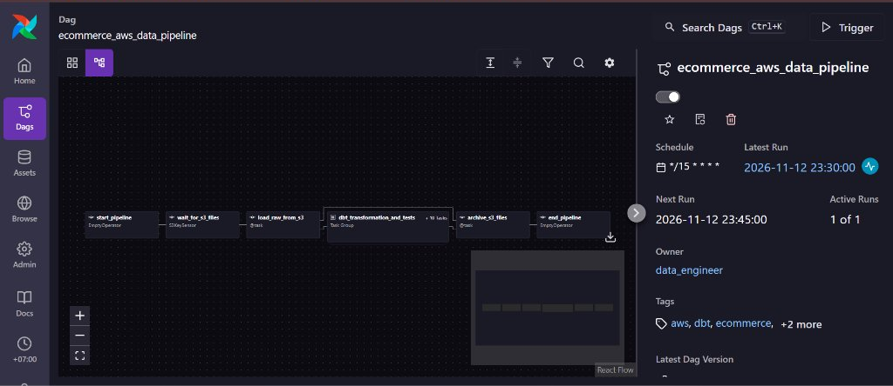
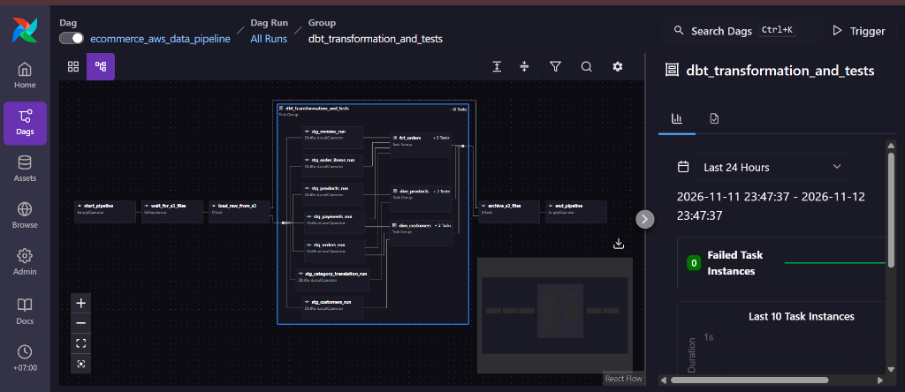
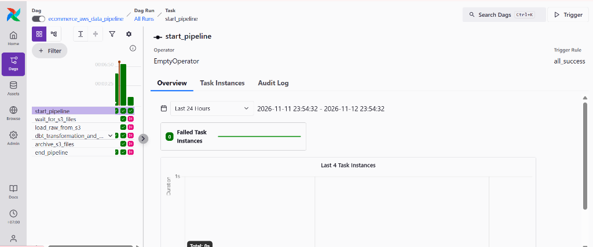
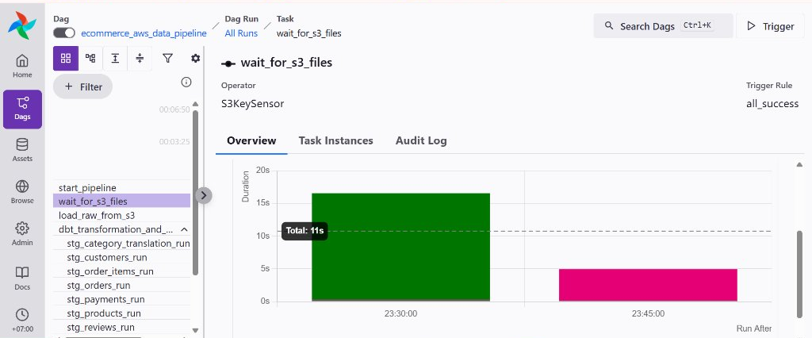

# 🚀 AWS E-Commerce End-to-End Modern Data Pipeline (Event-Driven ELT - V3)

[](https://aws.amazon.com/)
[](https://www.getdbt.com/)
[](https://airflow.apache.org/)
[](https://www.docker.com/)
[](https://ubuntu.com/)

An enterprise-grade, **event-driven end-to-end ELT Data Pipeline** built on the **Modern Data Stack (MDS)** using **AWS (S3 & Redshift Serverless)**, **dbt Core**, and **Apache Airflow 3 (via Astro CLI & Astronomer Cosmos)**.

Upgraded from a manual V2 baseline into a fully automated **V3 Event-Driven Architecture**: Airflow polls an **Amazon S3** landing zone (`raw/`) every 15 minutes via `S3KeySensor`, skips downstream warehouse compute when no new files arrive (**\$0 Redshift RPU cost**), idempotently reloads **Amazon Redshift Serverless**, runs **Kimball Star Schema** transformations + **9/9 dbt quality tests**, and archives processed CSVs (`archive/<timestamp>/`) to eliminate duplicate reprocessing.

---

## 🏛️ System Architecture: Before (V2) vs. After (V3)

### Evolution Summary (V2 → V3)

| Dimension | V2 (Manual Baseline) | V3 (Event-Driven Automation) |
| :--- | :--- | :--- |
| **Triggering** | Manual UI trigger (`schedule=None`) | Automated cron check every 15 mins (`*/15 * * * *`, `max_active_runs=1`) |
| **Ingestion (S3 → Redshift)** | Static SQL scripts run manually (`scripts/copy_raw_tables.sql`) | Automated `S3KeySensor` (`wait_for_s3_files`) → `@task load_raw_from_s3` via `redshift_connector` |
| **Idempotency** | Re-running `COPY` risked duplicate rows | Atomic `TRUNCATE TABLE` + `COPY` per matched table inside Redshift |
| **FinOps Efficiency** | Always executed dbt on trigger | `mode="reschedule"` + `soft_fail=True` → empty `raw/` skips downstream cleanly (**\$0 Redshift**) |
| **S3 Lifecycle** | Files stayed indefinitely in `raw/` | `@task archive_s3_files` moves processed keys `raw/` → `archive/<timestamp>/` **only after dbt & tests pass** |

---

### Before — Architecture V2 (Manual Orchestration Baseline)



> Editable Draw.io source (V2): [`images/architecture.drawio`](images/architecture.drawio)

### After — Architecture V3 (Event-Driven S3 Sensor + Idempotent COPY + Archival)



> Editable Draw.io source (V3): [`images/architecture_v3.drawio`](images/architecture_v3.drawio)

**End-to-End V3 Flow:**
1. **Landing (`raw/`):** Olist CSVs (`~100k` orders across 9 datasets) are synced from WSL2 Ubuntu to `s3://<bucket>/raw/` via [`scripts/upload_to_s3.sh`](scripts/upload_to_s3.sh).
2. **Sense (`wait_for_s3_files`):** Every 15 minutes (`*/15 * * * *`), Airflow runs `S3KeySensor` (`wildcard_match=True`, `mode="reschedule"`, `soft_fail=True`) checking `raw/*.csv` via S3 metadata without waking Redshift. If no files exist, the sensor marks `SKIPPED` cleanly and skips all downstream compute.
3. **Idempotent Extract & Load (`load_raw_from_s3`):** Lists `raw/*.csv`, matches files against `CSV_TO_RAW_TABLE`, connects to **Amazon Redshift Serverless** (SSL port `5439`) using `redshift_connector`, executes `TRUNCATE TABLE` + `COPY` via **IAM Role** (`RedshiftS3ReadOnlyRole`, STS AssumeRole — zero hardcoded keys), and passes `loaded_keys` via XCom.
4. **Transform & Test (`dbt_transformation_and_tests`):** **Astronomer Cosmos** (`DbtTaskGroup`) compiles and executes 7 Staging Views (`public_staging`), 3 Kimball Star Schema Marts Tables (`public_marts`: `fct_orders`, `dim_customers`, `dim_products`), and **9/9 automated data quality tests**.
5. **Lifecycle Archival (`archive_s3_files`):** Runs **strictly after** dbt models and tests pass — copies `loaded_keys` to `archive/<YYYYMMDD_HHMMSS>/<filename>` and deletes them from `raw/`, leaving the landing zone clean for the next batch.
6. **Serving & Cost-Optimized BI:** [`scripts/export_to_csv.py`](scripts/export_to_csv.py) exports clean marts tables into analytical CSVs (`exports/`) so **Power BI** consumes flat files offline without waking Redshift RPUs.

---

## 📸 Pipeline Observability & Verification Results

### 1. V3 Automated DAG Graph (`*/15 * * * *` Event-Driven Flow)
Full V3 pipeline orchestration: `start_pipeline` → `wait_for_s3_files` (`S3KeySensor`) → `load_raw_from_s3` (`@task`) → `dbt_transformation_and_tests` (`DbtTaskGroup`) → `archive_s3_files` (`@task`) → `end_pipeline`:



Expanded view of **Astronomer Cosmos** dynamically mapping all staging models, star-schema marts, and tests inside the automated DAG:



### 2. FinOps Verification: Full E2E Execution vs. Empty-S3 Auto-Skip
Side-by-side scheduled runs in Airflow Grid View demonstrating **zero wasted Redshift compute**:
* **Run `23:30:00` (Green Column — `18/18 success`):** Detected 9 CSVs in `raw/`, loaded Redshift `raw_data`, executed full dbt models & tests, and archived all 9 files to `archive/20261112_165135/`.
* **Run `23:45:00` (Pink Column — `1 success, 17 skipped`):** Next scheduled poll found `raw/` empty, timed out cleanly at 60s (`soft_fail=True`), and skipped Redshift + dbt (**\$0 compute cost**).



### 3. `S3KeySensor` Polling Comparison
Task-level duration comparison on `wait_for_s3_files` (`S3KeySensor`) between file-detected ingestion (`23:30:00`, green) and empty-bucket skip (`23:45:00`, pink):



### 4. dbt Data Lineage Graph
Dependency lineage from 9 `raw_data` sources through 7 `public_staging` views into the 3 Kimball Star Schema `public_marts` tables:


> Legacy V2 All-Green Airflow baseline screenshot preserved at [`images/airflow_dag_success.png`](images/airflow_dag_success.png).

---

## 💡 Key Engineering Highlights & Best Practices

### 1. Event-Driven Orchestration, Idempotency & Data Lifecycle (New in V3)
* **Schedule & Concurrency Safety:** Runs every 15 minutes (`schedule="*/15 * * * *"`) with `catchup=False` and `max_active_runs=1` to guarantee sequential `TRUNCATE + COPY` safety on shared raw tables.
* **Non-Blocking Sensor (`mode="reschedule"`):** `S3KeySensor` releases its worker slot between `poke_interval=20` checks and uses `soft_fail=True` with `timeout=60` so an empty landing zone transitions to `SKIPPED` rather than alerting false failures.
* **Exact-Key XCom Handoff:** `archive_s3_files` only moves the exact `loaded_keys` returned by `load_raw_from_s3`, avoiding race conditions if new files land in `raw/` mid-run.

### 2. Cloud Infrastructure & FinOps (Cost-Optimization)
* **Amazon Redshift Serverless (4 RPUs):** Minimum base capacity scaling down to \$0 when idle; combined with V3's `S3KeySensor` skip gate, idle 15-minute checks never wake the warehouse.
* **AWS Budgets:** Configured strict budget guardrails (\$5/month alert) to eliminate financial surprises.
* **Decoupled BI Extraction:** [`scripts/export_to_csv.py`](scripts/export_to_csv.py) exports clean marts tables to local CSVs (`exports/`) so Power BI refreshes consume flat files instead of waking Redshift RPUs on every query.
* **Storage Optimization:** Private Amazon S3 bucket with Block Public Access enabled and structured `raw/` vs. `archive/` prefixes.

### 3. Cloud Security & Governance
* **Principle of Least Privilege:** Redshift communicates with Amazon S3 via `RedshiftS3ReadOnlyRole` (AssumeRole via AWS STS) — zero hardcoded credentials or access keys stored inside SQL or database configs.
* **Network Perimeter:** VPC Security Group locking down Redshift inbound port `5439` exclusively to authorized developer IP traffic.
* **Secret Management:** Database credentials and AWS Airflow connection URI (`AIRFLOW_CONN_AWS_DEFAULT=aws://`) reside in `.env` (git-ignored) and `~/.dbt/profiles.yml`, preventing secret leakage in version control.

### 4. Data Modeling (Kimball Dimensional Modeling)
* **Multi-Layered Medallion Architecture:**
  * **`raw_data` (Bronze):** Raw tables mirroring Olist S3 CSVs (99,441 orders loaded, refreshed idempotently on new batch arrival).
  * **`public_staging` (Silver - Views):** 7 one-to-one staging views standardizing casing, fixing source column typos (e.g., `product_name_lenght`), and casting types with zero storage duplication.
  * **`public_marts` (Gold - Physical Tables):**
    * **`fct_orders`:** Order-grain fact table combining financial metrics (revenue, freight value), delivery SLA performance (actual vs. estimated delay days, `is_delayed` flag), and customer review scores.
    * **`dim_customers`:** Customer dimension with **Customer Lifetime Value (LTV)**, order frequency, first/last purchase timestamps, and segmentation (`Returning Customer` vs. `One-Time Customer`).
    * **`dim_products`:** Product dimension with English category translation joins and volumetric attributes.
* **Data Quality Testing:** 9 automated dbt tests enforcing primary key `unique` & `not_null` assertions and foreign key `relationships` integrity across Fact and Dimensions.

---

## 📂 Project Structure

```text
aws_data_pipeline/
├── .astro/                         # Astro CLI project settings
├── dags/
│   └── ecommerce_pipeline_dag.py   # V3 Event-Driven Airflow DAG (S3KeySensor -> COPY -> Cosmos dbt -> Archive)
├── dbt/
│   ├── dbt_project.yml             # dbt project configuration & materializations
│   ├── profiles.yml                # Redshift connection profile with env variables
│   └── models/
│       ├── staging/                # Staging layer (7 views + sources.yml)
│       └── marts/                  # Marts layer (fct_orders, dim_customers, dim_products + schema.yml tests)
├── tests/
│   └── dags/
│       └── test_dag_example.py     # Pytest DAG validation (imports, tags, retries >= 2)
├── data/                           # Olist CSV files (git-ignored)
├── exports/                        # Clean analytics CSV exports for Power BI (git-ignored)
├── images/
│   ├── architecture.png            # V2 System Architecture diagram (Before)
│   ├── architecture.drawio         # V2 editable Draw.io source
│   ├── architecture_v3.png         # V3 Event-Driven System Architecture diagram (After)
│   ├── architecture_v3.drawio      # V3 editable Draw.io source
│   ├── airflow_v3_dag_graph.png    # V3 DAG Graph & */15 schedule screenshot
│   ├── airflow_v3_dag_expanded.png # V3 expanded Cosmos TaskGroup screenshot
│   ├── airflow_v3_grid_finops.png  # V3 Grid View (Full Run vs. Empty-S3 Skipped)
│   ├── airflow_v3_s3_sensor.png    # V3 S3KeySensor duration bar chart
│   ├── airflow_dag_success.png     # V2 All-Green DAG baseline screenshot
│   └── dbt_lineage.png             # dbt Data Lineage Graph
├── scripts/
│   ├── upload_to_s3.sh             # Bash script for S3 raw data synchronization
│   ├── create_raw_tables.sql       # Redshift DDL for raw_data schema (initial setup)
│   ├── copy_raw_tables.sql         # Standalone Redshift COPY script (V2 reference)
│   └── export_to_csv.py            # Python script exporting marts tables to CSV via redshift-connector
├── .env                            # Environment variables & secrets (git-ignored)
├── .gitignore
├── Dockerfile                      # Astronomer Runtime 3.3 Dockerfile
├── Makefile                        # Automation shortcuts (verify, upload, export)
├── PROJECT_ACCEPTANCE_REPORT.md    # Project sign-off, V3 upgrade verification & retrospective
└── requirements.txt                # Python dependencies (cosmos, dbt-redshift, airflow-providers-amazon)
```

---

## 🛠️ Tech Stack & Tools

| Component | Technology | Role |
| :--- | :--- | :--- |
| **Cloud Provider** | AWS (Amazon Web Services) | Cloud infrastructure & IAM governance |
| **Object Storage** | Amazon S3 (`raw/` & `archive/`) | Bronze Landing Zone & Processed Batch Archive |
| **Data Warehouse** | Amazon Redshift Serverless (4 RPUs) | Scalable MPP Cloud Data Warehouse |
| **Transformation** | dbt Core (`dbt-redshift`) | SQL Transformation, Kimball Star Schema & 9/9 Tests |
| **Orchestration** | Apache Airflow 3 (Astro CLI) | Event-driven scheduling (`*/15`), `S3KeySensor`, TaskFlow `@task` |
| **Integration** | Astronomer Cosmos | Native dbt-to-Airflow TaskGroup mapping |
| **AWS Integration** | `apache-airflow-providers-amazon` & `redshift-connector` | S3 polling/archival hooks & SSL Redshift `TRUNCATE + COPY` |
| **Containerization** | Docker / Docker Compose | Containerized Airflow runtime |
| **Data Export & BI** | Python (`redshift-connector`, `pandas`) & Power BI | Cost-optimized mart extraction & analytics |
| **OS / Shell** | Ubuntu (WSL2) + Bash | Linux development environment |

---

## ⚡ Quickstart Guide

### 1. Prerequisites
* [Docker Desktop](https://www.docker.com/products/docker-desktop/) installed and running with WSL2 backend.
* [AWS CLI v2](https://aws.amazon.com/cli/) configured (`aws configure`).
* [Astro CLI](https://www.astronomer.io/docs/astro/cli/install-cli) installed (`curl -sSL install.astronomer.io | sudo bash -s`).

### 2. Setup Infrastructure & Credentials
1. Clone the repository:
   ```bash
   git clone https://github.com/AOMINHTAM/aws-data-pipeline.git
   cd aws-data-pipeline
   ```
2. Verify AWS CLI connectivity:
   ```bash
   make aws-verify
   ```
3. Create raw schema tables once in Redshift Query Editor v2 using [`scripts/create_raw_tables.sql`](scripts/create_raw_tables.sql).
4. Configure environment secrets in `.env` (never commit `.env`):
   ```env
   DBT_REDSHIFT_PASSWORD=<your-redshift-admin-password>
   AWS_DEFAULT_REGION=us-east-1
   AWS_ACCESS_KEY_ID=<your-aws-access-key>
   AWS_SECRET_ACCESS_KEY=<your-aws-secret-key>
   S3_BUCKET_NAME=<your-s3-bucket-name>
   AIRFLOW_CONN_AWS_DEFAULT=aws://
   ```

### 3. Run the Event-Driven Stack with Airflow & Cosmos
1. Start the Airflow stack using Astro CLI:
   ```bash
   astro dev start
   ```
2. Open the Airflow Web UI URL printed by `astro dev start` (default `http://localhost:8080`, or the dynamically mapped localhost port shown in `docker ps` / Astro CLI output).
3. Locate DAG **`ecommerce_aws_data_pipeline`** and toggle it **Active** (Unpaused).
4. Drop Olist CSV files into `s3://<your-s3-bucket-name>/raw/` (e.g., via `make upload-data BUCKET=<your-s3-bucket-name>`):
   * Airflow automatically detects `raw/*.csv` on the next 15-minute schedule (or manual Trigger), loads Redshift idempotently, runs dbt models & tests, and moves processed files to `archive/<timestamp>/`.
   * Subsequent scheduled checks with an empty `raw/` prefix will automatically `SKIP` without waking Redshift.

### 4. Export Marts for BI & Analytics
Extract the transformed Star Schema marts into clean local CSVs in `exports/`:
```bash
make export-data
```

---

## 📊 Dataset Reference
* **Source:** [Brazilian E-Commerce Public Dataset by Olist (Kaggle)](https://www.kaggle.com/datasets/olistbr/brazilian-ecommerce)
* **Scope:** 100,000 real anonymized orders from 2016 to 2018 across Brazilian marketplaces, covering order statuses, payments, freight calculations, customer locations, product dimensions, and customer reviews.

---

## 👤 Author
* **Minh Tam Ao** - [GitHub](https://github.com/AOMINHTAM)
* Project: *AWS E-Commerce Data Pipeline V3 (Event-Driven ELT)*
