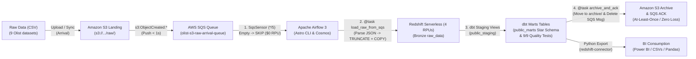
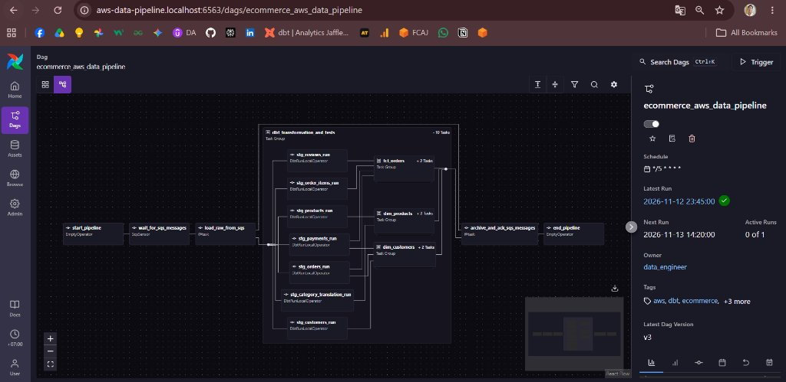
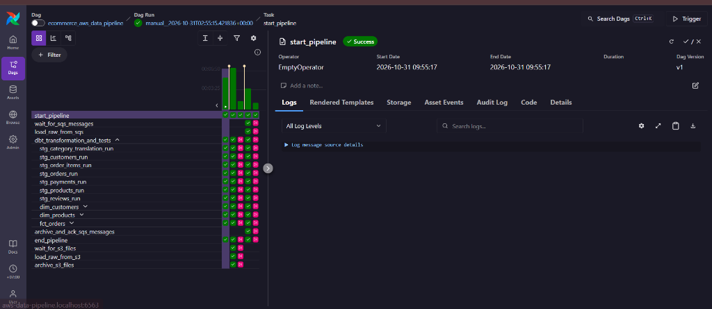
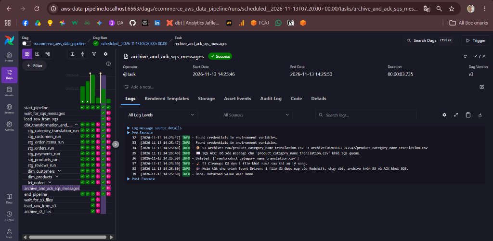
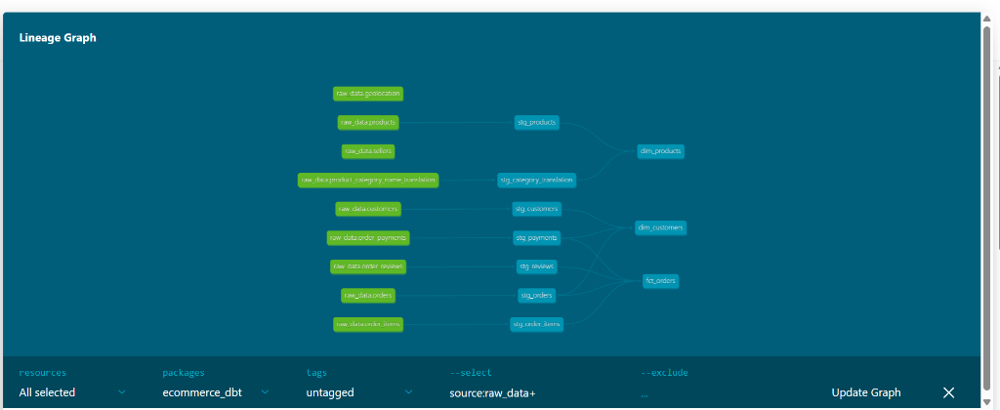

# 🚀 AWS E-Commerce End-to-End Modern Data Pipeline (Pure Event-Driven ELT - V4)

[](https://aws.amazon.com/)
[](https://www.getdbt.com/)
[](https://airflow.apache.org/)
[](https://www.docker.com/)
[](https://ubuntu.com/)

An enterprise-grade, **pure event-driven ELT Data Pipeline** built on the **Modern Data Stack (MDS)** using **AWS (S3, SQS & Redshift Serverless)**, **dbt Core**, and **Apache Airflow 3 (via Astro CLI & Astronomer Cosmos)**.

Upgraded from a manual V2 baseline directly into a resilient **V4 Push-Based Event-Driven Architecture**: Amazon S3 automatically pushes `s3:ObjectCreated:*` events into an **AWS SQS Queue** (`olist-s3-raw-arrival-queue`), Airflow 3 senses incoming messages via `SqsSensor` with **Zero Polling Latency**, skips downstream warehouse compute when the queue is empty (**\$0 Redshift RPU cost**), idempotently reloads **Amazon Redshift Serverless**, transforms data into a **Kimball Star Schema** with **9/9 dbt quality tests**, archives processed CSVs, and safely **ACKs (deletes) SQS messages** with **At-Least-Once Delivery** guarantees.

---

## 🏛️ System Architecture: Before (V2 Baseline) vs. After (V4 Event-Driven)



### Architectural Evolution Comparison (V2 vs. V4)

| Architectural Dimension | V2 (Manual / Batch Baseline) | V4 (Pure Push Event-Driven Architecture) |
| :--- | :--- | :--- |
| **Trigger Mechanism** | Manual UI trigger (`schedule=None`) | **Push-based Event Notification**: File upload to S3 pushes JSON payload directly to **AWS SQS** within seconds. |
| **Trigger Latency** | Manual intervention required | **Zero Polling Latency**: Airflow `SqsSensor` inspects SQS queue directly on a 5-min cadence (`*/5 * * * *`). |
| **S3 API Overhead** | Required heavy `LIST` calls on entire S3 bucket | **Zero `LIST` Overhead**: Event messages contain exact object keys (`Records[0].s3.object.key`). |
| **Fault Tolerance & Reliability** | Direct coupled execution: error midway caused silent failure | **Decoupled with SQS Visibility Timeout (300s)**: Messages remain safe in queue and are only deleted after Redshift COPY + dbt 9/9 tests pass. Network/compute failures allow automatic redelivery. |
| **Data Ingestion (S3 → DWH)** | Static manual SQL script (`copy_raw_tables.sql`) | Dynamic `@task load_raw_from_sqs`: Modular parser, URL unquoting, deduplication, and atomic `TRUNCATE + COPY`. |
| **FinOps Cost Optimization** | Full pipeline runs on trigger | `SqsSensor` with `soft_fail=True` (timeout 45s): Empty queue marks `SKIPPED` (**\$0 Redshift RPU cost**). |
| **Data Lifecycle & SQS ACK** | Files lingered indefinitely in `raw/` | `@task archive_and_ack_sqs_messages`: S3 archive (`raw/` → `archive/<timestamp>/`) + atomic SQS Message Deletion (`delete_message`). |
| **Data Modeling & Governance** | Basic tables / manual scripts | Multi-layered Medallion Kimball Star Schema via **Astronomer Cosmos** with 9 automated dbt tests. |

---

## 📸 Pipeline Observability & Live Verification Results

### 1. V4 Event-Driven Airflow DAG Graph
Orchestration workflow: `start_pipeline` → `wait_for_sqs_messages` (`SqsSensor`) → `load_raw_from_sqs` (`@task`) → `dbt_transformation_and_tests` (`DbtTaskGroup`) → `archive_and_ack_sqs_messages` (`@task`) → `end_pipeline`:



---

### 2. Live Grid Verification: Happy Path Event Run vs. FinOps Zero-Cost Skip
Side-by-side scheduled runs in Airflow Grid View demonstrating **instant event processing** vs. **zero wasted Redshift compute**:
* **Run `14:20:00` (All-Green Column — `18/18 Success`):** Consumed SQS notification for `product_category_name_translation.csv`, refreshed Redshift `raw_data`, executed full dbt models & tests, moved file to S3 archive, and ACK'ed (deleted) message from SQS.
* **Run `14:25:00` (All-Pink Column — `1 Success, 17 Skipped`):** Next 5-minute poll found SQS queue empty, timed out cleanly at 45s (`soft_fail=True`), and skipped all downstream Redshift + dbt compute (**\$0 compute cost**).



---

### 3. SQS Message ACK & S3 Archival Verification Log
Task execution log from `archive_and_ack_sqs_messages` verifying complete **At-Least-Once Delivery** and lifecycle completion:



```text
[INFO] - 📦 S3 Archive: raw/product_category_name_translation.csv -> archive/20261113_072547/product_category_name_translation.csv
[INFO] - ✉️ SQS ACK: Đã xóa message cho 'product_category_name_translation.csv' khỏi SQS queue.
[INFO] - Deleted: ['raw/product_category_name_translation.csv']
[INFO] - 🧹 S3 Cleanup: Đã dọn 1 file khỏi raw/ sau khi xử lý xong.
[INFO] - 🎉 Hoàn tất chu trình Event-Driven: 1 file đã được nạp vào Redshift, chạy dbt, archive trên S3 và ACK khỏi SQS.
```

---

### 4. dbt Data Lineage Graph
Dependency lineage from 9 `raw_data` sources through 7 `public_staging` views into the 3 Kimball Star Schema `public_marts` tables:



---

## 💡 Key Engineering Highlights & Best Practices

### 1. Pure Event-Driven Ingestion with AWS S3 & SQS (New in V4)
* **Decoupled Architecture:** Storage (Amazon S3) is decoupled from Orchestration (Airflow) through **Amazon SQS**. If Airflow containers are stopped for maintenance, S3 events buffer safely in SQS for up to 4 days.
* **Resource-Based Queue Policy:** Configured secure IAM resource policy on SQS granting `sqs:SendMessage` strictly to `s3.amazonaws.com` constrained by `aws:SourceArn` and `aws:SourceAccount`.
* **Fault-Tolerant At-Least-Once Delivery:** Airflow reads messages with `delete_message_on_reception=False` and a `VisibilityTimeout=300s`. Messages are deleted from SQS **only after** dbt models and 9/9 data tests succeed. Any downstream failure leaves the message in SQS for automatic retry.
* **Modular Parser & Unit Testing:** Event parsing logic is isolated in [`include/sqs_parser.py`](include/sqs_parser.py) with automated unit tests in [`tests/test_sqs_parser.py`](tests/test_sqs_parser.py) covering test events, deduplication, and URL-decoding.

### 2. Cloud Infrastructure & FinOps (Cost-Optimization)
* **Amazon Redshift Serverless (4 RPUs):** Base capacity scales down to \$0 when idle; with V4's `SqsSensor` skip gate, empty queue polls never wake Redshift.
* **AWS Budgets:** Strict budget guardrail alert at \$5/month.
* **Decoupled BI Extraction:** [`scripts/export_to_csv.py`](scripts/export_to_csv.py) extracts clean marts to local CSVs (`exports/`), enabling offline Power BI dashboarding without Redshift RPU consumption.

### 3. Cloud Security & Governance
* **Principle of Least Privilege:** Redshift communicates with Amazon S3 via `RedshiftS3ReadOnlyRole` (AssumeRole via AWS STS) — zero hardcoded credentials inside SQL or database configs.
* **Network Perimeter:** VPC Security Group locking down Redshift inbound port `5439` exclusively to authorized developer IP traffic.
* **Secret Management:** Database credentials and AWS Airflow connection URI (`AIRFLOW_CONN_AWS_DEFAULT=aws://`) reside in `.env` (git-ignored).

### 4. Data Modeling (Kimball Dimensional Modeling)
* **Multi-Layered Medallion Architecture:**
  * **`raw_data` (Bronze):** Raw tables mirroring Olist S3 CSVs (99,441 orders loaded, refreshed idempotently on batch arrival).
  * **`public_staging` (Silver - Views):** 7 staging views standardizing naming conventions, fixing column typos (e.g., `product_name_lenght`), and casting types with zero storage duplication.
  * **`public_marts` (Gold - Physical Tables):**
    * **`fct_orders`:** Order-grain fact table combining revenue, freight costs, delivery SLA performance (`is_delayed`), and review scores.
    * **`dim_customers`:** Customer dimension with **Customer Lifetime Value (LTV)**, purchase frequency, and segmentation (`Returning Customer` vs. `One-Time Customer`).
    * **`dim_products`:** Product dimension with English translations and volumetric measurements.
* **Data Quality Testing:** 9 automated dbt tests enforcing `unique`, `not_null`, and foreign key `relationships` across Fact and Dimensions.

---

## 📂 Project Structure

```text
aws_data_pipeline/
├── .astro/                         # Astro CLI project settings
├── dags/
│   └── ecommerce_pipeline_dag.py   # V4 Event-Driven Airflow DAG (SqsSensor -> COPY -> Cosmos dbt -> Archive & ACK)
├── dbt/
│   ├── dbt_project.yml             # dbt project configuration & materializations
│   ├── profiles.yml                # Redshift connection profile with env variables
│   └── models/
│       ├── staging/                # Staging layer (7 views + sources.yml)
│       └── marts/                  # Marts layer (fct_orders, dim_customers, dim_products + schema.yml tests)
├── include/
│   └── sqs_parser.py               # Modular SQS S3 Event JSON parser & deduplicator
├── tests/
│   ├── dags/
│   │   └── test_dag_example.py     # Pytest DAG validation (imports, tags, retries >= 2)
│   └── test_sqs_parser.py          # Unit tests for SQS event parsing (6/6 passing)
├── data/                           # Olist CSV files (git-ignored)
├── exports/                        # Clean analytics CSV exports for Power BI (git-ignored)
├── images/
│   ├── architecture.png            # V2 System Architecture diagram (Baseline)
│   ├── architecture_v3.png         # Intermediate V3 diagram
│   ├── airflow_v4_dag_graph.png    # V4 Event-Driven DAG Graph screenshot
│   ├── airflow_v4_grid_event_driven.png # V4 Grid View (Happy Path vs. FinOps Skip)
│   ├── airflow_v4_sqs_ack_log.png  # V4 SQS ACK and S3 Archival task execution log
│   ├── airflow_dag_success.png     # V2 Legacy DAG baseline screenshot
│   └── dbt_lineage.png             # dbt Data Lineage Graph
├── scripts/
│   ├── upload_to_s3.sh             # Bash script for S3 raw data synchronization
│   ├── create_raw_tables.sql       # Redshift DDL for raw_data schema (initial setup)
│   ├── copy_raw_tables.sql         # Standalone Redshift COPY script (reference)
│   └── export_to_csv.py            # Python script exporting marts tables to CSV via redshift-connector
├── .env                            # Environment variables & secrets (git-ignored)
├── .gitignore
├── Dockerfile                      # Astronomer Runtime 3.3 Dockerfile
├── Makefile                        # Automation shortcuts (verify, upload, export)
├── PROJECT_ACCEPTANCE_REPORT.md    # Project sign-off, V4 roadmap & live verification logs
└── requirements.txt                # Python dependencies (cosmos, dbt-redshift, airflow-providers-amazon)
```

---

## 🛠️ Tech Stack & Tools

| Component | Technology | Role |
| :--- | :--- | :--- |
| **Cloud Provider** | AWS (Amazon Web Services) | Cloud infrastructure & IAM governance |
| **Object Storage** | Amazon S3 (`raw/` & `archive/`) | Bronze Landing Zone & Processed Batch Archive |
| **Message Queue** | Amazon SQS (`olist-s3-raw-arrival-queue`) | Decoupled event buffering & push notifications |
| **Data Warehouse** | Amazon Redshift Serverless (4 RPUs) | Scalable MPP Cloud Data Warehouse |
| **Transformation** | dbt Core (`dbt-redshift`) | SQL Transformation, Kimball Star Schema & 9/9 Tests |
| **Orchestration** | Apache Airflow 3 (Astro CLI) | Event-driven scheduling (`*/5`), `SqsSensor`, TaskFlow `@task` |
| **Integration** | Astronomer Cosmos | Native dbt-to-Airflow TaskGroup mapping |
| **AWS Integration** | `apache-airflow-providers-amazon` & `redshift-connector` | SQS/S3 hooks & SSL Redshift `TRUNCATE + COPY` |
| **Containerization** | Docker / Docker Compose | Containerized Airflow runtime |
| **Data Export & BI** | Python (`redshift-connector`, `pandas`) & Power BI | Cost-optimized mart extraction & analytics |
| **OS / Shell** | Ubuntu (WSL2) + Bash | Linux development environment |

---

## ⚡ Quickstart Guide

### 1. Prerequisites
* [Docker Desktop](https://www.docker.com/products/docker-desktop/) installed and running with WSL2 backend.
* [AWS CLI v2](https://aws.amazon.com/cli/) configured (`aws configure`).
* [Astro CLI](https://www.astronomer.io/docs/astro/cli/install-cli) installed (`curl -sSL install.astronomer.io | sudo bash -s`).

### 2. Setup Infrastructure & Credentials
1. Clone the repository:
   ```bash
   git clone https://github.com/AOMINHTAM/aws-data-pipeline.git
   cd aws-data-pipeline
   git checkout feat/v4-sqs-event-driven
   ```
2. Verify AWS CLI connectivity:
   ```bash
   make aws-verify
   ```
3. Create raw schema tables once in Redshift Query Editor v2 using [`scripts/create_raw_tables.sql`](scripts/create_raw_tables.sql).
4. Configure environment secrets in `.env`:
   ```env
   DBT_REDSHIFT_PASSWORD=<your-redshift-admin-password>
   AWS_DEFAULT_REGION=us-east-1
   AWS_ACCESS_KEY_ID=<your-aws-access-key>
   AWS_SECRET_ACCESS_KEY=<your-aws-secret-key>
   S3_BUCKET_NAME=olist-raw-data-amt-us-east-1-205506434601-us-east-1-an
   SQS_QUEUE_URL=https://sqs.us-east-1.amazonaws.com/205506434601/olist-s3-raw-arrival-queue
   AIRFLOW_CONN_AWS_DEFAULT=aws://
   ```

### 3. Run the Event-Driven Stack with Airflow & Cosmos
1. Start the Airflow stack using Astro CLI:
   ```bash
   astro dev start
   ```
2. Open the Airflow Web UI (e.g. `http://localhost:8080`) and locate DAG **`ecommerce_aws_data_pipeline`**.
3. Drop Olist CSV files into `s3://<your-s3-bucket-name>/raw/`:
   * Amazon S3 pushes an `ObjectCreated` event to Amazon SQS in `< 1s`.
   * Airflow's `SqsSensor` consumes the message, runs idempotent `TRUNCATE + COPY` into Redshift, executes dbt models & tests, moves files to `archive/<timestamp>/`, and ACKs (deletes) the SQS message.
   * If no files land in S3, Airflow's next scheduled poll skips cleanly without waking Redshift (**\$0 compute cost**).

### 4. Export Marts for BI & Analytics
Extract the transformed Star Schema marts into clean local CSVs in `exports/`:
```bash
make export-data
```

---

## 📊 Dataset Reference
* **Source:** [Brazilian E-Commerce Public Dataset by Olist (Kaggle)](https://www.kaggle.com/datasets/olistbr/brazilian-ecommerce)
* **Scope:** 100,000 real anonymized orders from 2016 to 2018 across Brazilian marketplaces, covering order statuses, payments, freight calculations, customer locations, product dimensions, and customer reviews.

---

## 👤 Author
* **Minh Tam Ao** - [GitHub](https://github.com/AOMINHTAM)
* Project: *AWS E-Commerce Data Pipeline V4 (Pure Event-Driven ELT with S3, SQS & Airflow)*
