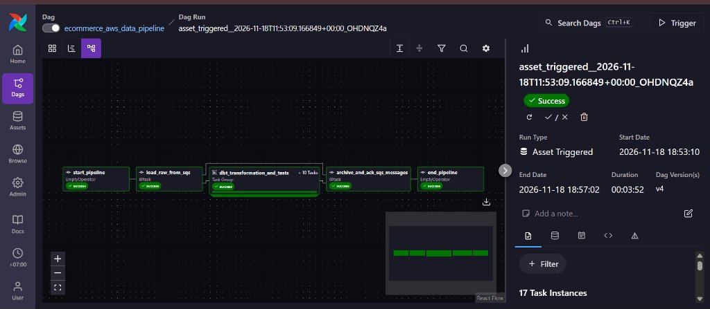
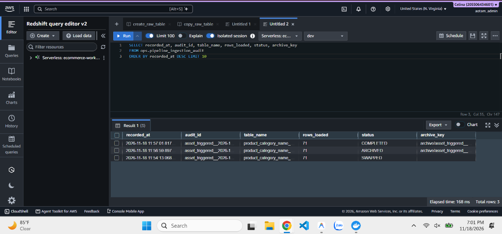
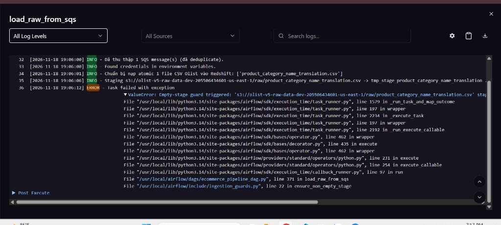
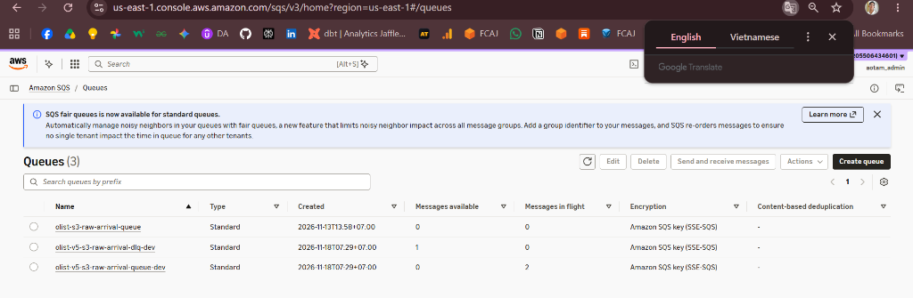
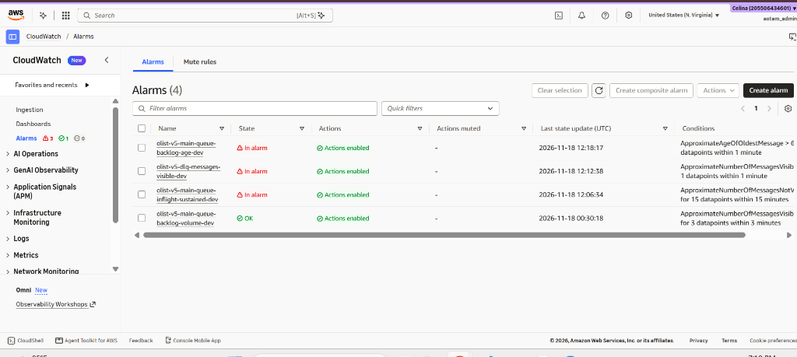
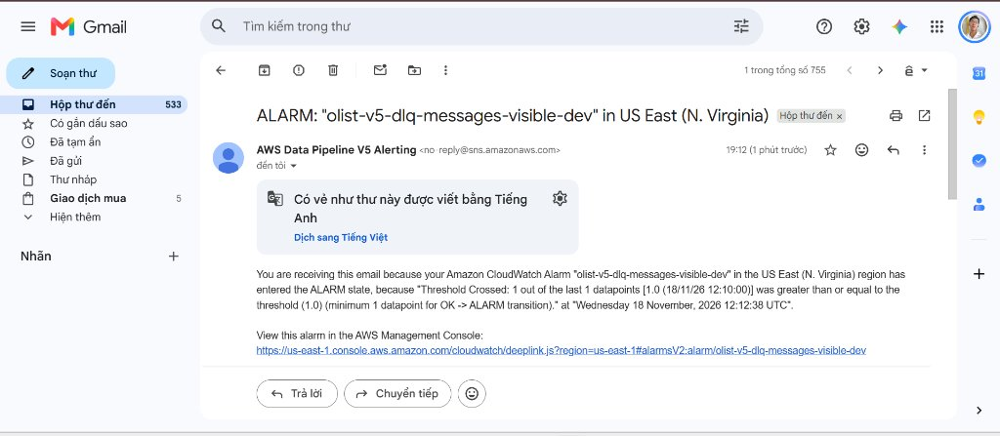
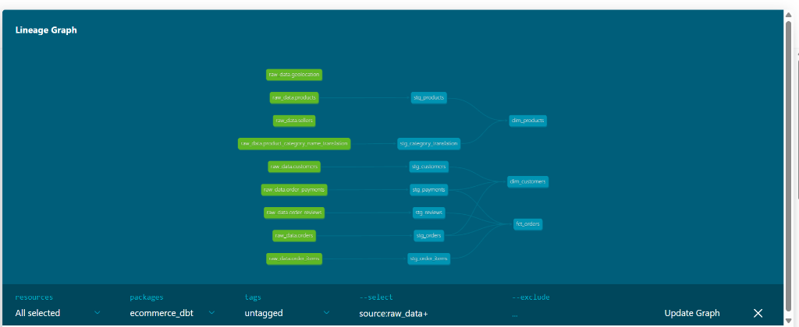

# 🚀 AWS E-Commerce End-to-End Modern Data Pipeline (V5 — CloudFormation IaC, Fault-Tolerant ELT & CloudOps)

[](https://aws.amazon.com/)
[](https://www.getdbt.com/)
[](https://airflow.apache.org/)
[](https://www.docker.com/)
[](.github/workflows/ci.yml)

An enterprise-grade, **pure event-driven, fault-tolerant ELT Data Pipeline** built on **AWS** using **Infrastructure as Code (AWS CloudFormation)**, **Amazon S3 (Versioned Data Lake)**, **Amazon SQS + Dead-Letter Queue (DLQ)**, **Amazon CloudWatch (4 Alarms) + Amazon SNS**, **Amazon Redshift Serverless**, **dbt Core**, and **Apache Airflow 3 (Astro CLI & Astronomer Cosmos)**.

Upgraded from the **V4 (`v4.0.1`)** Event-Driven Data Core into **V5 Production CloudOps (AWS First Cloud Journey Standard)**:
* **100% Reproducible CloudFormation IaC ([`infra/cloudformation/template.yaml`](infra/cloudformation/template.yaml)):** Provisions 15 core resources (and 4 conditional FinOps/Redshift resources) with **Native Stack Auto-Rollback**, `cfn-lint` CI validation, and 1-command versioned bucket clean-up (`make cfn-delete`).
* **Resilient Ingestion & Poison Message Isolation:** Amazon S3 emits `s3:ObjectCreated:*` notifications into `SqsMainQueue` (`VisibilityTimeout=900s`, `Long Polling 20s`). Empty or malformed CSVs are blocked by [`ensure_non_empty_stage`](include/ingestion_guards.py) inside an explicit per-table `TEMP TABLE` + `DELETE/INSERT` transaction (`autocommit=False`), and repeated failures (`maxReceiveCount=3`) isolate into `SqsDeadLetterQueue` (`RedriveAllowPolicy: byQueue`) for safe **DLQ Redrive** after remediation.
* **Active 4-Alarm CloudWatch & SNS Alerting:** Monitors DLQ arrivals (`>= 1`), SLA queue age (`> 600s`), sustained in-flight activity (`>= 1` for 15m), and backlog volume (`>= 20`), dispatching instant email alerts via `PipelineAlertTopicPolicy` + Amazon SNS.
* **Ingestion Audit Ledger & Deterministic Safe ACK:** Tracks per-run lifecycle transitions (`SWAPPED` → `ARCHIVED` → `COMPLETED` / `FAILED`) in [`ops.pipeline_ingestion_audit`](scripts/create_ops_audit_table.sql), archives to deterministic `archive/<audit_id>/<filename>` paths, refreshes SQS `VisibilityTimeout` across stages, and blocks premature ACKs via [`verify_safe_to_ack_when_raw_missing`](include/ingestion_guards.py).

---

## 🏛️ System Architecture: V4 Data Core vs. V5 CloudOps & Resilience

<table width="100%">
  <tr>
    <th width="50%">V4 (v4.0.1) — Event-Driven Data Core</th>
    <th width="50%">V5 — CloudFormation IaC, DLQ &amp; CloudOps (Current)</th>
  </tr>
  <tr>
    <td align="center">
      <a href="images/architecture_v4.png">
        
      </a>
    </td>
    <td align="center">
      <a href="images/architecture_v5.png">
        
      </a>
    </td>
  </tr>
</table>

> *Tip: Click either diagram to inspect full resolution (`V2` baseline [`images/architecture.png`](images/architecture.png) • `V3` [`images/architecture_v3.png`](images/architecture_v3.png) • `V4` [`images/architecture_v4.png`](images/architecture_v4.png) • `V5` [`images/architecture_v5.png`](images/architecture_v5.png)). Editable Draw.io sources are stored alongside each PNG.*

### Architectural Evolution (V2 → V4 → V5)

| Dimension | V2 (Manual Baseline) | V4 (`v4.0.1` — Event-Driven Core) | **V5 (`v5.0.0` — Production CloudOps)** |
| :--- | :--- | :--- | :--- |
| **Provisioning & Rollback** | Manual AWS Console / CLI | Code & CI in Git; AWS infra manual | **100% AWS CloudFormation IaC (`infra/cloudformation/template.yaml`)** with Change Sets, Native Auto-Rollback, `cfn-lint` CI, and `make cfn-delete` (S3 version purge). |
| **Trigger & Asset Parsing** | Manual UI trigger (`schedule=None`) | Airflow 3 `Asset` + `AssetWatcher` (`SqsSensorTrigger`, Long Poll `20s`, zero `*/5` cron) | Same zero-cron `AssetWatcher`, hardened for Airflow 3 `TriggeringAssetEventsAccessor` (`collections.abc.Mapping`) + `ChangeMessageVisibility` heartbeat across stages. |
| **Fault Tolerance (SQS)** | Coupled execution | `VisibilityTimeout=900s` + duplicate check | **`SqsDeadLetterQueue` (`maxReceiveCount=3`, 14-day retention, `RedriveAllowPolicy: byQueue`)** + 1-command **DLQ Redrive** (`start-message-move-task`). |
| **Ingestion & Safe ACK** | Static manual `COPY` | Per-table `TEMP TABLE` swap + Empty-Stage Guard | Adds **`ops.pipeline_ingestion_audit`** (`SWAPPED` → `ARCHIVED` → `COMPLETED` / `FAILED`), **deterministic `archive/<audit_id>/`**, and Safe ACK verification (`verify_safe_to_ack_when_raw_missing`). |
| **IAM & Storage Security** | Single broad IAM setup | `RedshiftS3ReadOnlyRole` (STS) + `.env` | **Split Least-Privilege IAM:** `RedshiftS3ReadOnlyRole` scoped strictly to `raw/*`; `AirflowRuntimePolicy` (no `archive/*` delete); `DlqOperatorPolicy`; **S3 Versioning + Lifecycle + AES256**. |
| **Observability & Alerting** | Manual log check | GitHub Actions 3-job CI | **4 CloudWatch Alarms** (`DLQ >= 1`, `Age > 600s`, `InFlight >= 1 for 15m`, `Backlog >= 20`) + **`PipelineAlertTopicPolicy`** + **Amazon SNS Email Notifications**. |
| **Data Modeling (dbt)** | Basic full rebuilds | Incremental `fct_orders` (4-source `affected_order_ids`, `delivery_status`) + LTV `dim_customers` | Preserved Star Schema + paused-by-default weekly full-refresh maintenance DAG + `exports/` CSV decoupling. |

---

## 📸 V5 Live Verification Evidence (AWS & Airflow 3)

### 1. Happy Path E2E: Airflow 3 `AssetWatcher` (`17/17` Green) & Audit Ledger
Replaying `product_category_name_translation.csv` into `s3://<v5-bucket>/raw/` triggered `AssetWatcher` automatically with **zero empty runs**, completing all **17/17 tasks** (`00:03:52`), recording `SWAPPED` → `ARCHIVED` → `COMPLETED` (`71` rows) in `ops.pipeline_ingestion_audit`, archiving deterministically, and ACKing SQS cleanly:

<table width="100%">
  <tr>
    <th width="50%">Airflow 3 Event-Driven Run (17/17 Tasks Success)</th>
    <th width="50%">Redshift Audit Ledger (<code>ops.pipeline_ingestion_audit</code>)</th>
  </tr>
  <tr>
    <td align="center">
      
    </td>
    <td align="center">
      
    </td>
  </tr>
</table>

---

### 2. Fault Tolerance Verified: Empty CSV → Empty-Stage Guard → SQS DLQ → CloudWatch Alarms → SNS Email → Redrive Recovery
Uploading a header-only CSV (`0` data rows) triggered `ensure_non_empty_stage`, rolled back cleanly (**preserving all `71` rows** in `raw_data.product_category_name_translation`), logged `FAILED` (`rows_loaded=0`) in `ops.pipeline_ingestion_audit`, routed the poison event to **`olist-v5-s3-raw-arrival-dlq-dev`** after `maxReceiveCount=3`, tripped **CloudWatch Alarms**, and delivered a real alert email to Gmail via **Amazon SNS**. After restoring a valid CSV and running **SQS DLQ Redrive**, the recovery run passed **17/17 tasks** and **all 4/4 CloudWatch Alarms returned to `OK`**:

<table width="100%">
  <tr>
    <th width="50%">1) Empty-Stage Guard Error Log (Data Preserved)</th>
    <th width="50%">2) SQS DLQ Isolates Poison Message (Available: 1)</th>
  </tr>
  <tr>
    <td align="center">
      
    </td>
    <td align="center">
      
    </td>
  </tr>
  <tr>
    <th width="50%">3) CloudWatch 4 Alarms Monitoring (In Alarm State)</th>
    <th width="50%">4) Real-Time Amazon SNS Alert Email in Gmail</th>
  </tr>
  <tr>
    <td align="center">
      
    </td>
    <td align="center">
      
    </td>
  </tr>
</table>

---

### 3. dbt Data Lineage Graph
Dependency lineage from 9 `raw_data` sources through 7 `public_staging` views into the 3 Kimball Star Schema `public_marts` tables:



---

## 💡 Key Engineering Highlights & Best Practices

### 1. Declarative AWS CloudFormation IaC & Operations Runbook (`infra/` & `docs/`)
* **Circular Dependency-Free S3 + SQS + DLQ:** [`infra/cloudformation/template.yaml`](infra/cloudformation/template.yaml) constructs bucket and queue ARNs via `!Sub` inside `SqsMainQueuePolicy` and `SqsDeadLetterQueue.RedriveAllowPolicy` with `DependsOn: SqsMainQueuePolicy` on `S3RawBucket`, guaranteeing clean single-pass `CREATE_COMPLETE` and Native Auto-Rollback on errors.
* **FinOps-Safe Toggle (`DeployRedshift=true/false`):** Allows testing the full S3 + SQS + DLQ + 4 CloudWatch Alarms + SNS + IAM stack within AWS Always Free allowances while reusing an existing Redshift Serverless workgroup, or provisioning a VPC-secured Redshift Serverless workgroup (`PubliclyAccessible=false`, `SecurityGroupIds`, `SubnetIds`, `/32` CIDR) from scratch.
* **Disaster Recovery & Clean-up Runbook:** Bilingual [`docs/OPERATIONS_RUNBOOK.md`](docs/OPERATIONS_RUNBOOK.md) | [`Tiếng Việt`](docs/OPERATIONS_RUNBOOK.vi.md) covers Change Sets, Stack Rollback, DLQ Redrive, Redshift Serverless Recovery Points/Snapshots, S3 Event Replay, `ops.pipeline_ingestion_audit` queries, and 1-command `make cfn-delete` (powered by [`scripts/empty_versioned_bucket.py`](scripts/empty_versioned_bucket.py)).

### 2. Event-Driven Ingestion, Audit Ledger & Safe ACK
* **Airflow 3 `AssetWatcher` (`Mapping` Support):** [`include/sqs_parser.py`](include/sqs_parser.py) supports both `dict` and Airflow 3 `TriggeringAssetEventsAccessor` (`collections.abc.Mapping`), verified by 21/21 unit tests in [`tests/`](tests/).
* **Two-Phase Validated Atomic Swap, CSV Header Guard & Empty-Stage Guard:** Validates CSV headers (`validate_csv_header`), stages all batch CSVs into Redshift `TEMP TABLE`s, enforces [`ensure_non_empty_stage`](include/ingestion_guards.py) (`staged_rows > 0`), and executes `DELETE + INSERT` + `SWAPPED` audit logging inside the same explicit `autocommit=False` transaction.
* **Audit-Verified Safe ACK & Heartbeat:** [`dags/ecommerce_pipeline_dag.py`](dags/ecommerce_pipeline_dag.py) refreshes `VisibilityTimeout=900s` (fail-closed prior to S3 modifications), writes cross-run deterministic `archive/<audit_id>/<filename>`, logs `SWAPPED` → `ARCHIVED` → `COMPLETED` (or `FAILED`), defers multi-record SQS ACKs until batch completion, and enforces [`verify_safe_to_ack_when_raw_missing`](include/ingestion_guards.py) in both Task 1 and Task 3 so a missing `raw/` object never causes a blind SQS ACK.

### 3. Cloud Security & FinOps
* **Split Least-Privilege IAM:** `RedshiftS3ReadOnlyRole` reads strictly `raw/*` via STS `AssumeRole` (`aws:SourceAccount` constrained); `AirflowRuntimePolicy` handles `SqsMainQueue` + S3 `raw/*` (`GET/DELETE`) & `archive/*` (`GET/PUT`, no `DELETE`); `DlqOperatorPolicy` isolates DLQ inspection and `StartMessageMoveTask` redrive permissions; `PipelineAlertTopicPolicy` locks SNS publishing to account CloudWatch alarms.
* **Workload-Driven Compute:** Stopping Astro (`astro dev stop`) halts SQS polling immediately (`$0` compute), `ecommerce_dbt_full_refresh_maintenance` starts paused (`is_paused_upon_creation=True`), S3 Lifecycle expires `archive/` after 90 days and noncurrent versions after 30 days, and [`scripts/export_to_csv.py`](scripts/export_to_csv.py) exports clean marts to `exports/` for offline Power BI analysis.

### 4. Data Modeling (Kimball Dimensional Modeling)
* **`raw_data` (Bronze):** 9 raw Olist tables (99,441 orders).
* **`public_staging` (Silver - Views):** 7 views standardizing types and fixing upstream column typos.
* **`public_marts` (Gold - Physical & Incremental Tables):**
  * **`fct_orders` (`incremental`, `delete+insert`):** Multi-source `affected_order_ids` CTE tracking changes across `stg_orders`, `stg_order_items`, `stg_payments`, and `stg_reviews`, computing `total_order_cost`, `primary_payment_type`, `is_delayed` (`NULL` when pending), and `delivery_status` (`'Pending Delivery'`, `'Delayed'`, `'On Time'`).
  * **`dim_customers` (`incremental`, `delete+insert`):** Resolves impacted `customer_unique_id` histories before upsert to preserve exact Customer Lifetime Value (LTV).
  * **`dim_products` (`table`):** Static product catalog with English translations and volumetric attributes.

---

## 📂 Project Structure

```text
aws_data_pipeline/
├── .github/
│   └── workflows/
│       └── ci.yml                            # CI: Ruff lint, cfn-lint, unit tests, dbt parse, Astro Docker DAG import test
├── infra/
│   └── cloudformation/
│       └── template.yaml                     # Declarative CloudFormation IaC (S3, SQS+DLQ, IAM, 4 Alarms, SNS, Budget, Redshift)
├── dags/
│   ├── ecommerce_pipeline_dag.py             # V5 Event-Driven DAG (AssetWatcher -> Temp Swap & Audit -> Cosmos dbt -> Safe ACK)
│   └── ecommerce_weekly_full_refresh_dag.py  # Optional weekly dbt --full-refresh DAG (paused by default for $0 FinOps)
├── dbt/
│   ├── dbt_project.yml                       # dbt project configuration & materializations
│   ├── profiles.yml                          # Redshift connection profile with env variables
│   └── models/
│       ├── staging/                          # Staging layer (7 views + sources.yml)
│       └── marts/                            # Marts layer (fct_orders, dim_customers, dim_products + schema.yml tests)
├── include/
│   ├── ingestion_guards.py                   # Empty-stage guard, deterministic archive key, and Safe ACK verifier
│   └── sqs_parser.py                         # SQS S3 Event JSON parser, Mapping accessor extractor & deduplicator
├── docs/
│   ├── V5_DEEP_DIVE.md                       # Detailed V5 CloudFormation, Fault-Tolerance, Observability & FinOps Deep Dive (EN)
│   ├── V5_DEEP_DIVE.vi.md                    # Detailed V5 CloudFormation, Fault-Tolerance, Observability & FinOps Deep Dive (VI)
│   ├── OPERATIONS_RUNBOOK.md                 # V5 Operations, Rollback, DLQ Redrive, DR & Clean-up Runbook (EN)
│   ├── OPERATIONS_RUNBOOK.vi.md              # V5 Operations, Rollback, DLQ Redrive, DR & Clean-up Runbook (VI)
│   ├── RETROSPECTIVE.md                      # Engineering retrospective & V2->V5 verification report (EN)
│   └── RETROSPECTIVE.vi.md                   # Engineering retrospective & V2->V5 verification report (VI)
├── tests/
│   ├── dags/test_dag_example.py              # Pytest DAG validation (imports, tags, retries >= 2)
│   ├── test_ingestion_guards.py              # Unit tests for header, empty-stage & Safe ACK guards (11/11 passing)
│   └── test_sqs_parser.py                    # Unit tests for SQS + Airflow 3 Mapping accessor parsing (10/10 passing)
├── images/                                   # V2-V5 Draw.io diagrams (.drawio + .png) and live verification screenshots
├── scripts/
│   ├── create_raw_tables.sql                 # Redshift DDL for raw_data schema
│   ├── create_ops_audit_table.sql            # Redshift DDL for ops.pipeline_ingestion_audit
│   ├── empty_versioned_bucket.py             # Purges S3 Object Versions & DeleteMarkers before stack deletion
│   ├── export_to_csv.py                      # Extracts clean marts CSVs to exports/ via redshift-connector
│   └── upload_to_s3.sh                       # Bash script for S3 raw data synchronization
├── Dockerfile                                # Astronomer Runtime 3.3 Dockerfile
├── Makefile                                  # Shortcuts: verify, cfn-validate, cfn-deploy, cfn-status, cfn-delete, export-data
├── pyproject.toml                            # Ruff lint configuration
└── requirements.txt                          # Python dependencies (cosmos, dbt-redshift, apache-airflow-providers-amazon)
```

---

## ⚡ Quickstart Guide (CloudFormation IaC + Event-Driven Stack)

### 1. Prerequisites
* [Docker Desktop](https://www.docker.com/products/docker-desktop/) running with WSL2 backend.
* [AWS CLI v2](https://aws.amazon.com/cli/) configured (`aws configure`).
* [Astro CLI](https://www.astronomer.io/docs/astro/cli/install-cli) installed.

### 2. Provision AWS Infrastructure via CloudFormation & Verify Code
```bash
git clone https://github.com/AOMINHTAM/aws-data-pipeline.git
cd aws-data-pipeline

make aws-verify
make verify
make cfn-validate
make cfn-deploy ALERT_EMAIL="your-email@example.com"
make cfn-status
```
> *Open your `ALERT_EMAIL` inbox and click **Confirm subscription** on the SNS confirmation email. See [`docs/OPERATIONS_RUNBOOK.md`](docs/OPERATIONS_RUNBOOK.md) for `DeployRedshift=true` VPC parameters, Redshift namespace role association, DLQ Redrive, and Clean-up.*

### 3. Configure `.env` & Run Airflow 3 + Cosmos
1. Create raw tables once using [`scripts/create_raw_tables.sql`](scripts/create_raw_tables.sql) (and optionally [`scripts/create_ops_audit_table.sql`](scripts/create_ops_audit_table.sql), which the DAG also creates automatically).
2. Populate `.env` (git-ignored) from `make cfn-status` Outputs:
   ```env
   DBT_REDSHIFT_PASSWORD=<your-redshift-admin-password>
   AWS_DEFAULT_REGION=us-east-1
   AWS_ACCESS_KEY_ID=<your-aws-access-key>
   AWS_SECRET_ACCESS_KEY=<your-aws-secret-key>
   S3_BUCKET_NAME=<S3RawBucketName-from-stack-outputs>
   SQS_QUEUE_NAME=<SqsMainQueueName-from-stack-outputs>
   SQS_QUEUE_URL=<SqsMainQueueUrl-from-stack-outputs>
   REDSHIFT_IAM_ROLE=<RedshiftS3ReadOnlyRoleArn-from-stack-outputs>
   AIRFLOW_CONN_AWS_DEFAULT=aws://
   ```
3. Start Airflow, unpause `ecommerce_aws_data_pipeline`, and upload Olist CSVs to `s3://$S3_BUCKET_NAME/raw/`:
   ```bash
   astro dev start
   ```
4. Export analytics marts to `exports/` and tear down test resources when finished:
   ```bash
   make export-data
   astro dev stop
   make cfn-delete   # Purges S3 versions + deletes CloudFormation stack ($0 AWS billing)
   ```

---

## 📊 Dataset Reference
* **Source:** [Brazilian E-Commerce Public Dataset by Olist (Kaggle)](https://www.kaggle.com/datasets/olistbr/brazilian-ecommerce)
* **Scope:** 100,000 anonymized orders (2016–2018) across Brazilian marketplaces (9 relational CSVs).

---

## 👤 Author
* **Minh Tam Ao** - [GitHub](https://github.com/AOMINHTAM)
* Project: *AWS E-Commerce Data Pipeline V5 (CloudFormation IaC, Fault-Tolerant Event-Driven ELT & CloudOps)*

> 📖 *Read more: [V5 Deep Dive (EN)](docs/V5_DEEP_DIVE.md) | [Giải thích chi tiết V5 (VI)](docs/V5_DEEP_DIVE.vi.md) • [Project Retrospective (EN)](docs/RETROSPECTIVE.md) | [Bản Tiếng Việt](docs/RETROSPECTIVE.vi.md) • [Operations & DR Runbook (EN)](docs/OPERATIONS_RUNBOOK.md) | [Sổ tay Vận hành (VI)](docs/OPERATIONS_RUNBOOK.vi.md).*
