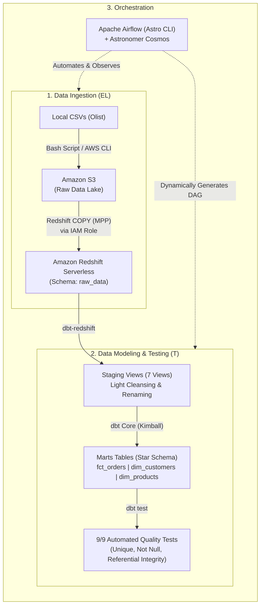
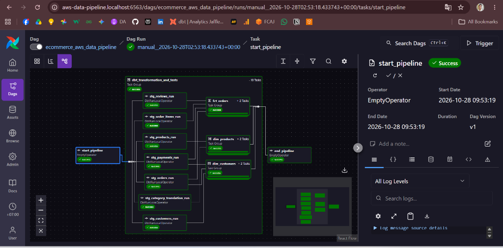
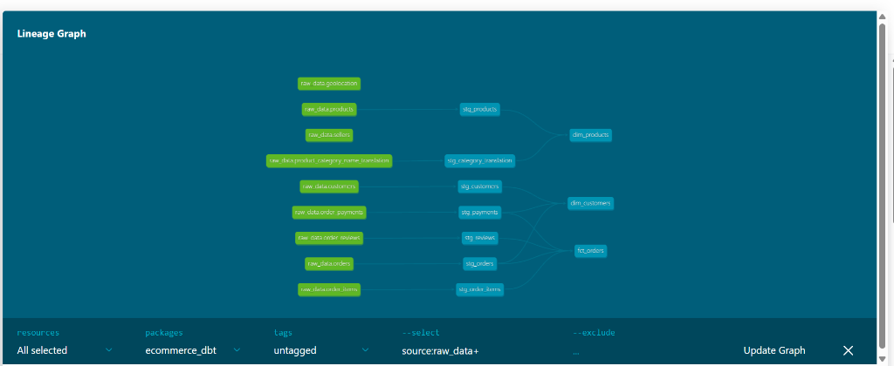

# 🚀 AWS E-Commerce End-to-End Modern Data Pipeline (ELT)

[](https://aws.amazon.com/)
[](https://www.getdbt.com/)
[](https://airflow.apache.org/)
[](https://www.docker.com/)
[](https://ubuntu.com/)

An enterprise-grade, end-to-end **ELT Data Pipeline** built on the **Modern Data Stack (MDS)** using **AWS (S3 & Redshift Serverless)**, **dbt Core**, and **Apache Airflow (via Astro CLI & Astronomer Cosmos)**. 

The pipeline ingests, transforms, and tests real-world e-commerce data from the **Olist Brazilian E-Commerce Dataset** (~100,000 orders), delivering clean, business-ready **Kimball Star Schema (Facts & Dimensions)** for analytical reporting and Business Intelligence.

---

## 🏛️ System Architecture



---

## 📸 Pipeline Observability & Results

### 1. Airflow Orchestration DAG (Astronomer Cosmos - All Green)
All staging models, marts models, and data quality tests are dynamically mapped into native Airflow tasks and executed with **100% Success**:



### 2. dbt Data Lineage Graph
Clean dependency graph illustrating data flow from 9 raw sources through 7 staging views to the 3 core analytical marts:



---

## 💡 Key Engineering Highlights & Best Practices

### 1. Cloud Infrastructure & FinOps (Cost-Optimization)
* **Amazon Redshift Serverless:** Configured with minimum base capacity of **4 RPUs** (compute scales down to \$0 when idle), cutting computing costs by 50% compared to standard 8-RPU setups.
* **AWS Budgets:** Configured strict budget guardrails with email alerting thresholds to eliminate financial surprises.
* **Storage Optimization:** Amazon S3 standard storage with blocked public access (100% private bucket).

### 2. Cloud Security & Governance
* **Principle of Least Privilege:** Redshift communicates with Amazon S3 using a dedicated `RedshiftS3ReadOnlyRole` (AssumeRole via AWS STS) — zero hardcoded credentials or access keys stored inside the database.
* **Network Perimeter:** VPC Security Group locking down Redshift's inbound port `5439` exclusively to authorized developer IP traffic.
* **Secret Management:** Sensitive database credentials reside in `.env` (git-ignored) and `~/.dbt/profiles.yml`, ensuring zero leakage of secrets in public version control.

### 3. Data Modeling (Kimball Dimensional Modeling)
* **Multi-Layered Architecture:**
  * **`raw_data` (Bronze):** Unmodified, append-only raw tables mirroring S3 CSV files (99,441 orders loaded).
  * **`staging` (Silver - Views):** One-to-one staging views standardizing casing, column naming (e.g. fixing Olist typos like `product_name_lenght`), casting types, and zero extra storage overhead.
  * **`marts` (Gold - Physical Tables):**
    * **`fct_orders`:** Core business fact table at order granularity combining financial metrics (revenue, freight value), logistics delivery performance (actual vs. estimated delivery delay days, `is_delayed` flag), and customer satisfaction review scores.
    * **`dim_customers`:** Customer dimension featuring **Customer Lifetime Value (LTV)** calculations, order frequency, first/last purchase timestamps, and automated customer segmentation (`Returning Customer` vs. `One-Time Customer`).
    * **`dim_products`:** Product dimension with English category translation joins and volumetric dimensions.
* **Data Quality Testing:** Enforced 9 automated dbt tests including primary key `unique` & `not_null` assertions and foreign key `relationships` tests ensuring referential integrity between Fact and Dimensions.

---

## 📂 Project Structure

```text
aws_data_pipeline/
├── .astro/                     # Astro CLI project settings
├── dags/
│   └── ecommerce_pipeline_dag.py # Airflow DAG orchestrating Cosmos & dbt
├── dbt/
│   ├── dbt_project.yml         # dbt project configuration & materializations
│   ├── profiles.yml            # Redshift connection profile with env variables
│   └── models/
│       ├── staging/            # Staging layer (materialized as VIEW)
│       │   ├── sources.yml     # Source definitions for raw_data schema
│       │   ├── stg_orders.sql
│       │   ├── stg_order_items.sql
│       │   ├── stg_customers.sql
│       │   ├── stg_products.sql
│       │   ├── stg_payments.sql
│       │   ├── stg_reviews.sql
│       │   └── stg_category_translation.sql
│       └── marts/              # Marts layer (materialized as TABLE)
│           ├── schema.yml      # Model documentation & 9 data quality tests
│           ├── fct_orders.sql
│           ├── dim_customers.sql
│           └── dim_products.sql
├── data/                       # Olist CSV files (git-ignored)
├── images/                     # Lineage graph and Airflow execution screenshots
├── scripts/
│   ├── upload_to_s3.sh         # Bash script for S3 raw data synchronization
│   ├── create_raw_tables.sql   # Redshift DDL for raw schema
│   └── copy_raw_tables.sql     # Redshift COPY commands from S3
├── .env                        # Environment variables & secrets (git-ignored)
├── .gitignore
├── Dockerfile                  # Astronomer Runtime Dockerfile
├── Makefile                    # Automation shortcuts (verify, upload, etc.)
└── requirements.txt            # Python dependencies (cosmos, dbt-redshift)
```

---

## 🛠️ Tech Stack & Tools

| Component | Technology | Role |
| :--- | :--- | :--- |
| **Cloud Provider** | AWS (Amazon Web Services) | Infrastructure host |
| **Object Storage** | Amazon S3 | Raw Data Lake (Landing Zone) |
| **Data Warehouse** | Amazon Redshift Serverless | Scalable MPP Cloud Data Warehouse |
| **Transformation** | dbt Core (`dbt-redshift`) | SQL Transformation, Kimball Modeling & Tests |
| **Orchestration** | Apache Airflow (Astro CLI) | Workflow scheduling & DAG management |
| **Integration** | Astronomer Cosmos | Native dbt-Airflow task parsing |
| **Containerization** | Docker / Docker Compose | Local containerized Airflow runtime |
| **OS / Shell** | Ubuntu (WSL2) + Bash | Linux development environment |

---

## ⚡ Quickstart Guide

### 1. Prerequisites
* [Docker Desktop](https://www.docker.com/products/docker-desktop/) installed and running with WSL2 backend.
* [AWS CLI v2](https://aws.amazon.com/cli/) configured (`aws configure`).
* [Astro CLI](https://www.astronomer.io/docs/astro/cli/install-cli) installed (`curl -sSL install.astronomer.io | sudo bash -s`).

### 2. Setup Infrastructure & Credentials
1. Clone the repository:
   ```bash
   git clone https://github.com/AOMINHTAM/aws_data_pipeline.git
   cd aws_data_pipeline
   ```
2. Verify AWS CLI connectivity:
   ```bash
   make aws-verify
   ```
3. Configure environment secrets in `.env`:
   ```bash
   DBT_REDSHIFT_PASSWORD=YourRedshiftAdminPassword
   AWS_DEFAULT_REGION=us-east-1
   ```

### 3. Ingest Data (S3 -> Redshift)
1. Download the [Olist Dataset from Kaggle](https://www.kaggle.com/datasets/olistbr/brazilian-ecommerce) and extract CSVs into `data/`.
2. Sync raw data to Amazon S3:
   ```bash
   make upload-data BUCKET=<your-s3-bucket-name>
   ```
3. Execute `scripts/create_raw_tables.sql` and `scripts/copy_raw_tables.sql` in Redshift Query Editor v2.

### 4. Run Locally with Airflow & Cosmos
1. Start the Airflow stack using Astro CLI:
   ```bash
   astro dev start
   ```
2. Open your browser at `http://localhost:8080`.
3. Locate DAG `ecommerce_aws_data_pipeline`, toggle **ON**, and trigger execution!

---

## 📊 Dataset Reference
* **Source:** [Brazilian E-Commerce Public Dataset by Olist (Kaggle)](https://www.kaggle.com/datasets/olistbr/brazilian-ecommerce)
* **Scope:** 100,000 real anonymized orders from 2016 to 2018 across Brazilian marketplaces, covering order statuses, payments, freight calculations, customer locations, product dimensions, and real customer reviews.

---

## 👤 Author
* **Minh Tam Ao** - [GitHub](https://github.com/AOMINHTAM)
* Project: *AWS E-Commerce Data Pipeline V2*
