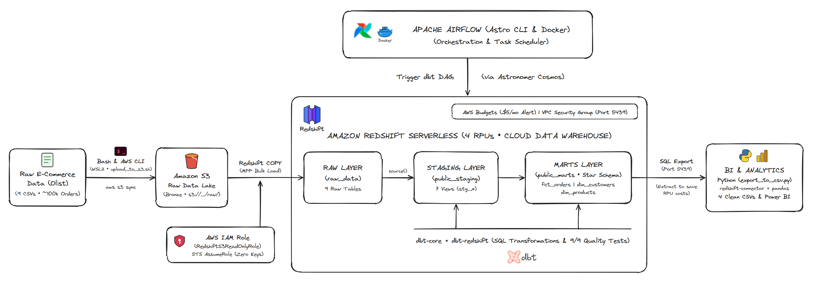
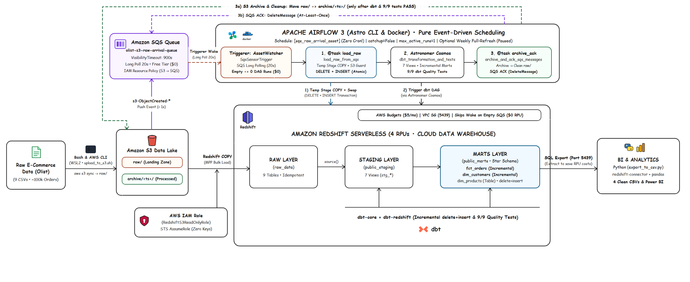
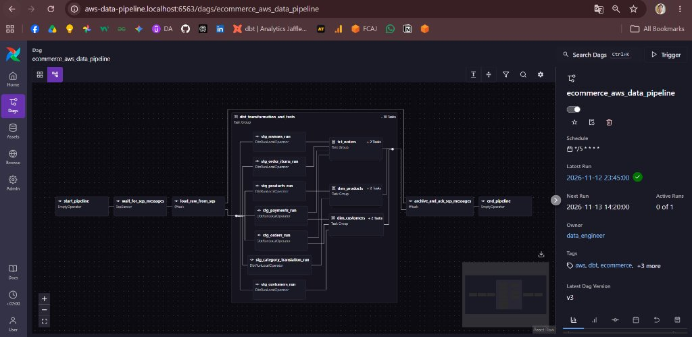
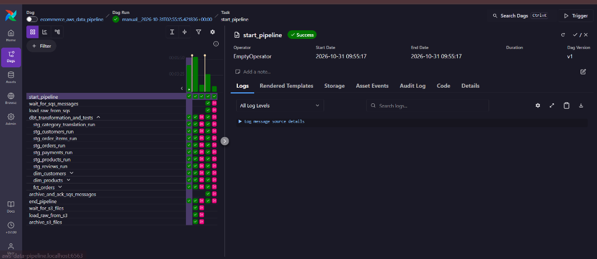
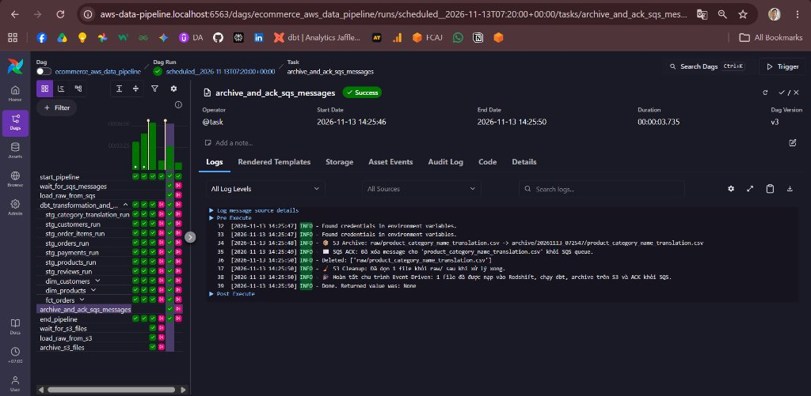

# 🚀 AWS E-Commerce End-to-End Modern Data Pipeline (Pure Event-Driven ELT - V4)

[](https://aws.amazon.com/)
[](https://www.getdbt.com/)
[](https://airflow.apache.org/)
[](https://www.docker.com/)
[](https://ubuntu.com/)

An enterprise-grade, **pure event-driven ELT Data Pipeline** built on the **Modern Data Stack (MDS)** using **AWS (S3, SQS & Redshift Serverless)**, **dbt Core**, and **Apache Airflow 3 (via Astro CLI & Astronomer Cosmos)**.

Upgraded from a manual V2 baseline directly into a resilient **V4 Push-Based Event-Driven & Incremental ELT Architecture**: Amazon S3 emits `s3:ObjectCreated:*` notifications into an **AWS SQS Queue** (`olist-s3-raw-arrival-queue`), Airflow 3's async Triggerer listens via **Airflow `Asset` + `AssetWatcher` (`SqsSensorTrigger` Long Polling 20s)** with **zero time-based cron (`*/5` eliminated)**, triggers the DAG upon file arrival (spawning **0 empty runs** when idle for **zero idle Redshift compute consumption** while keeping SQS polling within AWS Free Tier), loads Redshift via a **per-table atomic `TEMP TABLE` + `DELETE/INSERT` transaction** protected by an **empty-stage guard**, runs **dbt Incremental Modeling** (`delete+insert` detecting upstream changes across `orders`, `order_items`, `payments`, and `reviews` alongside automated dbt quality tests), archives processed CSVs, and retries/ACKs **SQS messages** only after downstream checks pass.

---

## 🏛️ System Architecture: Before (V2 Baseline) vs. After (V4 Event-Driven)

<table width="100%">
  <tr>
    <th width="50%">Before — V2 (Manual Batch Baseline)</th>
    <th width="50%">After — V4 (Pure Event-Driven &amp; Incremental ELT)</th>
  </tr>
  <tr>
    <td align="center">
      <a href="images/architecture.png">
        
      </a>
    </td>
    <td align="center">
      <a href="images/architecture_v4.png">
        
      </a>
    </td>
  </tr>
</table>

> *Tip: Click either diagram above to inspect the full-resolution architecture layout (`V2` [`images/architecture.png`](images/architecture.png) vs. `V4` [`images/architecture_v4.png`](images/architecture_v4.png)).*

### Architectural Evolution Comparison (V2 vs. V4)

| Architectural Dimension | V2 (Manual / Batch Baseline) | V4 (Pure Push Event-Driven Architecture) |
| :--- | :--- | :--- |
| **Trigger Mechanism** | Manual UI trigger (`schedule=None`) | **Push Notification + Airflow 3 `AssetWatcher`**: Event-triggered ingestion with low-latency notification delivery (typically seconds per AWS S3 Event Notification SLA; actual end-to-end latency depends on S3 delivery, SQS long polling, and Airflow scheduling). |
| **Scheduling & Latency** | Manual intervention required | **Zero Time Cron (`schedule=[sqs_raw_arrival_asset]`)**: Replaces the earlier `*/5` scheduled `SqsSensor` with async **SQS Long Polling (`20s`)** inside Triggerer; wakes upon arrival with zero empty scheduled runs. |
| **S3 API Overhead** | Required heavy `LIST` calls on entire S3 bucket | **Zero `LIST` Overhead**: Event messages contain exact object keys (`Records[0].s3.object.key`). |
| **Fault Tolerance & Reliability** | Direct coupled execution: error midway caused silent failure | **Decoupled with `VisibilityTimeout=900s`, S3 Guard & ACK Retry**: Duplicate SQS deliveries are filtered via `s3_hook.check_for_key()`; messages are ACK'd only after Redshift + dbt tests + S3 cleanup succeed, and failed ACKs raise to trigger task retry. |
| **Data Ingestion (S3 → DWH)** | Static manual SQL script (`copy_raw_tables.sql`) | **Per-Table Atomic Staging Swap (`autocommit=False`) + Empty-Stage Guard**: Stages CSVs into a Redshift `TEMP TABLE`, rejects 0-row loads (`staged_rows <= 0`), and swaps inside a rollback-safe `DELETE + INSERT` transaction. *(Atomicity is guaranteed per target table, not across the entire multi-file batch.)* |
| **FinOps Cost Optimization** | Full pipeline runs on trigger | **Zero Idle Redshift Compute**: Empty SQS spawns **0 DAG runs** (no idle Redshift RPU wakeups), SQS Long Polling (~104k requests/month if left running 24/7) stays within the 1M/month AWS Free Tier allowance *(persistent storage costs excluded)*, and `astro dev stop` halts Airflow polling completely. |
| **Data Lifecycle & SQS ACK** | Files lingered indefinitely in `raw/` | `@task archive_and_ack_sqs_messages`: Copies `raw/` → `archive/<ts>/`, cleans `raw/`, and **only then** deletes the SQS message (`DeleteMessage`). |
| **Data Modeling & Governance** | Basic tables / manual full rebuilds | Multi-layered Medallion Kimball Star Schema via **Astronomer Cosmos** with **Incremental Marts (`delete+insert`)** on `fct_orders` (multi-source change detection across `orders`, `order_items`, `payments`, `reviews`) & `dim_customers`, automated dbt tests (`unique`, `not_null`, `relationships`, `accepted_values`), and a paused-by-default weekly full-refresh reconciliation DAG. |

---

## 📸 Pipeline Observability & Live Verification Results

### 1. V4 Event-Driven Airflow DAG Topology
Current hardened DAG workflow (`schedule=[sqs_raw_arrival_asset]`, zero time cron): `AssetWatcher (Triggerer)` → `start_pipeline` → `load_raw_from_sqs` (`@task`, Per-Table Atomic Temp-Stage Swap + Empty-Stage Guard) → `dbt_transformation_and_tests` (`DbtTaskGroup`) → `archive_and_ack_sqs_messages` (`@task`) → `end_pipeline`.

> [!NOTE]
> **About the V4 Live Screenshots Below:** Both UI screenshots (`airflow_v4_dag_graph.png` and `airflow_v4_grid_event_driven.png`) were captured during **initial V4 Step 1 live AWS verification** when the DAG used a 5-minute scheduled `SqsSensor` (`timeout=45s`, `soft_fail=True`). The trigger mechanism has since been refactored in [`dags/ecommerce_pipeline_dag.py`](dags/ecommerce_pipeline_dag.py) to **Airflow 3 `AssetWatcher`** (`SqsSensorTrigger`), eliminating scheduled `SKIPPED` runs entirely while keeping the Redshift load, dbt models, S3 archival, and SQS ACK flow unchanged.



---

### 2. Historical Step 1 Grid Verification: Happy Path Event Run vs. FinOps Skip (`SqsSensor` Baseline)
Side-by-side runs from initial V4 Step 1 AWS live verification (`SqsSensor` baseline before the `AssetWatcher` refactor):
* **Run `14:20:00` (All-Green Column — `18/18 Success`):** Consumed SQS notification for `product_category_name_translation.csv`, refreshed Redshift `raw_data`, executed dbt models & 9/9 tests, moved file to S3 archive, and ACK'ed (deleted) message from SQS.
* **Run `14:25:00` (All-Pink Column — `1 Success, 17 Skipped`):** Legacy `SqsSensor` poll found SQS queue empty, timed out at 45s (`soft_fail=True`), and skipped downstream Redshift + dbt compute. *(In the current `AssetWatcher` implementation on `main`, empty queues do not create DAG runs at all.)*



---

### 3. SQS Message ACK & S3 Archival Verification Log
Task execution log from `archive_and_ack_sqs_messages` verifying complete **At-Least-Once Delivery** and lifecycle completion:



```text
[INFO] - 📦 S3 Archive: raw/product_category_name_translation.csv -> archive/20261113_072547/product_category_name_translation.csv
[INFO] - ✉️ SQS ACK: Đã xóa message cho 'product_category_name_translation.csv' khỏi SQS queue.
[INFO] - Deleted: ['raw/product_category_name_translation.csv']
[INFO] - 🧹 S3 Cleanup: Đã dọn 1 file khỏi raw/ sau khi xử lý xong.
[INFO] - 🎉 Hoàn tất chu trình Event-Driven: 1 file đã được nạp vào Redshift, chạy dbt, archive trên S3 và ACK khỏi SQS.
```

---

### 4. dbt Data Lineage Graph
Dependency lineage from 9 `raw_data` sources through 7 `public_staging` views into the 3 Kimball Star Schema `public_marts` tables:


---

## 💡 Key Engineering Highlights & Best Practices

### 1. Event-Driven Ingestion with AWS S3, SQS & Airflow 3 `AssetWatcher` (V4)
* **True Asset-Based Triggering (Zero Time Cron):** Uses Airflow 3 `Asset` + `AssetWatcher` backed by `SqsSensorTrigger` (`wait_time_seconds=20` SQS Long Polling, `waiter_delay=5`) instead of a fixed cron schedule (`*/5`). When idle, **no empty DAG runs are spawned** and Redshift stays asleep; stopping Astro (`astro dev stop`) halts SQS polling immediately.
* **Resource-Based Queue Policy:** Configured secure IAM resource policy on SQS granting `sqs:SendMessage` strictly to `s3.amazonaws.com` constrained by `aws:SourceArn` and `aws:SourceAccount`.
* **Per-Table Atomic Redshift Staging Swap & Empty-Stage Guard:** Redshift's `TRUNCATE` auto-commits and cannot be rolled back if `COPY` fails. `load_raw_from_sqs` stages each file into a `TEMP TABLE`, enforces [`ensure_non_empty_stage`](include/ingestion_guards.py) (`staged_rows > 0`) so empty CSVs cannot wipe existing data, and swaps via `DELETE + INSERT` inside an explicit `autocommit=False` transaction. *(Atomicity is per target table, not across the entire multi-file batch.)*
* **Idempotent Consumer & `VisibilityTimeout=900s`:** `delete_message_on_reception=False` protects messages for 15 minutes while dbt runs; `s3_hook.check_for_key()` prevents re-loading duplicate SQS deliveries, SQS messages are ACK'd **only after** `archive/` copy, `raw/` cleanup, and dbt tests succeed, and failed ACKs raise to allow Airflow task retries.
* **Modular Helpers, Unit Tests & CI/CD:** Event parsing lives in [`include/sqs_parser.py`](include/sqs_parser.py), data-integrity guards live in [`include/ingestion_guards.py`](include/ingestion_guards.py), automated unit tests run via [`tests/`](tests/), and [`.github/workflows/ci.yml`](.github/workflows/ci.yml) + `make verify` validate linting, unit tests, dbt parsing, and Airflow DAG imports on every push/PR.

### 2. Cloud Infrastructure & FinOps (Cost-Optimization)
* **Amazon Redshift Serverless (4 RPUs):** Base compute capacity consumes zero RPU credits when idle; `AssetWatcher` only triggers Redshift workloads when valid Olist `.csv` events arrive on `s3://.../raw/`. SQS long polling (~104k reqs/month if run continuously) stays well within the 1M/month AWS Free Tier allowance *(persistent S3 and Redshift Managed Storage costs excluded)*. An optional `ecommerce_dbt_full_refresh_maintenance` DAG is created **paused by default** (`is_paused_upon_creation=True`).
* **AWS Budgets:** Strict budget guardrail alert at \$5/month.
* **Decoupled BI Extraction:** [`scripts/export_to_csv.py`](scripts/export_to_csv.py) extracts clean marts to local CSVs (`exports/`), enabling offline Power BI dashboarding without Redshift RPU consumption.

### 3. Cloud Security & Governance
* **Principle of Least Privilege:** Redshift communicates with Amazon S3 via `RedshiftS3ReadOnlyRole` (AssumeRole via AWS STS) — zero hardcoded credentials inside SQL or database configs.
* **Network Perimeter:** VPC Security Group locking down Redshift inbound port `5439` exclusively to authorized developer IP traffic.
* **Secret Management:** Database credentials and AWS Airflow connection URI (`AIRFLOW_CONN_AWS_DEFAULT=aws://`) reside in `.env` (git-ignored).

### 4. Data Modeling (Kimball Dimensional Modeling)
* **Multi-Layered Medallion Architecture:**
  * **`raw_data` (Bronze):** Raw tables mirroring Olist S3 CSVs (99,441 orders loaded, refreshed idempotently on batch arrival).
  * **`public_staging` (Silver - Views):** 7 staging views standardizing naming conventions, fixing column typos (e.g., `product_name_lenght`), and casting types with zero storage duplication.
  * **`public_marts` (Gold - Physical & Incremental Tables):**
    * **`fct_orders` (`materialized='incremental'`, `unique_key='order_id'`):** Order-grain fact table combining item revenue, freight, **`total_order_cost`**, value-ranked **`primary_payment_type`**, review scores, and explicit SLA fields (`is_delayed` returning `NULL` for pending deliveries alongside **`delivery_status`**: `'Pending Delivery'`, `'Delayed'`, `'On Time'`). Uses **`delete+insert`** with an `affected_order_ids` CTE tracking changes across all four upstream tables (`stg_orders`, `stg_order_items`, `stg_payments`, `stg_reviews`) so updates on older orders are never missed.
    * **`dim_customers` (`materialized='incremental'`, `unique_key='customer_id'`):** Customer dimension computing **Customer Lifetime Value (LTV)**, purchase frequency, and segmentation (`Returning Customer` vs. `One-Time Customer`) — resolving impacted `customer_unique_id` histories before incremental upsert so lifetime totals remain exact.
    * **`dim_products` (`materialized='table'`):** Static product dimension with English translations and volumetric measurements.
* **Data Quality Testing:** Automated dbt tests (`unique`, `not_null`, `relationships`, `accepted_values`) enforcing structural and SLA integrity across Fact and Dimensions.

---

## 📂 Project Structure

```text
aws_data_pipeline/
├── .astro/                         # Astro CLI project settings
├── .github/
│   └── workflows/
│       └── ci.yml                  # GitHub Actions CI (Ruff lint, unit tests, dbt parse, Airflow DAG validation)
├── dags/
│   ├── ecommerce_pipeline_dag.py             # V4 True Event-Driven Airflow DAG (AssetWatcher -> Temp Stage Swap -> Cosmos dbt -> Archive & ACK)
│   └── ecommerce_weekly_full_refresh_dag.py  # Optional weekly dbt --full-refresh DAG (paused by default for $0 FinOps)
├── dbt/
│   ├── dbt_project.yml             # dbt project configuration & materializations
│   ├── profiles.yml                # Redshift connection profile with env variables
│   └── models/
│       ├── staging/                # Staging layer (7 views + sources.yml)
│       └── marts/                  # Marts layer (fct_orders, dim_customers, dim_products + schema.yml tests)
├── include/
│   ├── ingestion_guards.py         # Data integrity guards (empty-stage protection)
│   └── sqs_parser.py               # Modular SQS S3 Event JSON parser & deduplicator
├── docs/
│   ├── RETROSPECTIVE.md            # Engineering retrospective, troubleshooting journey & V4 roadmap (EN)
│   └── RETROSPECTIVE.vi.md         # Engineering retrospective, troubleshooting journey & V4 roadmap (VI)
├── tests/
│   ├── dags/
│   │   └── test_dag_example.py     # Pytest DAG validation (imports, tags, retries >= 2)
│   ├── test_ingestion_guards.py    # Unit tests for Redshift empty-stage protection
│   └── test_sqs_parser.py          # Unit tests for SQS + AssetWatcher event parsing (7/7 passing)
├── data/                           # Olist CSV files (git-ignored)
├── exports/                        # Clean analytics CSV exports for Power BI (git-ignored)
├── images/
│   ├── architecture.png            # V2 System Architecture diagram (Before / Baseline)
│   ├── architecture_v3.png         # Intermediate V3 diagram
│   ├── architecture_v4.png         # V4 System Architecture diagram (After / Event-Driven & Incremental)
│   ├── airflow_v4_dag_graph.png    # V4 Event-Driven DAG Graph screenshot
│   ├── airflow_v4_grid_event_driven.png # V4 Grid View (Happy Path vs. FinOps Skip)
│   ├── airflow_v4_sqs_ack_log.png  # V4 SQS ACK and S3 Archival task execution log
│   ├── airflow_dag_success.png     # V2 Legacy DAG baseline screenshot
│   └── dbt_lineage.png             # dbt Data Lineage Graph
├── scripts/
│   ├── upload_to_s3.sh             # Bash script for S3 raw data synchronization
│   ├── create_raw_tables.sql       # Redshift DDL for raw_data schema (initial setup)
│   ├── copy_raw_tables.sql         # Standalone Redshift COPY script (reference)
│   └── export_to_csv.py            # Python script exporting marts tables to CSV via redshift-connector
├── .env                            # Environment variables & secrets (git-ignored)
├── .gitignore
├── Dockerfile                      # Astronomer Runtime 3.3 Dockerfile
├── Makefile                        # Automation shortcuts (verify, upload, export)
└── requirements.txt                # Python dependencies (cosmos, dbt-redshift, apache-airflow-providers-amazon[aiobotocore])
```

---

## 🛠️ Tech Stack & Tools

| Component | Technology | Role |
| :--- | :--- | :--- |
| **Cloud Provider** | AWS (Amazon Web Services) | Cloud infrastructure & IAM governance |
| **Object Storage** | Amazon S3 (`raw/` & `archive/`) | Bronze Landing Zone & Processed Batch Archive |
| **Message Queue** | Amazon SQS (`olist-s3-raw-arrival-queue`) | Decoupled event buffering & push notifications |
| **Data Warehouse** | Amazon Redshift Serverless (4 RPUs) | Scalable MPP Cloud Data Warehouse |
| **Transformation** | dbt Core (`dbt-redshift`) | SQL Transformation, Kimball Star Schema & Automated Tests |
| **Orchestration** | Apache Airflow 3 (Astro CLI) | Native `Asset` + `AssetWatcher` (`SqsSensorTrigger` Long Polling 20s, zero time cron) & TaskFlow `@task` |
| **Integration** | Astronomer Cosmos | Native dbt-to-Airflow TaskGroup mapping |
| **AWS Integration** | `apache-airflow-providers-amazon[aiobotocore]` & `redshift-connector` | Async SQS Triggerer, S3 hooks & atomic `TEMP TABLE` staging swap |
| **CI/CD & Quality** | GitHub Actions (`ci.yml`) & Ruff | Automated lint, unit tests, `dbt parse` & container DAG import validation |
| **Containerization** | Docker / Docker Compose | Containerized Airflow runtime |
| **Data Export & BI** | Python (`redshift-connector`, `pandas`) & Power BI | Cost-optimized mart extraction & analytics |
| **OS / Shell** | Ubuntu (WSL2) + Bash | Linux development environment |

---

## ⚡ Quickstart Guide

### 1. Prerequisites
* [Docker Desktop](https://www.docker.com/products/docker-desktop/) installed and running with WSL2 backend.
* [AWS CLI v2](https://aws.amazon.com/cli/) configured (`aws configure`).
* [Astro CLI](https://www.astronomer.io/docs/astro/cli/install-cli) installed (`curl -sSL install.astronomer.io | sudo bash -s`).

### 2. Setup Infrastructure & Credentials
1. Clone the repository:
   ```bash
   git clone https://github.com/AOMINHTAM/aws-data-pipeline.git
   cd aws-data-pipeline
   ```
2. Verify AWS CLI connectivity and local code/tests:
   ```bash
   make aws-verify
   make verify
   ```
3. Create raw schema tables once in Redshift Query Editor v2 using [`scripts/create_raw_tables.sql`](scripts/create_raw_tables.sql).
4. Configure environment secrets in `.env`:
   ```env
   DBT_REDSHIFT_PASSWORD=<your-redshift-admin-password>
   AWS_DEFAULT_REGION=us-east-1
   AWS_ACCESS_KEY_ID=<your-aws-access-key>
   AWS_SECRET_ACCESS_KEY=<your-aws-secret-key>
   S3_BUCKET_NAME=olist-raw-data-amt-us-east-1-205506434601-us-east-1-an
   SQS_QUEUE_URL=https://sqs.us-east-1.amazonaws.com/205506434601/olist-s3-raw-arrival-queue
   AIRFLOW_CONN_AWS_DEFAULT=aws://
   ```

### 3. Run the Event-Driven Stack with Airflow & Cosmos
1. Start the Airflow stack using Astro CLI:
   ```bash
   astro dev start
   ```
2. Open the Airflow Web UI (e.g. `http://localhost:8080`) and locate DAG **`ecommerce_aws_data_pipeline`**.
* **Dry-Run & No Time Cron Needed:** Ensure Airflow `trigger_pipeline` (`AssetWatcher`) is running; no scheduled 5-minute empty runs will clutter your UI.
3. Drop Olist CSV files into `s3://<your-s3-bucket-name>/raw/`:
   * Amazon S3 delivers an `ObjectCreated` notification to Amazon SQS (typically within seconds per S3 Event Notification SLA).
   * Airflow 3's `AssetWatcher` wakes up via SQS Long Polling (`20s`), triggers `ecommerce_aws_data_pipeline` automatically, validates non-empty staging (`staged_rows > 0`) and swaps each table atomically into Redshift (`TEMP TABLE` + `DELETE/INSERT` transaction), runs dbt Incremental models & tests, moves files to `archive/<timestamp>/`, deletes `raw/`, and ACKs the SQS message.
   * When finished experimenting, stop Astro (`astro dev stop`) to halt all Airflow SQS polling; idle Redshift Serverless consumes zero compute RPUs *(persistent S3 and Redshift Managed Storage costs excluded)*.

### 4. Export Marts for BI & Analytics
Extract the transformed Star Schema marts into clean local CSVs in `exports/`:
```bash
make export-data
```

---

## 📊 Dataset Reference
* **Source:** [Brazilian E-Commerce Public Dataset by Olist (Kaggle)](https://www.kaggle.com/datasets/olistbr/brazilian-ecommerce)
* **Scope:** 100,000 real anonymized orders from 2016 to 2018 across Brazilian marketplaces, covering order statuses, payments, freight calculations, customer locations, product dimensions, and customer reviews.

---

## 👤 Author
* **Minh Tam Ao** - [GitHub](https://github.com/AOMINHTAM)
* Project: *AWS E-Commerce Data Pipeline V4 (Pure Event-Driven ELT with S3, SQS & Airflow)*

> 📖 *For technical challenges, troubleshooting journey, acceptance checklist, and V4 roadmap, see [Project Retrospective (EN)](docs/RETROSPECTIVE.md) | [Bản Tiếng Việt](docs/RETROSPECTIVE.vi.md).*
