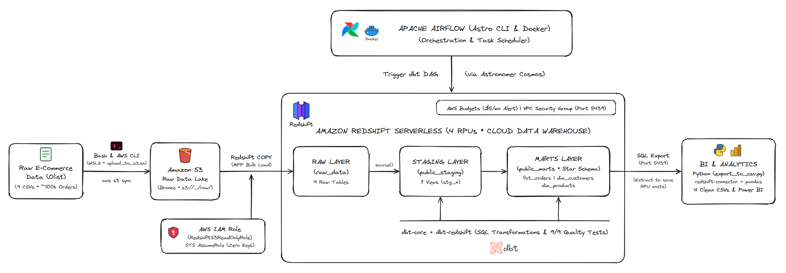
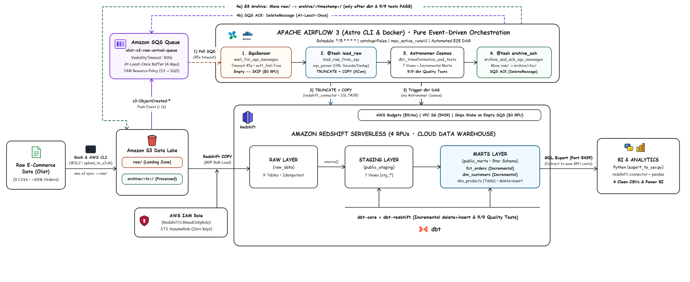
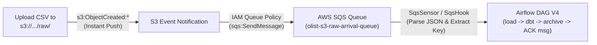

# 📋 PROJECT SIGN-OFF, ACCEPTANCE REPORT & ENGINEERING RETROSPECTIVE

> 🌐 **Language:** **English** | [Tiếng Việt](RETROSPECTIVE.vi.md)

---

## 📌 PROJECT OVERVIEW

| Attribute | Details |
| :--- | :--- |
| **Project Name** | **End-to-End Event-Driven AWS E-Commerce Data Pipeline & Kimball Star Schema Analytics** |
| **Data Engineer** | Ao Minh Tam ([@AOMINHTAM](https://github.com/AOMINHTAM)) |
| **Repository** | [github.com/AOMINHTAM/aws-data-pipeline](https://github.com/AOMINHTAM/aws-data-pipeline) |
| **Dataset** | Olist Brazilian E-Commerce Dataset (~120 MB, ~100k orders, 9 relational tables) |
| **Core Stack** | AWS (S3, SQS, Redshift Serverless, IAM), dbt Core, Apache Airflow 3 (Astro CLI & Astronomer Cosmos), Docker, Python (`redshift-connector`, `pandas`), Ubuntu WSL2 |
| **Milestones** | **V2 (Baseline):** Oct 2026 • **V3 (S3 Sensor):** Nov 12, 2026 • **V4 Step 1 (S3 → SQS → Airflow):** Nov 13, 2026 • **V4 Step 2 (dbt Incremental):** Nov 13, 2026 |
| **Status** | ✅ **100% ACCEPTED & LIVE VERIFIED** |

---

## 🏗️ SYSTEM ARCHITECTURE EVOLUTION (V2 → V4)

| V2 (Manual Batch Baseline) | V4 (Pure Event-Driven & Incremental ELT) |
| :---: | :---: |
|  |  |

---

## ✅ TECHNICAL ACCEPTANCE CHECKLIST

| # | Workstream | Acceptance Criteria | Result | Status |
| :---: | :--- | :--- | :--- | :---: |
| **1** | **Security & Base Environment** | Ubuntu WSL2 environment, least-privilege IAM user, AWS CLI v2, Git version control. | Completed; credentials + `AIRFLOW_CONN_AWS_DEFAULT` secured via `.env` (git-ignored). | **PASS** |
| **2** | **AWS Cloud Infra & FinOps** | Private S3 bucket, Redshift Serverless (4 RPUs), AWS Budget Alert configured at \$5/month. | Completed; zero unexpected AWS billing. | **PASS** |
| **3** | **Data Ingestion (Lake → DWH)** | Load 9 raw tables via `COPY` using `RedshiftS3ReadOnlyRole` (STS AssumeRole). | Loaded 99,441 orders & 112,650 order items; automated with idempotent `TRUNCATE + COPY`. | **PASS** |
| **4** | **Data Modeling (Kimball Star Schema)** | Build dbt project: Staging Views (`public_staging`) and Marts Tables (`fct_orders`, `dim_customers`, `dim_products`). | Clean Star Schema optimized for analytical BI queries. | **PASS** |
| **5** | **Data Quality & Testing** | Implement dbt tests for `unique`, `not_null`, `accepted_values`, `relationships`. | Passed 9/9 tests (`PASS=9 WARN=0 ERROR=0`). | **PASS** |
| **6** | **Pipeline Orchestration (Airflow + Cosmos)** | Deploy Airflow 3 via Astro CLI on Docker; map dbt DAG natively using Astronomer Cosmos `DbtTaskGroup`. | Full DAG executed cleanly (18/18 green tasks in UI). | **PASS** |
| **7** | **Event-Driven Automation (V3 → V4)** | Evolve from V3 polling (`S3KeySensor`) to V4 push-based (`S3 Event` → `SQS` → `SqsSensor` with `soft_fail=True` & atomic SQS ACK). | Live-verified across consecutive runs: happy path processed event + archived S3 + ACKed SQS; empty queue auto-skipped (**\$0 Redshift RPU**). | **PASS** |
| **8** | **Data Consumption & Export** | Python export module (`redshift-connector` + `pandas`) extracting marts to clean local CSVs for Power BI. | Exported 4 clean analytical datasets into `exports/` (~54 MB). | **PASS** |

---

## 📊 VERIFIED OUTPUT DATASETS

Extracted analytical datasets stored locally in [`exports/`](../exports/) (git-ignored):

1. **`1_master_orders_analytics.csv`** (24.5 MB | 99,441 rows): Consolidated order facts, customer attributes, revenue, delivery lead time, SLA delay flags, and review scores.
2. **`2_dim_products.csv`** (3.2 MB | 32,951 rows): Product catalog with English category translations, dimensions, and weight.
3. **`3_dim_customers.csv`** (15.2 MB | 99,441 rows): Customer dimension featuring `One-time` vs. `Returning` segmentation and Customer Lifetime Value (LTV).
4. **`4_order_items_product_sales.csv`** (11.3 MB | 112,650 rows): Line-item level sales details joined with product attributes.

---

## 🛠️ TROUBLESHOOTING JOURNEY & ENGINEERING RETROSPECTIVE

### 1. Real-World Technical Challenges Solved
* **Network & Redshift Serverless Connectivity (Port `5439`):** Diagnosed and resolved Cloudflare WARP blocking direct SSL connections from local/Docker containers to Redshift Serverless, as well as a Power BI connector crash triggered when appending `:5439` directly in the Server input field.
* **Idempotent Ingestion (Preventing Row Duplication):** Fixed 4x row duplication caused by repeated `COPY` runs by standardizing an atomic per-table `TRUNCATE TABLE` + `COPY` workflow coupled with lifecycle movement (`raw/` → `archive/<timestamp>/`).
* **Ubuntu WSL2, Docker & Astro Runtime 3.3:** Configured WSL2 filesystem permissions, isolated secrets in `.env` (`AIRFLOW_CONN_AWS_DEFAULT=aws://`), and mastered Astro CLI dynamic UI ports and scheduler behaviors.
* **SQS Event-Driven Edge Cases (V4):** Handled `s3:TestEvent` payloads (which lack the `Records` key when S3 notifications are first enabled) to prevent `KeyError`, and set `delete_message_on_reception=False` on `SqsSensor` so messages remain protected by `VisibilityTimeout` until dbt tests pass.

### 2. Core Engineering Takeaways
* **Dimensional Modeling (Kimball Star Schema):** Structured a 3-layer Medallion architecture (`raw_data` Bronze → `public_staging` Silver views → `public_marts` Gold physical tables) guarded by 9 automated dbt quality tests.
* **Pull vs. Push Event-Driven Architecture:** Transitioned from periodic bucket scanning (`S3KeySensor`) to instant push-based notifications (`S3 ObjectCreated` → `AWS SQS` → `Airflow SqsSensor`), decoupling storage from compute via `VisibilityTimeout` and `At-Least-Once Delivery`.
* **Cloud FinOps Mindset:** Minimized Redshift Serverless (4 RPUs) cost using `soft_fail=True` (zero compute wake-up on empty queue polls) and decoupled offline BI exports.

---

## 📝 PROJECT SIGN-OFF (V2, V3 & V4 STEP 1)

- **Overall Assessment:** ⭐⭐⭐⭐⭐ (5/5)
- **Sign-Off Dates:** V2: Oct 31, 2026 • V3 (S3 Sensor): Nov 12, 2026 • V4 Step 1 (S3 → SQS → Airflow): Nov 13, 2026
- **Project Engineer:** Ao Minh Tam ([@AOMINHTAM](https://github.com/AOMINHTAM))

---

## 🚀 V4 UPGRADE ROADMAP & TECHNICAL DEEP DIVE

### Why Sequence V4 as: Step 1 (SQS Push) → Step 2 (dbt Incremental) → Step 3 (Alerting)?
These three steps follow a **strict architectural causality chain**:
1. **Step 1 (S3 → SQS → Airflow)** solves **"When to run and with what latency?"** — moving from 15-minute polling to push-based event queuing.
2. **Step 2 (dbt Incremental Modeling)** solves **"How do we process continuous micro-batch events without wiping historical data or burning Redshift credits?"** — once triggered by individual file arrivals, full `TRUNCATE` / `CREATE TABLE AS` rebuilds become inefficient, requiring **Incremental Upsert / Merge**.
3. **Step 3 (Webhook Alerting)** adds lightweight external observability for automated `SUCCESS` / `FAILED` notifications.

---

### STEP 1: Pure Event-Driven Ingestion with AWS S3 Event Notification & AWS SQS (`✅ COMPLETED`)

#### 1. What Was Built
1. Created Standard SQS Queue: `olist-s3-raw-arrival-queue` (`us-east-1`, \$0 within AWS Free Tier of 1M requests/month).
2. Attached a **Resource-based Queue Policy** granting `s3.amazonaws.com` `sqs:SendMessage` permission restricted by `aws:SourceArn` (`arn:aws:s3:::olist-raw-data-amt-us-east-1-205506434601-us-east-1-an`) and `aws:SourceAccount`.
3. Enabled **S3 Bucket Notification Configuration** listening to `s3:ObjectCreated:*` filtered by `prefix = raw/` and `suffix = .csv`.
4. Upgraded [`dags/ecommerce_pipeline_dag.py`](../dags/ecommerce_pipeline_dag.py) and added modular [`include/sqs_parser.py`](../include/sqs_parser.py) + [`tests/test_sqs_parser.py`](../tests/test_sqs_parser.py) (6/6 unit tests passing).

#### 2. Under-the-Hood Mechanism
* **Zero Polling Latency & Zero S3 `LIST` Overhead:** S3 emits event metadata (`Records[0].s3.object.key`) within 1–2 seconds directly into SQS, eliminating expensive bucket listing scans.
* **Visibility Timeout & At-Least-Once Delivery:**
  * `SqsSensor` sets `delete_message_on_reception=False` with `VisibilityTimeout=300s`.
  * Messages are deleted (`delete_message` via `ReceiptHandle`) **only after** Redshift COPY, dbt models, 9/9 tests, and S3 archiving all succeed.
  * If any step fails mid-run, the message automatically becomes visible again after 300 seconds for fault-tolerant retry.

#### 3. Step 1 Live Verification Results
> [!NOTE]
> **Status:** ✅ **100% PASS (LIVE VERIFIED ON AWS & AIRFLOW 3)**
> - **Run `14:20:00` (Happy Path):** SQS delivered `product_category_name_translation.csv` event → Airflow refreshed Redshift → dbt passed 9/9 tests → archived CSV to `archive/20261113_072547/` → executed `✉️ SQS ACK` to delete the queue message.
> - **Run `14:25:00` (FinOps Zero-Cost):** Empty SQS queue timed out cleanly at 45s (`soft_fail=True`) and transitioned downstream tasks to **`SKIPPED`** (\$0 Redshift RPU).
> - **Live Evidence Screenshots:**
>   - V4 DAG Graph: [`images/airflow_v4_dag_graph.png`](../images/airflow_v4_dag_graph.png)
>   - Grid View (Event Run vs. FinOps Skip): [`images/airflow_v4_grid_event_driven.png`](../images/airflow_v4_grid_event_driven.png)
>   - SQS ACK & S3 Archival Execution Logs: [`images/airflow_v4_sqs_ack_log.png`](../images/airflow_v4_sqs_ack_log.png)

---

### STEP 2: dbt Incremental Modeling (`materialized='incremental'` & `delete+insert`) — `✅ COMPLETED`

#### 1. What Was Built
1. Converted [`dbt/models/marts/fct_orders.sql`](../dbt/models/marts/fct_orders.sql) to **`materialized='incremental'`** (`unique_key='order_id'`, `incremental_strategy='delete+insert'`, `on_schema_change='sync_all_columns'`) with a **3-day lookback window** on both `order_purchase_timestamp` and `order_delivered_customer_date`, plus `WHERE EXISTS` pruning across `order_items`, `payments`, and `reviews` CTEs.
2. Converted [`dbt/models/marts/dim_customers.sql`](../dbt/models/marts/dim_customers.sql) to **`materialized='incremental'`** (`unique_key='customer_id'`, `incremental_strategy='delete+insert'`, `on_schema_change='sync_all_columns'`). Because Olist issues a new `customer_id` per order while tracking people by `customer_unique_id`, the model resolves `affected_customers` at the `customer_unique_id` grain first (3-day lookback + brand-new `customer_id`s) and re-aggregates full order/payment histories only for those impacted people so LTV metrics stay exact.
3. Intentionally left [`dbt/models/marts/dim_products.sql`](../dbt/models/marts/dim_products.sql) as `materialized='table'` (small static lookup dimension).

#### 2. Under-the-Hood Mechanism
* **Initial / Full-Refresh Run (`is_incremental() == False`):** Falls back to loading complete history (`CREATE TABLE ... AS SELECT ...`).
* **Incremental Runs (`is_incremental() == True`):**
  * Applies high-water mark lookback filters (`dateadd(day, -3, coalesce(max(...), cast('2016-01-01' as timestamp)))` from `{{ this }}`) to catch both newly arrived orders and late-arriving delivery updates without scanning unchanged history.
  * **Atomic Upsert (`delete+insert`) on Redshift:** Stages changed keys in `*__dbt_tmp*`, executes `DELETE FROM target WHERE (unique_key) IN (SELECT DISTINCT unique_key FROM tmp)`, and `INSERT INTO target SELECT ... FROM tmp` cleanly.

#### 3. Step 2 Live Verification Results & Engineering Takeaways
> [!NOTE]
> **Status:** ✅ **100% PASS (LIVE VERIFIED ON REDSHIFT SERVERLESS)**
> - **`dbt compile` (incremental) & `dbt compile --full-refresh`:** Compiled cleanly across all 10 models, 9 tests, and 9 sources (`is_incremental()` True and False branches verified).
> - **`dbt run --select fct_orders dim_customers`:** **PASS 2/2** (`fct_orders` `37.38s`, `dim_customers` `39.20s`, total `56.29s`).
> - **`dbt test`:** **PASS 9/9** (`28.75s`, `WARN=0 ERROR=0`) including `unique`, `not_null`, and `relationships`.
* **Takeaways:** Mastery of **Incremental Data Modeling**, **High-Water Marks**, **Late-Arriving Data** (lookback windows), **grain vs. lifetime entity re-aggregation** (`dim_customers`), and Redshift `delete+insert` compilation.

---

### STEP 3: Lightweight Observability & Webhook Alerting — `🗓️ OPTIONAL / BACKLOG`

#### 1. What to Build
* Implement a Python callback (`send_pipeline_notification(context)`) attached to Airflow DAG `on_success_callback` / `on_failure_callback`.
* Dispatch formatted Markdown alerts to **Telegram Bot API** or **Slack/Discord Incoming Webhooks** using standard HTTP POST requests.

#### 2. Under-the-Hood Mechanism
* Leverages Airflow's **Execution Context (`context`)** dictionary and `xcom_pull` to extract batch metrics (loaded files, execution duration, exception traces, and log links) for rich, actionable incident alerting.
