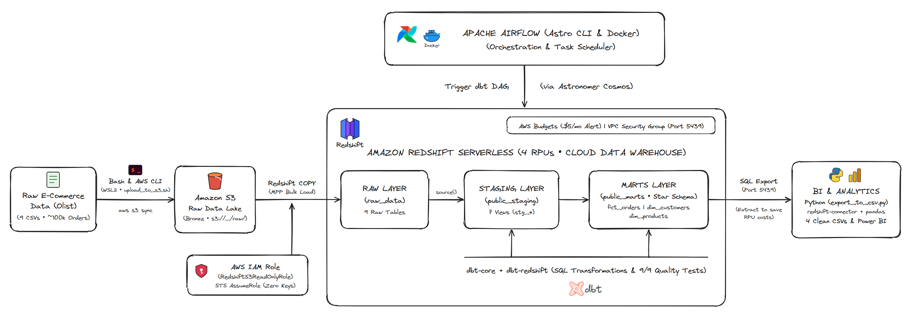
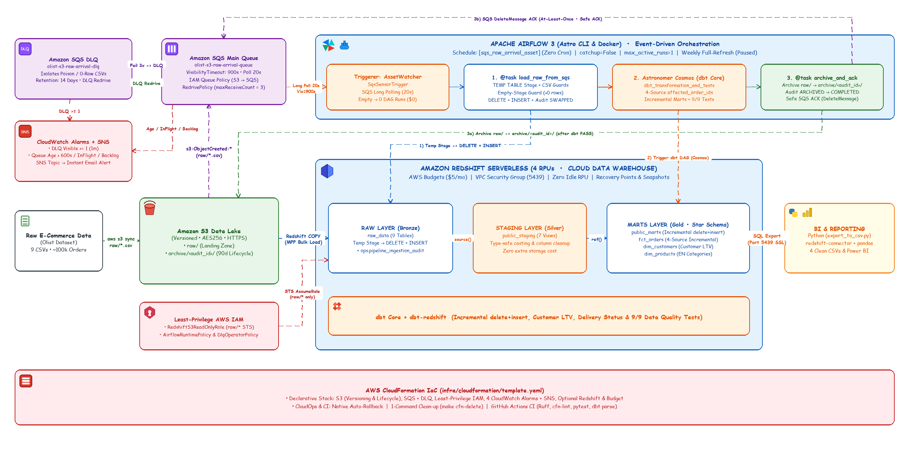
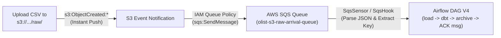
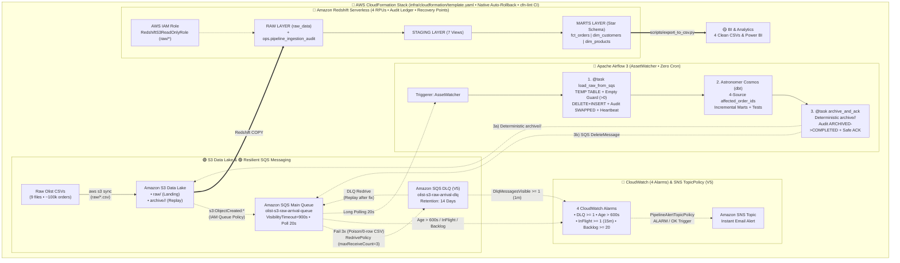

# 📋 PROJECT SIGN-OFF, ACCEPTANCE REPORT & ENGINEERING RETROSPECTIVE

> 🌐 **Language:** **English** | [Tiếng Việt](RETROSPECTIVE.vi.md)

---

## 📌 PROJECT OVERVIEW

| Attribute | Details |
| :--- | :--- |
| **Project Name** | **End-to-End Event-Driven AWS E-Commerce Data Pipeline & Kimball Star Schema Analytics (V5 — `5.0.0`)** |
| **Data Engineer** | Ao Minh Tam ([@AOMINHTAM](https://github.com/AOMINHTAM)) |
| **Repository** | [github.com/AOMINHTAM/aws-data-pipeline](https://github.com/AOMINHTAM/aws-data-pipeline) |
| **Dataset** | Olist Brazilian E-Commerce Dataset (~120 MB, ~100k orders, 9 relational tables) |
| **Core Stack** | AWS (CloudFormation, S3, SQS + DLQ, CloudWatch, SNS, Redshift Serverless, IAM), dbt Core, Apache Airflow 3 (Astro CLI & Astronomer Cosmos), Docker, Python (`redshift-connector`, `boto3`, `pandas`), Ubuntu WSL2 |
| **Milestones** | **V2 (Baseline):** Oct 2026 • **V3 (S3 Sensor):** Nov 12, 2026 • **V4 (`v4.0.1` Event-Driven & Incremental):** Nov 13, 2026 • **V5 (`5.0.0` CloudFormation IaC, DLQ & Observability):** Nov 18, 2026 |
| **Status** | ✅ **100% ACCEPTED, LIVE VERIFIED & RELEASED (`5.0.0`)** |

---

## 🏗️ SYSTEM ARCHITECTURE EVOLUTION (V2 → V5)

| V2 (Manual Batch Baseline) | V5 (`5.0.0` — CloudFormation IaC, DLQ & Observability) |
| :---: | :---: |
|  |  |

> 📖 **Detailed V5 Documentation:** [V5 Architecture Deep Dive (V5_DEEP_DIVE.md)](V5_DEEP_DIVE.md) • [Operations & DR Runbook (OPERATIONS_RUNBOOK.md)](OPERATIONS_RUNBOOK.md)

---

## ✅ TECHNICAL ACCEPTANCE CHECKLIST

| # | Workstream | Acceptance Criteria | Result | Status |
| :---: | :--- | :--- | :--- | :---: |
| **1** | **Security & Base Environment** | Ubuntu WSL2 environment, least-privilege IAM user, AWS CLI v2, Git version control. | Completed; credentials + `AIRFLOW_CONN_AWS_DEFAULT` secured via `.env` (git-ignored). | **PASS** |
| **2** | **AWS Cloud Infra & FinOps** | Private S3 bucket, Redshift Serverless (4 RPUs), AWS Budget Alert configured at \$5/month. | Completed; zero unexpected AWS billing. | **PASS** |
| **3** | **Data Ingestion (Lake → DWH)** | Load 9 raw tables via `COPY` using `RedshiftS3ReadOnlyRole` (STS AssumeRole). | Loaded 99,441 orders & 112,650 order items; automated with idempotent `TRUNCATE + COPY`. | **PASS** |
| **4** | **Data Modeling (Kimball Star Schema)** | Build dbt project: Staging Views (`public_staging`) and Marts Tables (`fct_orders`, `dim_customers`, `dim_products`). | Clean Star Schema optimized for analytical BI queries. | **PASS** |
| **5** | **Data Quality & Testing** | Implement dbt tests for `unique`, `not_null`, `accepted_values`, `relationships`. | Passed 9/9 tests (`PASS=9 WARN=0 ERROR=0`). | **PASS** |
| **6** | **Pipeline Orchestration (Airflow + Cosmos)** | Deploy Airflow 3 via Astro CLI on Docker; map dbt DAG natively using Astronomer Cosmos `DbtTaskGroup`. | Full DAG executed cleanly (18/18 green tasks in UI). | **PASS** |
| **7** | **Event-Driven Automation (V3 → V4)** | Evolve from V3 polling (`S3KeySensor`) to V4 push-based (`S3 Event` → `SQS` → `SqsSensor` with `soft_fail=True` & atomic SQS ACK). | Live-verified across consecutive runs: happy path processed event + archived S3 + ACKed SQS; empty queue auto-skipped (**\$0 Redshift RPU**). | **PASS** |
| **8** | **Data Consumption & Export** | Python export module (`redshift-connector` + `pandas`) extracting marts to clean local CSVs for Power BI. | Exported 4 clean analytical datasets into `exports/` (~54 MB). | **PASS** |

---

## 📊 VERIFIED OUTPUT DATASETS

Extracted analytical datasets stored locally in [`exports/`](../exports/) (git-ignored):

1. **`1_master_orders_analytics.csv`** (24.5 MB | 99,441 rows): Consolidated order facts, customer attributes, revenue, delivery lead time, SLA delay flags, and review scores.
2. **`2_dim_products.csv`** (3.2 MB | 32,951 rows): Product catalog with English category translations, dimensions, and weight.
3. **`3_dim_customers.csv`** (15.2 MB | 99,441 rows): Customer dimension featuring `One-time` vs. `Returning` segmentation and Customer Lifetime Value (LTV).
4. **`4_order_items_product_sales.csv`** (11.3 MB | 112,650 rows): Line-item level sales details joined with product attributes.

---

## 🛠️ TROUBLESHOOTING JOURNEY & ENGINEERING RETROSPECTIVE

### 1. Real-World Technical Challenges Solved
* **Network & Redshift Serverless Connectivity (Port `5439`):** Diagnosed and resolved Cloudflare WARP blocking direct SSL connections from local/Docker containers to Redshift Serverless, as well as a Power BI connector crash triggered when appending `:5439` directly in the Server input field.
* **Idempotent & Atomic Ingestion (Temp-Stage Swap vs. Redshift `TRUNCATE`):** Replaced naive `autocommit=True` `TRUNCATE + COPY` (where `TRUNCATE` auto-commits in Redshift and cannot roll back if `COPY` fails) with staging into a `TEMP TABLE` via `COPY` followed by an explicit `autocommit=False` `DELETE + INSERT` swap transaction and S3 duplicate-delivery guard (`check_for_key`).
* **Ubuntu WSL2, Docker & Astro Runtime 3.3:** Configured WSL2 filesystem permissions, isolated secrets in `.env` (`AIRFLOW_CONN_AWS_DEFAULT=aws://`), and mastered Airflow 3.3 (`astrocrpublic.azurecr.io/runtime:3.3-11`) Task SDK (`Asset`, `AssetWatcher`).
* **SQS Event-Driven Edge Cases (V4):** Handled `s3:TestEvent` payloads (which lack the `Records` key when S3 notifications are first enabled), configured `AssetWatcher` with `SqsSensorTrigger` (SQS Long Polling `20s`, **zero `*/5` cron**), raised `VisibilityTimeout` to `900s`, ordered S3 archive/cleanup before SQS ACK, and added an optional paused-by-default weekly full-refresh DAG for >3-day late-arriving data.

### 2. Core Engineering Takeaways
* **Dimensional Modeling (Kimball Star Schema):** Structured a 3-layer Medallion architecture (`raw_data` Bronze → `public_staging` Silver views → `public_marts` Gold incremental & dimension tables) guarded by 9 automated dbt quality tests.
* **Pure Event-Driven Scheduling (Airflow 3 `AssetWatcher`):** Transitioned from periodic bucket scanning (`S3KeySensor`) → 5-min `SqsSensor` micro-batch → native Airflow 3 `AssetWatcher` (`SqsSensorTrigger` Long Polling `20s`), spawning **0 empty DAG runs** while keeping `VisibilityTimeout=900s` & `At-Least-Once Delivery` intact.
* **Cloud FinOps Mindset:** Minimized Redshift Serverless (4 RPUs) compute cost: idle Triggerer creates **0 DAG runs** (zero idle RPU wakeups), SQS Long Polling (~104k requests/month if left active) stays well within the 1M/month AWS Free Tier allowance *(persistent storage costs excluded)*, `s3_hook.check_for_key()` prevents waking Redshift on duplicate SQS deliveries, `ecommerce_dbt_full_refresh_maintenance` starts paused (`is_paused_upon_creation=True`), and `astro dev stop` halts Airflow SQS polling completely.

---

## 📝 PROJECT SIGN-OFF (V2, V3 & V4 STEP 1)

- **Overall Assessment:** ⭐⭐⭐⭐⭐ (5/5)
- **Sign-Off Dates:** V2: Oct 31, 2026 • V3 (S3 Sensor): Nov 12, 2026 • V4 Step 1 (S3 → SQS → Airflow): Nov 13, 2026
- **Project Engineer:** Ao Minh Tam ([@AOMINHTAM](https://github.com/AOMINHTAM))

---

## 🚀 V4 UPGRADE ROADMAP & TECHNICAL DEEP DIVE

### Why Sequence V4 as: Step 1 (SQS Push) → Step 2 (dbt Incremental) → Step 3 (Alerting)?
These three steps follow a **strict architectural causality chain**:
1. **Step 1 (S3 → SQS → Airflow)** solves **"When to run and with what latency?"** — moving from 15-minute polling to push-based event queuing.
2. **Step 2 (dbt Incremental Modeling)** solves **"How do we process continuous micro-batch events without wiping historical data or burning Redshift credits?"** — once triggered by individual file arrivals, full `TRUNCATE` / `CREATE TABLE AS` rebuilds become inefficient, requiring **Incremental Upsert / Merge**.
3. **Step 3 (Webhook Alerting)** adds lightweight external observability for automated `SUCCESS` / `FAILED` notifications.

---

### STEP 1: Pure Event-Driven Ingestion with AWS S3 Event Notification & AWS SQS (`✅ COMPLETED`)

#### 1. What Was Built
1. Created Standard SQS Queue: `olist-s3-raw-arrival-queue` (`us-east-1`, \$0 within AWS Free Tier of 1M requests/month).
2. Attached a **Resource-based Queue Policy** granting `s3.amazonaws.com` `sqs:SendMessage` permission restricted by `aws:SourceArn` (`arn:aws:s3:::olist-raw-data-amt-us-east-1-205506434601-us-east-1-an`) and `aws:SourceAccount`.
3. Enabled **S3 Bucket Notification Configuration** listening to `s3:ObjectCreated:*` filtered by `prefix = raw/` and `suffix = .csv`.
4. Upgraded [`dags/ecommerce_pipeline_dag.py`](../dags/ecommerce_pipeline_dag.py) to **Airflow 3 `Asset` + `AssetWatcher` (`SqsSensorTrigger`)** removing the `*/5` cron completely, wrapped Redshift ingestion in an atomic `TEMP TABLE` + `DELETE/INSERT` transaction (`autocommit=False`), added an optional paused-by-default reconciliation DAG [`dags/ecommerce_weekly_full_refresh_dag.py`](../dags/ecommerce_weekly_full_refresh_dag.py), and added modular [`include/sqs_parser.py`](../include/sqs_parser.py) + [`tests/test_sqs_parser.py`](../tests/test_sqs_parser.py) (`7/7` unit tests passing).

#### 2. Under-the-Hood Mechanism
* **Event-Driven Long Polling (Zero Time Cron) & Zero S3 `LIST` Overhead:** S3 emits event metadata (`Records[0].s3.object.key`) into SQS (typically within seconds per S3 Event Notification SLA). Airflow 3's Triggerer listens asynchronously via SQS Long Polling (`wait_time_seconds=20`, `waiter_delay=5`), waking the DAG on arrival without scheduled cron clutter — and stops SQS polling completely when `astro dev stop` runs.
* **Visibility Timeout (`900s`), Empty-Stage Guard & Atomic Cleanup Ordering:**
  * `SqsSensorTrigger` sets `delete_message_on_reception=False` with `VisibilityTimeout=900s` (15 minutes).
  * `load_raw_from_sqs` checks `s3_hook.check_for_key()` before touching Redshift, stages into `TEMP TABLE`, enforces [`ensure_non_empty_stage`](../include/ingestion_guards.py) (`staged_rows > 0`) so empty CSVs cannot wipe target tables, and executes per-table `DELETE/INSERT` (`autocommit=False`).
  * Messages are deleted (`delete_message` via `ReceiptHandle`) **only after** dbt tests pass, S3 files are archived to `archive/`, and `raw/` objects are removed (raising on ACK error for Airflow task retry).

#### 3. Step 1 Live Verification Results *(Initial `SqsSensor` Baseline)*
> [!NOTE]
> **Status:** ✅ **100% PASS (LIVE VERIFIED ON AWS & AIRFLOW 3 — INITIAL `SqsSensor` BASELINE)**
> *(Note: Runs `14:20:00` and `14:25:00` below were captured when Step 1 initially used `SqsSensor` on a 5-minute schedule prior to refactoring the trigger to `AssetWatcher` with zero empty runs.)*
> - **Run `14:20:00` (Happy Path):** SQS delivered `product_category_name_translation.csv` event → Airflow refreshed Redshift → dbt passed 9/9 tests → archived CSV to `archive/20261113_072547/` → executed `✉️ SQS ACK` to delete the queue message.
> - **Run `14:25:00` (FinOps Skip):** Empty SQS queue timed out cleanly at 45s (`soft_fail=True`) and transitioned downstream tasks to **`SKIPPED`** (zero Redshift RPU compute).
> - **Live Evidence Screenshots:**
>   - V4 DAG Graph: [`images/airflow_v4_dag_graph.png`](../images/airflow_v4_dag_graph.png)
>   - Grid View (Event Run vs. FinOps Skip): [`images/airflow_v4_grid_event_driven.png`](../images/airflow_v4_grid_event_driven.png)
>   - SQS ACK & S3 Archival Execution Logs: [`images/airflow_v4_sqs_ack_log.png`](../images/airflow_v4_sqs_ack_log.png)

---

### STEP 2: dbt Incremental Modeling (`materialized='incremental'` & `delete+insert`) — `✅ COMPLETED`

#### 1. What Was Built
1. Converted [`dbt/models/marts/fct_orders.sql`](../dbt/models/marts/fct_orders.sql) to **`materialized='incremental'`** (`unique_key='order_id'`, `incremental_strategy='delete+insert'`, `on_schema_change='sync_all_columns'`) with a **3-day lookback window** on both `order_purchase_timestamp` and `order_delivered_customer_date`, plus `WHERE EXISTS` pruning across `order_items`, `payments`, and `reviews` CTEs.
2. Converted [`dbt/models/marts/dim_customers.sql`](../dbt/models/marts/dim_customers.sql) to **`materialized='incremental'`** (`unique_key='customer_id'`, `incremental_strategy='delete+insert'`, `on_schema_change='sync_all_columns'`). Because Olist issues a new `customer_id` per order while tracking people by `customer_unique_id`, the model resolves `affected_customers` at the `customer_unique_id` grain first (3-day lookback + brand-new `customer_id`s) and re-aggregates full order/payment histories only for those impacted people so LTV metrics stay exact.
3. Intentionally left [`dbt/models/marts/dim_products.sql`](../dbt/models/marts/dim_products.sql) as `materialized='table'` (small static lookup dimension).

#### 2. Under-the-Hood Mechanism
* **Initial / Full-Refresh Run (`is_incremental() == False`):** Falls back to loading complete history (`CREATE TABLE ... AS SELECT ...`).
* **Incremental Runs (`is_incremental() == True`):**
  * Applies high-water mark lookback filters (`dateadd(day, -3, coalesce(max(...), cast('2016-01-01' as timestamp)))` from `{{ this }}`) to catch both newly arrived orders and late-arriving delivery updates without scanning unchanged history.
  * **Atomic Upsert (`delete+insert`) on Redshift:** Stages changed keys in `*__dbt_tmp*`, executes `DELETE FROM target WHERE (unique_key) IN (SELECT DISTINCT unique_key FROM tmp)`, and `INSERT INTO target SELECT ... FROM tmp` cleanly.

#### 3. Step 2 Live Verification Results & Engineering Takeaways
> [!NOTE]
> **Status:** ✅ **100% PASS (LIVE VERIFIED ON REDSHIFT SERVERLESS)**
> - **`dbt compile` (incremental) & `dbt compile --full-refresh`:** Compiled cleanly across all 10 models, 9 tests, and 9 sources (`is_incremental()` True and False branches verified).
> - **`dbt run --select fct_orders dim_customers`:** **PASS 2/2** (`fct_orders` `37.38s`, `dim_customers` `39.20s`, total `56.29s`).
> - **`dbt test`:** **PASS 9/9** (`28.75s`, `WARN=0 ERROR=0`) including `unique`, `not_null`, and `relationships`.
* **Takeaways:** Mastery of **Incremental Data Modeling**, **High-Water Marks**, **Late-Arriving Data** (lookback windows), **grain vs. lifetime entity re-aggregation** (`dim_customers`), and Redshift `delete+insert` compilation.

---

### STEP 3 (UPGRADING TO V5): Production CloudOps, AWS CloudFormation IaC, SQS DLQ & CloudWatch/SNS Alerting (FCJ Standard) — `✅ MERGED TO MAIN & RELEASED 5.0.0 (LIVE VERIFIED)`

Following the **`v4.0.1`** release that locked in the **Data Engineering Core** (S3 → SQS → Airflow 3 `AssetWatcher` → Per-Table Atomic Redshift Swap → dbt Multi-Source Incremental Marts + 100% Green GitHub Actions CI), the project completed and released **V5 (`5.0.0`, PR #4 at `692050c`)** to meet full **AWS First Cloud Journey (FCJ)** production engineering standards for reproducibility, poison-message fault tolerance, active alerting, and disaster recovery. For a full component-by-component breakdown, see [`docs/V5_DEEP_DIVE.md`](V5_DEEP_DIVE.md).

#### 1. Architectural Evolution Matrix (V2 → V3 → V4 → V5)

| Generation | Architectural Focus | Infrastructure & Provisioning | Fault Tolerance & Observability |
| :--- | :--- | :--- | :--- |
| **V2 (Baseline)** | Manual batch ELT pipeline | Manual AWS Console / CLI setup | Manual UI inspection |
| **V3 (Polling)** | Scheduled `S3KeySensor` polling (every 15m) | Manual AWS Console / CLI setup | `soft_fail=True` empty-run skip |
| **V4 (`v4.0.1`)** | **Pure Push Event-Driven & Incremental Core** (`S3 Event` → `SQS` → Airflow 3 `AssetWatcher` + `TEMP TABLE` Atomic Swap + Empty-Stage Guard + 4-source `fct_orders` Incremental) | Code, SQL & 3-job GitHub Actions CI (`ci.yml`) in Git; AWS infra created via CLI | Per-table transaction rollback + S3 duplicate guard + SQS ACK retry safety |
| **V5 (`v5.0.0`)** | **Production CloudOps & Resilience (FCJ Standard)** | **100% AWS CloudFormation IaC (`infra/cloudformation/template.yaml`, 15 core resources)** with Native Auto-Rollback, Change Sets, `cfn-lint` CI, S3 Versioning + `scripts/empty_versioned_bucket.py`, split `AirflowRuntimePolicy` & `DlqOperatorPolicy` | **SQS DLQ (`maxReceiveCount=3`, `RedriveAllowPolicy`) + DLQ Redrive** + **4 CloudWatch Alarms + `PipelineAlertTopicPolicy` + SNS Email** + **`ops.pipeline_ingestion_audit` & Deterministic Archive Safe ACK** + **Operations Runbook** |

#### 2. V5 Target Architecture Diagram (Draw.io & Mermaid Preview)

* **Draw.io Vector Source:** [`images/architecture_v5.drawio`](../images/architecture_v5.drawio) *(plus [`images/architecture_v4.drawio`](../images/architecture_v4.drawio) for V4)*
* **High-Resolution PNG:** [`images/architecture_v5.png`](../images/architecture_v5.png)

#### 3. Four Engineering Pillars of V5 (CloudFormation Stack `CREATE_COMPLETE` & Live E2E Verified)
1. **100% Infrastructure as Code via AWS CloudFormation (`infra/cloudformation/template.yaml`):**
   * Codifies 15 core resources (Versioned S3 Bucket + HTTPS BucketPolicy + Lifecycle + Event Notification, SQS Main Queue + Queue Policy, SQS DLQ + `RedriveAllowPolicy`, least-privilege `RedshiftS3ReadOnlyRole` scoped to `raw/*`, split `AirflowRuntimePolicy` & `DlqOperatorPolicy`, 4 CloudWatch Alarms, SNS Topic + `PipelineAlertTopicPolicy` + Email Subscription) plus 4 conditional resources (AWS Budget \$5/month and VPC-secured Redshift Serverless).
   * Leverages CloudFormation **Native Stack Auto-Rollback**, automated `cfn-lint` checks in CI, and [`scripts/empty_versioned_bucket.py`](../scripts/empty_versioned_bucket.py) for 1-command `make cfn-delete` clean-up.
2. **Poison Message Isolation & Application Reliability (`ops.pipeline_ingestion_audit` + Safe ACK):**
   * Enforces `RedrivePolicy` (`maxReceiveCount = 3`) on `SqsMainQueue` and `RedriveAllowPolicy: byQueue` on `SqsDeadLetterQueue`.
   * Validates CSV headers (`validate_csv_header`), stages all batch files before swapping, records `SWAPPED` → `ARCHIVED` → `COMPLETED` (or `FAILED`) transitions in [`ops.pipeline_ingestion_audit`](../scripts/create_ops_audit_table.sql), writes cross-run deterministic archive keys `archive/<audit_id>/<filename>`, blocks unsafe ACKs via [`verify_safe_to_ack_when_raw_missing`](../include/ingestion_guards.py), defers multi-record SQS ACKs, and refreshes SQS `VisibilityTimeout` (`900s`) across stages.
   * **Real Airflow 3 Bug Caught & Fixed Live:** `context["triggering_asset_events"]` in Airflow 3 Task SDK is a `TriggeringAssetEventsAccessor` (`collections.abc.Mapping`, not `dict`); updated [`include/sqs_parser.py`](../include/sqs_parser.py) to check `Mapping` with a dedicated regression test (**21/21 unit tests passing**).
3. **Proactive 4-Alarm CloudWatch & SNS TopicPolicy Alerting:**
   * Monitors `DlqMessagesVisibleAlarm` ($\ge 1$), `MainQueueOldestMessageAlarm` ($> 600\text{s}$ SLA), `MainQueueInFlightAlarm` ($\ge 1$ for 15m), and `MainQueueBacklogAlarm` ($\ge 20$), publishing via `PipelineAlertTopicPolicy` to confirmed email subscribers.
4. **Operations & 14-Scenario Critical Test Runbook (`docs/OPERATIONS_RUNBOOK.md`):**
   * Documents repeatable procedures for **CloudFormation Stack Rollback**, **Redshift Serverless Recovery Point / Snapshot Restore**, **S3 Archive Replay**, **DLQ Redrive**, **100% AWS Clean-up**, and the **14-Scenario V5 Reliability Test Matrix**.

#### 4. V5 Live Verification Results on AWS & Airflow 3 (Nov 18, 2026)
> [!NOTE]
> **Status:** ✅ **100% PASS (LIVE VERIFIED ACROSS CLOUDFORMATION, SQS DLQ, CLOUDWATCH/SNS, AIRFLOW 3 & REDSHIFT SERVERLESS)**
> - **CloudFormation Stack (`olist-v5-pipeline-stack`):** `CREATE_COMPLETE` (14 core resources, 16 Outputs); SNS Email confirmed.
> - **Scenario 1 — Happy Path E2E (`asset_triggered__2026-11-18T11:53:09...`):** Replayed `product_category_name_translation.csv` to S3 `raw/` → Airflow 3 `AssetWatcher` triggered automatically → **17/17 tasks PASS** (`00:03:52`), deterministic S3 archive verified, SQS ACKed cleanly, and `ops.pipeline_ingestion_audit` recorded `SWAPPED` → `ARCHIVED` → `COMPLETED` (`71` rows).
> - **Scenario 2 — Empty CSV (`0` rows) $\rightarrow$ DLQ $\rightarrow$ CloudWatch `ALARM` $\rightarrow$ SNS Email $\rightarrow$ DLQ Redrive:**
>   - `ensure_non_empty_stage` aborted swap (`ValueError`), transaction rollback preserved **`71` rows** in `raw_data.product_category_name_translation`, and `ops.pipeline_ingestion_audit` logged `status='FAILED', rows_loaded=0`.
>   - After `maxReceiveCount=3`, SQS routed the poison message to `olist-v5-s3-raw-arrival-dlq-dev` (`1` message) → CloudWatch Alarms (`dlq-messages-visible`, `backlog-age`, `inflight-sustained`) entered **`ALARM`** and SNS dispatched real email alerts.
>   - Restored valid CSV and ran `aws sqs start-message-move-task` (**DLQ Redrive**) → recovery DAG run **PASS 17/17 tasks**, `ops.pipeline_ingestion_audit` logged `SWAPPED` → `ARCHIVED` → `COMPLETED`, SQS Main & DLQ cleared to `0/0`, and **all 4/4 CloudWatch Alarms returned to `OK`**.
