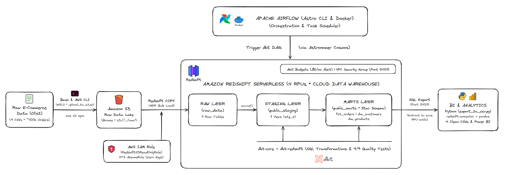
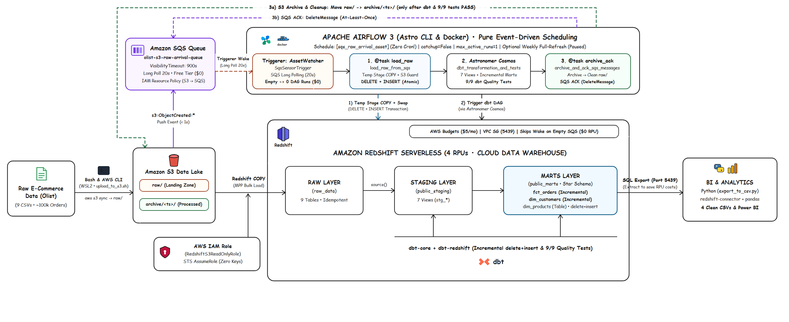
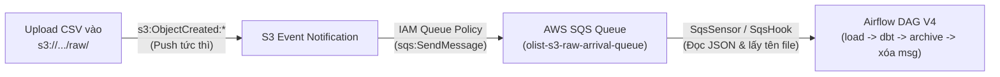
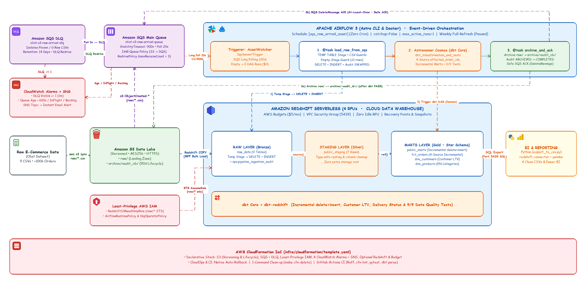
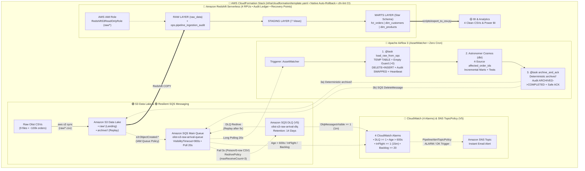

# BÁO CÁO NGHIỆM THU DỰ ÁN & ĐÁNH GIÁ KỸ THUẬT (PROJECT SIGN-OFF & RETROSPECTIVE)

> 🌐 **Language:** [English](RETROSPECTIVE.md) | **Tiếng Việt**

---

## 📌 THÔNG TIN CHUNG DỰ ÁN (PROJECT OVERVIEW)

| Thuộc tính | Chi tiết |
| :--- | :--- |
| **Tên dự án** | **End-to-End Event-Driven AWS E-Commerce Data Pipeline & Kimball Star Schema Analytics (V4)** |
| **Kỹ sư thực hiện** | Ao Minh Tam ([@AOMINHTAM](https://github.com/AOMINHTAM)) |
| **Repository** | [github.com/AOMINHTAM/aws-data-pipeline](https://github.com/AOMINHTAM/aws-data-pipeline) |
| **Dataset sử dụng** | Olist Brazilian E-Commerce Dataset (~120MB, ~100k đơn hàng, 9 quan hệ) |
| **Công nghệ cốt lõi** | AWS (S3, SQS, Redshift Serverless, IAM), dbt Core, Apache Airflow 3 (Astro CLI & Astronomer Cosmos), Docker, Python (`redshift-connector`, `pandas`), WSL2 Ubuntu |
| **Lịch sử hoàn thành** | **V2 (Baseline):** 10/2026 • **V3 (S3 Sensor):** 12/11/2026 • **V4 Bước 1 (SQS) & Bước 2 (dbt Incremental):** 13/11/2026 |
| **Trạng thái** | ✅ **HOÀN THÀNH TOÀN DIỆN (100% ACCEPTED & LIVE VERIFIED)** |

---

## 🏗️ TIẾN HÓA KIẾN TRÚC HỆ THỐNG (V2 → V4)

| V2 (Manual Batch Baseline) | V4 (Pure Event-Driven & Incremental ELT) |
| :---: | :---: |
|  |  |

---

## ✅ BẢNG NGHIỆM THU CÁC HẠNG MỤC KỸ THUẬT (ACCEPTANCE CHECKLIST)

| STT | Hạng mục công việc | Tiêu chí nghiệm thu | Kết quả | Trạng thái |
| :---: | :--- | :--- | :--- | :---: |
| **1** | **Bảo mật & Môi trường Base** | Môi trường Linux Ubuntu WSL2, phân quyền IAM User tối thiểu (`least privilege`), AWS CLI v2, quản lý source code bằng Git. | Hoàn thành, bảo mật credentials + `AIRFLOW_CONN_AWS_DEFAULT` qua `.env` (git-ignored). | **ĐẠT** |
| **2** | **Hạ tầng AWS Cloud & Chi phí** | Thiết lập S3 Bucket bảo mật private, Amazon Redshift Serverless 4 RPU, cấu hình AWS Budget Alert kiểm soát ngưỡng \$5/tháng. | Hoàn thành, không vượt chi phí dự toán. | **ĐẠT** |
| **3** | **Data Ingestion (Data Lake -> DWH)** | Nạp 9 bảng raw qua lệnh `COPY` với IAM Role `RedshiftS3ReadOnlyRole` (STS AssumeRole). | Nạp đủ 99,441 orders, 112,650 order items; V3 nâng cấp thành `@task load_raw_from_s3` chạy `TRUNCATE + COPY` đảm bảo Idempotent. | **ĐẠT** |
| **4** | **Data Modeling (Kimball Star Schema)** | Xây dựng dbt project gồm: Staging Views (`public_staging`) và Marts Tables (`fct_orders`, `dim_customers`, `dim_products`). | Cấu trúc Star Schema chuẩn xác, tối ưu query phân tích. | **ĐẠT** |
| **5** | **Data Quality & Testing** | Viết dbt tests kiểm tra `unique`, `not_null`, `accepted_values`, `relationships`. | Vượt qua 9/9 tests (`PASS=9 WARN=0 ERROR=0`). | **ĐẠT** |
| **6** | **Pipeline Orchestration (Airflow + Cosmos)** | Triển khai Airflow bằng Astro CLI trên Docker, dùng Astronomer Cosmos parse dbt DAG thành native Airflow TaskGroup. | Toàn bộ DAG chạy thành công (18/18 tasks xanh lá trên UI). | **ĐẠT** |
| **7** | **Event-Driven Automation & FinOps (V3)** | Tự động quét `raw/*.csv` theo lịch `*/15 * * * *` (`S3KeySensor` `reschedule` + `soft_fail=True`), chỉ move sang `archive/<ts>/` sau khi dbt & test pass. | Nghiệm thu live 2 nhịp liên tiếp: nhịp `23:30:00` **18/18 success** + archive sạch 9 file sang `archive/20261112_165135/`; nhịp `23:45:00` khi `raw/` rỗng tự chuyển **17 tasks `skipped`** (\$0 Redshift). | **ĐẠT** |
| **8** | **Data Consumption & Export** | Viết module Python (`redshift-connector` + `pandas`) trích xuất dữ liệu marts ra các file CSV sạch phục vụ BI & Data Science. | Xuất 4 bộ dataset phân tích sạch vào `exports/` (~54 MB). | **ĐẠT** |

---

## 📊 KẾT QUẢ ĐẦU RA DỮ LIỆU ĐÃ NGHIỆM THU

Các file dữ liệu thành phẩm đã được trích xuất tại thư mục [`exports/`](../exports/) (git-ignored trên local):

1. **`1_master_orders_analytics.csv`** (24.5 MB | 99,441 dòng): Tổng hợp đơn hàng, khách hàng, doanh thu, thời gian giao hàng, độ trễ và review score.
2. **`2_dim_products.csv`** (3.2 MB | 32,951 dòng): Danh mục sản phẩm đã dịch chuẩn tiếng Anh, kích thước và khối lượng.
3. **`3_dim_customers.csv`** (15.2 MB | 99,441 dòng): Khách hàng, phân khúc One-time vs Returning, Customer Lifetime Value (LTV).
4. **`4_order_items_product_sales.csv`** (11.3 MB | 112,650 dòng): Chi tiết từng item bán ra kết nối với sản phẩm.

---

## 🛠️ BÀI HỌC KỸ THUẬT & QUÁ TRÌNH GỠ LỖI (TROUBLESHOOTING & RETROSPECTIVE)

### 1. Những thử thách kỹ thuật thực tế đã giải quyết (Troubleshooting Journey)
* **Mạng & Kết nối Redshift Serverless (Port `5439`):** Xử lý tình huống Cloudflare WARP chặn kết nối SSL trực tiếp từ máy local/Docker tới Redshift endpoint, và khắc phục lỗi Power BI bị crash khi nhập kèm `:5439` vào trường Server.
* **Đảm bảo tính Idempotent khi nạp dữ liệu (Chống trùng lặp):** Gỡ lỗi nhân 4 số dòng khi chạy `COPY` nhiều lần bằng cách chuẩn hóa quy trình `TRUNCATE TABLE` + `COPY` nguyên tử cho từng bảng, kết hợp di chuyển file khỏi `raw/` sang `archive/<timestamp>/`.
* **Môi trường Ubuntu WSL2, Docker & Astro Runtime 3.3:** Thiết lập phân quyền chuẩn trên WSL2, cấu hình secret qua `.env` (git-ignored) cho Airflow Connection `AIRFLOW_CONN_AWS_DEFAULT=aws://`, và làm chủ hành vi Scheduler / Port động của Astro CLI.
* **Event-Driven SQS Edge-Cases (V4):** Xử lý chuẩn xác gói tin `s3:TestEvent` (không chứa key `Records`) khi S3 mới bật Notification, tránh `KeyError`, đồng thời cấu hình `delete_message_on_reception=False` trên `SqsSensor` để bảo toàn message khi Redshift/dbt chưa pass.

### 2. Kiến thức cốt lõi đúc kết (Key Engineering Takeaways)
* **Dimensional Modeling (Kimball Star Schema):** Tổ chức tầng Bronze (`raw_data`) → Silver (`public_staging` views) → Gold (`public_marts` Fact/Dim tables) cùng 9 dbt tests kiểm soát chất lượng dữ liệu tự động.
* **Kiến trúc Pull vs. Push Event-Driven:** Chuyển dịch hoàn toàn từ Polling định kỳ sang Push-based (`S3 ObjectCreated` → `AWS SQS` → `Airflow SqsSensor`), tách rời Storage khỏi Compute qua `VisibilityTimeout` và cơ chế `At-Least-Once Delivery`.
* **Tư duy FinOps trên Cloud:** Tối ưu chi phí Redshift Serverless 4 RPUs bằng cơ chế `soft_fail=True` (skip sạch toàn bộ compute với \$0 RPU khi hàng đợi SQS rỗng) và tách lớp BI offline qua CSV export.

---

## 📝 XÁC NHẬN ĐÓNG DỰ ÁN V2, V3 & V4 BƯỚC 1 (SIGN-OFF)

- **Đánh giá tổng thể dự án:** ⭐⭐⭐⭐⭐ (5/5)
- **Ngày nghiệm thu:** V2: 31/10/2026 • V3 (S3 Sensor): 12/11/2026 • V4 Step 1 (S3 → SQS → Airflow): 13/11/2026
- **Kỹ sư thực hiện:** Ao Minh Tam ([@AOMINHTAM](https://github.com/AOMINHTAM))

---

## 🚀 LỘ TRÌNH NÂNG CẤP V4 & BÀN GIAO CONTEXT SANG CONVERSATION MỚI (V4 ROADMAP & HANDOFF)

> **Mục đích tài liệu này:** Ghi lại đầy đủ trạng thái hạ tầng hiện tại, lý do kiến trúc, cơ chế hoạt động bên dưới (under-the-hood) và giá trị kiến thức của 3 bước nâng cấp V4 để khi mở Conversation mới chỉ cần đọc file này là tiếp tục triển khai ngay không mất ngữ cảnh.

### 0. Trạng thái Bàn giao Hiện tại (Current Workspace & Cloud State)
* **Git Branch đang đứng:** `feat/v4-sqs-event-driven` (tách ra từ `main` tại commit `ffcdac2` sau khi đã hoàn tất và push V3).
* **Tài khoản & Quyền AWS IAM:**
  * IAM User: `arn:aws:iam::205506434601:user/de-ecommerce-dev` (Region: `us-east-1`).
  * Đã gắn đủ 4 Managed Policies: `AmazonS3FullAccess`, `AmazonRedshiftFullAccess`, `IAMFullAccess`, và **`AmazonSQSFullAccess`** (vừa cấp thêm và đã verify `wsl aws sqs list-queues --region us-east-1` thành công).
* **Trạng thái S3 (`olist-raw-data-amt-us-east-1-205506434601-us-east-1-an`):**
  * Folder `raw/` hiện đang trống (`[]`).
  * 9 file CSV gốc đang nằm trong `archive/20261112_165135/` (có thể copy ngược 1 hoặc vài file từ `archive/` về `raw/` trên S3 để test V4 mà không cần upload lại từ máy local).
  * S3 Event Notification hiện đang trống (chưa cấu hình).
* **Trạng thái Docker / Astro CLI:**
  * Đang tắt (`astro dev stop`) để tiết kiệm RAM.
  * File `.env` (git-ignored) đã cấu hình sẵn `DBT_REDSHIFT_PASSWORD`, `AWS_DEFAULT_REGION`, `AWS_ACCESS_KEY_ID`, `AWS_SECRET_ACCESS_KEY`, `S3_BUCKET_NAME`, `AIRFLOW_CONN_AWS_DEFAULT=aws://`.

---

### Tại sao lại đi theo thứ tự: Bước 1 (SQS Push) → Bước 2 (dbt Incremental) → Bước 3 (Alerting)?
Ba bước này có **quan hệ nhân quả chặt chẽ về mặt kiến trúc**:
1. **Bước 1 (S3 → SQS → Airflow)** giải quyết bài toán **"Khi nào chạy và độ trễ bao lâu?"** — chuyển từ *Polling định kỳ 15 phút* sang *Push-based Event-Driven* (file vừa chạm S3 là bắn event vào hàng đợi SQS để xử lý ngay).
2. **Bước 2 (dbt Incremental Modeling)** giải quyết bài toán **"Khi event nổ liên tục theo từng lô nhỏ (micro-batch), xử lý dữ liệu thế nào để không mất dữ liệu cũ và không đốt tiền Redshift?"** — khi đã chạy theo sự kiện thực tế, ta không thể `TRUNCATE` toàn bảng raw hay `CREATE TABLE AS` dựng lại toàn bộ bảng Fact hàng triệu dòng mỗi lần có 1 file mới được nữa, mà bắt buộc phải dùng cơ chế **Incremental (Upsert / Merge)**.
3. **Bước 3 (Webhook Alerting)** là lớp giám sát ngoại vi (Observability) — không bắt buộc cho pet project nhưng làm thử một kịch bản gọn nhẹ ở cuối để nắm trọn vẹn luồng báo động tự động khi pipeline thành công/thất bại.

---

### BƯỚC 1: Pure Event-Driven Ingestion với AWS S3 Event Notification & AWS SQS



#### 1. Cái gì chuẩn bị làm (What to build)
1. Tạo Standard Queue trên AWS SQS: `olist-s3-raw-arrival-queue` (Region `us-east-1`, chi phí \$0 vì Free Tier miễn phí 1 triệu requests/tháng).
2. Gắn **Resource-based Queue Policy** cho phép dịch vụ `s3.amazonaws.com` thực hiện quyền `sqs:SendMessage` từ đúng ARN của bucket `olist-raw-data-amt-us-east-1-205506434601-us-east-1-an`.
3. Bật **S3 Bucket Notification Configuration**: Lắng nghe sự kiện `s3:ObjectCreated:*` với bộ lọc `prefix = raw/` và `suffix = .csv` để đẩy message thẳng vào SQS.
4. Nâng cấp `dags/ecommerce_pipeline_dag.py` lên **Airflow 3 `Asset` + `AssetWatcher` (`SqsSensorTrigger` Long Polling 20s)** bỏ hoàn toàn lịch cron `*/5`, nạp Redshift qua **bảng tạm `TEMP TABLE` + transaction `DELETE/INSERT` (`autocommit=False`)**, thêm DAG bảo trì [`dags/ecommerce_weekly_full_refresh_dag.py`](../dags/ecommerce_weekly_full_refresh_dag.py) mặc định **Paused** để đảm bảo \$0 chi phí khi không chạy, và chuẩn hóa module `include/sqs_parser.py` + `tests/test_sqs_parser.py` (**7/7 tests PASS**).

#### 2. Mục đích — Vì sao phải làm (Why)
* **Event-Driven thực thụ không ràng buộc Cron (`Zero Time Cron`):** Loại bỏ lịch chạy rỗng mỗi 5 phút (`SKIPPED` clutter). Triggerer lắng nghe SQS bằng AWS Long Polling (`wait_time_seconds=20`, ~104k requests/tháng nếu chạy liên tục — nằm gọn trong Free Tier 1 triệu requests/tháng, không tốn compute RPU nhàn rỗi; lưu ý chi phí lưu trữ S3/Redshift Managed Storage tính riêng), và ngừng hẳn polling khi bạn chạy `astro dev stop`.
* **Nạp Redshift an toàn giao dịch + Empty-Stage Guard:** Trong Redshift, `TRUNCATE` tự commit ngay lập tức và **không thể `ROLLBACK`** nếu `COPY` lỗi; vì vậy bản nâng cấp stage vào `TEMP TABLE` trước, kiểm tra `staged_rows > 0` qua [`include/ingestion_guards.py`](../include/ingestion_guards.py) rồi mới chạy `DELETE + INSERT` trong transaction `autocommit=False` cho từng bảng *(atomicity đảm bảo ở cấp từng bảng đích)*.
* **Không cần quét (List) toàn bộ S3:** Lệnh `LIST` trên S3 khi bucket có hàng trăm ngàn object rất chậm và tốn phí API. Trong khi đó, message trong SQS chứa sẵn tên file vừa tạo (`Records[0].s3.object.key`), Airflow biết chính xác cần nạp file nào mà không cần quét thư mục.
* **Chống mất mát sự kiện (Buffering & Decoupling):** Nếu Airflow container đang bảo trì hoặc tắt, các sự kiện upload file lên S3 vẫn nằm an toàn trong hàng đợi SQS (lưu giữ tới 4–14 ngày). Khi Airflow bật lại, nó đọc hàng đợi và xử lý bù không sót một file nào!

#### 3. Cơ chế hoạt động bên dưới (Under-the-hood Mechanism)
* **JSON Event Payload:** Khi có file `raw/olist_orders_dataset.csv` được upload, S3 sinh ra một gói JSON chuẩn và đẩy vào SQS:
  ```json
  {
    "Records": [
      {
        "eventName": "ObjectCreated:Put",
        "s3": {
          "bucket": { "name": "olist-raw-data-amt-..." },
          "object": { "key": "raw/olist_orders_dataset.csv", "size": 17654914 }
        }
      }
    ]
  }
  ```
* **Visibility Timeout (`900s`), Idempotent S3 Guard & At-Least-Once Delivery:**
  * `SqsSensorTrigger` giữ `delete_message_on_reception=False` với `VisibilityTimeout=900s` (15 phút, đủ dư cho Redshift + dbt chạy xong).
  * `load_raw_from_sqs` kiểm tra `s3_hook.check_for_key()` trước khi mở kết nối Redshift (bỏ qua an toàn nếu SQS Standard gửi trùng message đã archive).
  * Pipeline archive S3 → xóa file `raw/` → **cuối cùng mới** gọi `DeleteMessage` để tránh trường hợp xóa SQS xong nhưng file còn kẹt trên `raw/`.

#### 4. Học được gì từ Bước 1 (Engineering Takeaways)
* Phân biệt sâu sắc hai mô hình kiến trúc kinh điển: **Pull/Polling (`S3KeySensor`)** vs. **Push/Event-Driven (`S3 Event -> SQS`)**.
* Hiểu cách hai dịch vụ AWS giao tiếp bảo mật với nhau qua **Resource-based Policy** (khác với Identity-based Policy của IAM User).
* Nắm vững cơ chế hàng đợi phân tán (**Message Queue**): `VisibilityTimeout`, `ReceiptHandle`, `Idempotent Consumer`, và cách **tách rời (Decouple)** tầng Storage (S3) khỏi tầng Compute/Orchestration (Airflow).

#### 5. Kết quả Nghiệm thu Live Bước 1 *(Mốc `SqsSensor` Ban Đầu)*
> [!NOTE]
> **Trạng thái:** ✅ **ĐẠT 100% (LIVE VERIFIED TRÊN AWS & AIRFLOW 3 — MỐC `SqsSensor` BAN ĐẦU)**
> *(Lưu ý: 2 nhịp `14:20:00` và `14:25:00` dưới đây được chụp lúc Step 1 ban đầu dùng `SqsSensor` lịch 5 phút, trước khi nâng cấp trigger sang `AssetWatcher` loại bỏ hoàn toàn các lượt `SKIPPED` định kỳ.)*
> - **Cấu hình AWS:** Đã tạo SQS queue `olist-s3-raw-arrival-queue`, gắn SQS Access Policy cấp quyền cho S3, và bật S3 Bucket Notification trên prefix `raw/` và suffix `.csv`.
> - **Airflow V4:** Ban đầu dùng `SqsSensor` (`timeout=45s`, `soft_fail=True`), sau đó nâng cấp [`dags/ecommerce_pipeline_dag.py`](../dags/ecommerce_pipeline_dag.py) lên `Asset` + `AssetWatcher` kết hợp [`include/sqs_parser.py`](../include/sqs_parser.py) & [`include/ingestion_guards.py`](../include/ingestion_guards.py).
> - **Kiểm thử thực tế 2 nhịp liên tiếp:**
>   - **Nhịp 1 (`14:20:00` - Happy Path):** SQS nhận event `product_category_name_translation.csv` → Airflow tự động nạp Redshift → chạy dbt 9/9 tests PASS → archive S3 → gọi `✉️ SQS ACK` xóa message khỏi queue.
>   - **Nhịp 2 (`14:25:00` - FinOps Zero-Cost):** SQS rỗng → `SqsSensor` timeout sau 45s chuyển toàn bộ task sang **màu hồng (`SKIPPED`)**, bảo toàn ngân sách \$0 Redshift RPU.
> - **Bằng chứng hình ảnh nghiệm thu:**
>   - Graph View V4: [`images/airflow_v4_dag_graph.png`](../images/airflow_v4_dag_graph.png)
>   - Grid View Event-Driven & FinOps: [`images/airflow_v4_grid_event_driven.png`](../images/airflow_v4_grid_event_driven.png)
>   - SQS ACK & S3 Archive Task Logs: [`images/airflow_v4_sqs_ack_log.png`](../images/airflow_v4_sqs_ack_log.png)


---

### BƯỚC 2: dbt Incremental Modeling (`materialized='incremental'` & `delete+insert`) — `✅ ĐÃ HOÀN THÀNH`

#### 1. Những gì đã triển khai (What Was Built)
1. Nâng cấp [`dbt/models/marts/fct_orders.sql`](../dbt/models/marts/fct_orders.sql) sang **`materialized='incremental'`** (`unique_key='order_id'`, `incremental_strategy='delete+insert'`, `on_schema_change='sync_all_columns'`) với **lookback window 3 ngày** trên cả `order_purchase_timestamp` và `order_delivered_customer_date`, kết hợp lọc `WHERE EXISTS` xuống các CTE `order_items`, `payments`, `reviews`.
2. Nâng cấp [`dbt/models/marts/dim_customers.sql`](../dbt/models/marts/dim_customers.sql) sang **`materialized='incremental'`** (`unique_key='customer_id'`, `incremental_strategy='delete+insert'`, `on_schema_change='sync_all_columns'`). Do Olist cấp `customer_id` mới theo từng đơn nhưng khách thật được định danh bằng `customer_unique_id`, model xác định trước `affected_customers` ở mức `customer_unique_id` (lookback 3 ngày + `customer_id` mới chưa có trong `{{ this }}`) rồi gom lại toàn bộ lịch sử đơn/thanh toán của đúng nhóm khách bị ảnh hưởng đó để giữ nguyên độ chính xác của chỉ số LTV (`total_orders`, `lifetime_spend`, `first_order_date`).
3. Chủ động giữ [`dbt/models/marts/dim_products.sql`](../dbt/models/marts/dim_products.sql) ở dạng `materialized='table'` vì là bảng danh mục tĩnh dung lượng nhỏ.

#### 2. Cơ chế hoạt động bên dưới (Under-the-Hood Mechanism)
* **Lần chạy đầu / `--full-refresh` (`is_incremental() == False`):** Thực thi full build nạp toàn bộ lịch sử.
* **Các lần chạy incremental (`is_incremental() == True`):**
  * Áp dụng bộ lọc **High-Water Mark + Lookback 3 ngày** (`dateadd(day, -3, coalesce(max(...), cast('2016-01-01' as timestamp)))` từ `{{ this }}`) để vừa nhận đơn mới vừa cập nhật đơn cũ mới giao hàng mà không quét lại toàn bộ lịch sử.
  * **Upsert nguyên tử (`delete+insert`) trên Redshift:** dbt tạo bảng tạm `*__dbt_tmp*`, chạy `DELETE FROM target WHERE (unique_key) IN (SELECT DISTINCT unique_key FROM tmp)` rồi `INSERT INTO target SELECT ... FROM tmp`.

#### 3. Kết quả Nghiệm thu Live Bước 2 & Giá trị rút ra
> [!NOTE]
> **Trạng thái:** ✅ **ĐẠT 100% (LIVE VERIFIED TRÊN REDSHIFT SERVERLESS)**
> - **`dbt compile` (incremental) & `dbt compile --full-refresh`:** Biên dịch sạch cả 10 models, 9 tests, 9 sources trên cả hai nhánh `is_incremental()` (`True` và `False`).
> - **`dbt run --select fct_orders dim_customers`:** **PASS 2/2** (`fct_orders` `37.38s`, `dim_customers` `39.20s`, tổng `56.29s`).
> - **`dbt test`:** **PASS 9/9** (`28.75s`, `WARN=0 ERROR=0`) gồm `unique`, `not_null`, và `relationships`.
* **Takeaways:** Làm chủ kỹ thuật **Incremental Data Modeling**, **High-Water Mark**, **Late-Arriving Data**, bài toán giữ toàn vẹn **LTV theo `customer_unique_id`** khi grain của bảng là `customer_id`, và cơ chế `delete+insert` trên Redshift.

---

### BƯỚC 3 (NÂNG CẤP LÊN V5): Production CloudOps, AWS CloudFormation IaC, SQS DLQ & CloudWatch/SNS Alerting (Chuẩn FCJ) — `✅ LIVE VERIFIED TRÊN NHÁNH feat/v5-cloudformation-resilience`

Sau khi đóng mốc **`v4.0.1`** cho tầng **Data Engineering Core** (S3 → SQS → Airflow 3 `AssetWatcher` → Atomic Redshift Swap → dbt Incremental + GitHub Actions CI xanh 100%), dự án bước sang thế hệ **V5 (`v5.0.0`)** nhằm đáp ứng trọn vẹn tiêu chuẩn vận hành đám mây thực tế (**CloudOps, Reproducibility, Fault Tolerance & Disaster Recovery**) theo khung **AWS First Cloud Journey (FCJ)**.

#### 1. Bức tranh Tiến hóa Kiến trúc (V2 → V3 → V4 → V5)

| Thế hệ | Trọng tâm Kiến trúc | Hạ tầng & Vận hành | Xử lý Lỗi & Giám sát |
| :--- | :--- | :--- | :--- |
| **V2 (Baseline)** | Batch ELT chạy thủ công | Tạo tay trên AWS Console / CLI | Xem log thủ công trên UI |
| **V3 (Polling)** | Lịch quét `S3KeySensor` (15 phút/lần) | Tạo tay trên AWS Console / CLI | `soft_fail=True` skip khi rỗng |
| **V4 (`v4.0.1`)** | **Pure Push Event-Driven & Incremental Core** (`S3 Event` → `SQS` → Airflow 3 `AssetWatcher` + `TEMP TABLE` Atomic Swap + Empty-Stage Guard + 4-source `fct_orders` Incremental) | Code/SQL/CI chuẩn hóa trên Git (`.github/workflows/ci.yml`), hạ tầng AWS tạo qua CLI | Transaction Rollback + S3 Idempotent Guard + ACK Retry Safety |
| **V5 (`v5.0.0`)** | **Production CloudOps & Resilience (FCJ Standard)** | **100% AWS CloudFormation IaC (`infra/cloudformation/template.yaml`, 14 tài nguyên mặc định)** có Native Auto-Rollback, Change Sets, `cfn-lint` CI, S3 Versioning + `scripts/empty_versioned_bucket.py`, tách `AirflowRuntimePolicy` & `DlqOperatorPolicy` | **SQS DLQ (`maxReceiveCount=3`, `RedriveAllowPolicy`) + DLQ Redrive** + **4 CloudWatch Alarms + `PipelineAlertTopicPolicy` + SNS Email** + **`ops.pipeline_ingestion_audit` & Deterministic Archive Safe ACK** + **Operations Runbook** |

#### 2. Sơ đồ Kiến trúc Đích V5 (Draw.io & Mermaid Preview)

* **File nguồn Draw.io Vector:** [`images/architecture_v5.drawio`](../images/architecture_v5.drawio) *(tương thích VS Code Draw.io Integration & Diagrams.net; đồng thời đã bổ sung [`images/architecture_v4.drawio`](../images/architecture_v4.drawio))*
* **File ảnh xuất độ phân giải cao:** [`images/architecture_v5.png`](../images/architecture_v5.png)





#### 3. 4 Trụ cột Kỹ thuật của V5 (Đã triển khai Stack CloudFormation `CREATE_COMPLETE` & Nghiệm thu Live E2E)
1. **100% Infrastructure as Code bằng AWS CloudFormation (`infra/cloudformation/template.yaml`):**
   * Định nghĩa 14 tài nguyên mặc định (S3 Bucket bật Versioning + Lifecycle + Event Notification, SQS Main Queue + Queue Policy, SQS DLQ + `RedriveAllowPolicy`, IAM Role `RedshiftS3ReadOnlyRole` thu hẹp chỉ đọc `raw/*`, tách riêng `AirflowRuntimePolicy` & `DlqOperatorPolicy`, 4 CloudWatch Alarms, SNS Topic + `PipelineAlertTopicPolicy` + Email Subscription) cùng 4 tài nguyên tùy chọn (AWS Budget \$5/tháng và Redshift Serverless khóa VPC/SecurityGroup).
   * Tận dụng **Native Stack Auto-Rollback** của CloudFormation, kiểm tra tĩnh tự động bằng `cfn-lint` trong CI, và script [`scripts/empty_versioned_bucket.py`](../scripts/empty_versioned_bucket.py) giúp `make cfn-delete` xóa sạch cả S3 Versions.
2. **Cô lập Gói tin Lỗi (Poison Message Isolation) & Độ tin cậy Ứng dụng (`ops.pipeline_ingestion_audit` + Safe ACK):**
   * Gắn `RedrivePolicy` (`maxReceiveCount = 3`) lên `SqsMainQueue` và `RedriveAllowPolicy: byQueue` lên `SqsDeadLetterQueue`.
   * Bảng [`ops.pipeline_ingestion_audit`](../scripts/create_ops_audit_table.sql) lưu vết `SWAPPED` → `ARCHIVED` → `COMPLETED` (hoặc `FAILED`), đường dẫn lưu trữ cố định (**deterministic**) `archive/<audit_id>/<filename>`, kết hợp [`verify_safe_to_ack_when_raw_missing`](../include/ingestion_guards.py) chặn ACK nhầm và gia hạn `change_message_visibility(900s)` xuyên chặng.
   * **Bug Airflow 3 thật đã phát hiện & vá trong kiểm thử live:** `context["triggering_asset_events"]` trong Airflow 3 Task SDK là `TriggeringAssetEventsAccessor` (kế thừa `collections.abc.Mapping`, không phải `dict`), đã cập nhật [`include/sqs_parser.py`](../include/sqs_parser.py) sang kiểm tra `Mapping` kèm unit test (**15/15 unit tests PASS**).
3. **Giám sát Chủ động (4 CloudWatch Alarms + Amazon SNS TopicPolicy & Email Alert):**
   * Thiết lập 4 CloudWatch Alarms (`TreatMissingData: notBreaching`): `DlqMessagesVisibleAlarm` ($\ge 1$), `MainQueueOldestMessageAlarm` ($> 600\text{s}$ SLA), `MainQueueInFlightAlarm` ($\ge 1$ liên tục 15 phút), và `MainQueueBacklogAlarm` ($\ge 20$), publish qua `PipelineAlertTopicPolicy` tới email đã xác nhận.
4. **Sổ tay Vận hành & Bộ 14 Kịch bản Kiểm thử (`docs/OPERATIONS_RUNBOOK.vi.md`):**
   * Chuẩn hóa quy trình **Stack Rollback**, **Backup & Restore** bằng **Redshift Serverless Recovery Points / Snapshots**, **S3 Event Replay**, **DLQ Redrive**, **Clean-up 100% về \$0**, và **V5 Critical Test Matrix (14 kịch bản P0/P1)**.

#### 4. Kết quả Nghiệm thu Live V5 trên AWS & Airflow 3 (2026-11-18)
> [!NOTE]
> **Trạng thái:** ✅ **ĐẠT 100% (LIVE VERIFIED TRÊN AWS CLOUDFORMATION, SQS DLQ, CLOUDWATCH/SNS, AIRFLOW 3 & REDSHIFT SERVERLESS)**
> - **CloudFormation Stack (`olist-v5-pipeline-stack`):** `CREATE_COMPLETE` đủ 14 tài nguyên & 16 Outputs; SNS Email đã Confirmed.
> - **Kịch bản 1 — Happy Path E2E (`asset_triggered__2026-11-18T11:53:09...`):** Replay `product_category_name_translation.csv` vào S3 `raw/` → Airflow 3 `AssetWatcher` kích hoạt tự động → **17/17 tasks PASS** (`00:03:52`), archive deterministic lên S3, ACK SQS sạch, và `ops.pipeline_ingestion_audit` ghi đủ `SWAPPED` → `ARCHIVED` → `COMPLETED` (`71` dòng).
> - **Kịch bản 2 — Empty CSV (`0` dòng) $\rightarrow$ DLQ $\rightarrow$ CloudWatch `ALARM` $\rightarrow$ SNS Email $\rightarrow$ DLQ Redrive:**
>   - `ensure_non_empty_stage` chặn swap (`ValueError`), rollback giữ nguyên **`71` dòng** trong `raw_data.product_category_name_translation` và ghi `status='FAILED', rows_loaded=0` vào `ops.pipeline_ingestion_audit`.
>   - Sau `maxReceiveCount=3`, SQS chuyển message sang `olist-v5-s3-raw-arrival-dlq-dev` (`1` message) → CloudWatch Alarms (`dlq-messages-visible`, `backlog-age`, `inflight-sustained`) chuyển Đỏ **`In alarm`** và SNS gửi email cảnh báo thật tới Gmail.
>   - Sau khi khôi phục CSV hợp lệ và chạy `aws sqs start-message-move-task` (**DLQ Redrive**), DAG Run phục hồi **PASS 17/17 tasks**, `ops.pipeline_ingestion_audit` ghi tiếp `SWAPPED` → `ARCHIVED` → `COMPLETED`, SQS Main & DLQ về `0/0`, và **4/4 CloudWatch Alarms tự quay về Xanh `OK`**.

