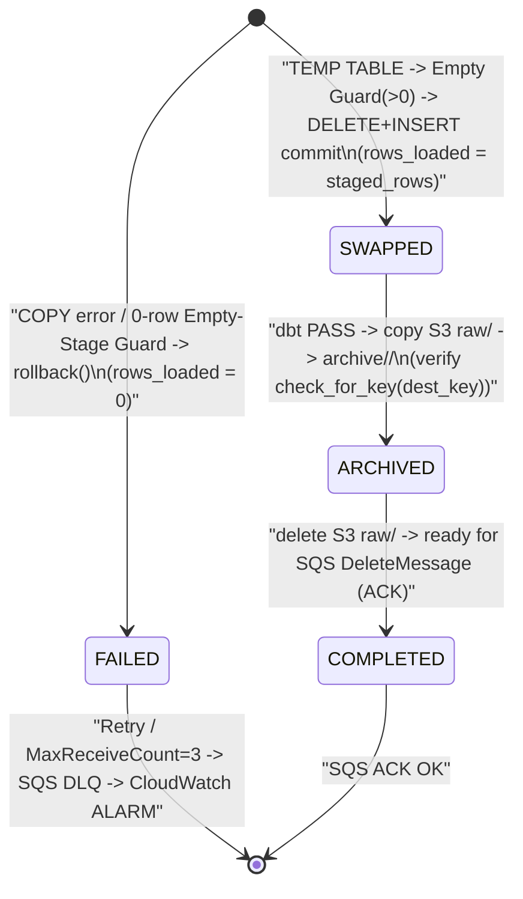

# 🔍 GIẢI THÍCH CHI TIẾT KIẾN TRÚC V5 — CLOUDFORMATION IaC, FAULT TOLERANCE & CLOUDOPS

> 🌐 **Ngôn ngữ / Language:** [English](V5_DEEP_DIVE.md) | **Tiếng Việt**
>
> Tài liệu này giải thích cặn kẽ **tại sao**, **cơ chế vận hành bên dưới (under-the-hood)** và **các quyết định thiết kế kỹ thuật (design trade-offs)** của bản nâng cấp **V5 (`5.0.0`)** — từ hạ tầng **AWS CloudFormation (`infra/cloudformation/template.yaml`)** đến tầng **Airflow 3 + Redshift Audit Ledger**.

---

## 1. Tại sao phải nâng cấp từ V4 (`v4.0.1`) lên V5 (`5.0.0`)?

Ở mốc **V4 (`v4.0.1`)**, hệ thống đã hoàn thiện tầng **Data Engineering Core** (Pure Event-Driven `AssetWatcher`, Atomic `TEMP TABLE` Swap, Empty-Stage Guard, 4-source Incremental `fct_orders`, GitHub Actions CI). Tuy nhiên, khi đặt dưới góc nhìn **Production CloudOps & Chuẩn AWS First Cloud Journey (FCJ)**, V4 vẫn còn 5 khoảng trống vận hành thực tế:

1. **Chưa có Infrastructure as Code (IaC):** Toàn bộ S3, SQS, IAM Role, Redshift trước đó tạo thủ công bằng CLI/Console — không thể tái lập toàn bộ hạ tầng trong 1 lệnh hay tự động **Rollback** khi lỗi khởi tạo.
2. **Chưa cách ly gói tin độc (Poison Message Isolation):** Nếu một file CSV bị lỗi cấu trúc hoặc rỗng 0 dòng làm task fail mãi mãi, message hết `VisibilityTimeout` sẽ quay lại hàng đợi chính vô tận (*infinite retry loop*).
3. **Thiếu giám sát chủ động (Observability):** Khi hàng đợi có tin nhắn lỗi hoặc consumer bị treo, không có **CloudWatch Alarms** và **Amazon SNS** báo ngay cho kỹ sư.
4. **Quyền IAM còn rộng & chưa tách vai trò:** Cần tách riêng quyền của Redshift (`raw/*` only), quyền chạy hàng ngày của Airflow (không được xóa `archive/*`), và quyền vận hành xử lý sự cố DLQ.
5. **Lỗ hổng ở nhánh Retry Safe ACK:** Trong V4, nếu `raw/` không còn file ở lượt retry, code mặc định tin rằng đã archive rồi và gọi ACK SQS — tiềm ẩn nguy cơ ACK nhầm nếu file trong `raw/` bị xóa ngoài ý muốn.

**V5 (`5.0.0`)** giải quyết triệt để cả 5 vấn đề trên mà **không làm phình kiến trúc** (không thêm Kafka, Spark, Lambda hay DynamoDB không cần thiết).

---

## 2. Giải phẫu Hạ tầng CloudFormation (`infra/cloudformation/template.yaml`)

File [`infra/cloudformation/template.yaml`](../infra/cloudformation/template.yaml) định nghĩa **14 tài nguyên mặc định**, **4 tài nguyên tùy chọn** và **16 Outputs**.

### 2.1. Cách phá bẫy "Circular Dependency kép" giữa S3, SQS Main Queue và DLQ
Trong CloudFormation, một lỗi rất phổ biến khi dựng kiến trúc S3 Event $\rightarrow$ SQS + DLQ là **vòng lặp phụ thuộc**:
- **Vòng lặp 1 (S3 $\leftrightarrow$ SQS Queue Policy):** `S3RawBucket` khai báo `NotificationConfiguration` trỏ vào `SqsMainQueue` nên yêu cầu `SqsMainQueuePolicy` phải tồn tại **trước** (S3 bắn `s3:TestEvent` ngay lúc tạo). Nhưng nếu `SqsMainQueuePolicy` dùng `!GetAtt S3RawBucket.Arn`, còn `S3RawBucket` dùng `DependsOn: SqsMainQueuePolicy` $\rightarrow$ CloudFormation báo **Circular Dependency**!
  - **Giải pháp V5:** `SqsMainQueuePolicy` tự ghép ARN của bucket bằng `!Sub "arn:${AWS::Partition}:s3:::${ProjectPrefix}-raw-data-${EnvironmentName}-${AWS::AccountId}-${AWS::Region}"` và `S3RawBucket` giữ `DependsOn: SqsMainQueuePolicy`.
- **Vòng lặp 2 (SQS Main Queue $\leftrightarrow$ SQS DLQ):** `SqsMainQueue` tham chiếu `!GetAtt SqsDeadLetterQueue.Arn` trong `RedrivePolicy`. Nếu `SqsDeadLetterQueue` lại tham chiếu `!GetAtt SqsMainQueue.Arn` trong `RedriveAllowPolicy` $\rightarrow$ **Circular Dependency ngược**!
  - **Giải pháp V5:** `SqsDeadLetterQueue` ghép trước ARN của queue chính bằng `!Sub` trong `RedriveAllowPolicy: { redrivePermission: byQueue, sourceQueueArns: [...] }`. Nhờ đó AWS tạo chuẩn thứ tự: `DLQ` $\rightarrow$ `Main Queue` $\rightarrow$ `Queue Policy` $\rightarrow$ `S3 Bucket`.

### 2.2. Bảo mật & Vòng đời Dữ liệu trên S3 (`S3RawBucket`)
- **Bảo mật 4 lớp:** Bật mã hóa `AES256`, chặn toàn bộ 4 cờ `PublicAccessBlockConfiguration`, giới hạn `ProjectPrefix` tối đa 16 ký tự (đảm bảo tên bucket luôn $\le 55$ ký tự, an toàn dưới ngưỡng 63 ký tự của AWS).
- **Versioning & Lifecycle:** Bật `VersioningConfiguration: Enabled` để giữ dấu vết khi có ghi đè file cùng tên; tự động hết hạn file trong `archive/` sau **90 ngày** và xóa các phiên bản cũ (`NoncurrentVersionExpiration`) sau **30 ngày**.
- **Xử lý điểm mù khi xóa Stack (`make cfn-delete`):** Vì bucket đã bật Versioning, lệnh `aws s3 rm --recursive` thông thường chỉ tạo *DeleteMarkers* chứ không xóa các *Object Versions*, dẫn đến `delete-stack` bị lỗi `BucketNotEmpty`. Script [`scripts/empty_versioned_bucket.py`](../scripts/empty_versioned_bucket.py) tự động liệt kê và xóa sạch toàn bộ `Versions` + `DeleteMarkers` theo lô 500 object trước khi xóa Stack.

### 2.3. Phân tách Quyền Least-Privilege IAM (3 Nhóm Độc lập)

| Thành phần IAM | Phạm vi tài nguyên | Quyền được cấp (V5) | Vì sao tách như vậy? |
| :--- | :--- | :--- | :--- |
| **`RedshiftS3ReadOnlyRole`** *(IAM Role)* | Chỉ `S3RawBucket` prefix `raw/*` | `sts:AssumeRole` (khóa `aws:SourceAccount`), `s3:GetBucketLocation`, `s3:ListBucket` (`s3:prefix: raw/*`), `s3:GetObject` / `GetObjectVersion` trên `raw/*` | Redshift chỉ cần đọc dữ liệu thô ở `raw/` để chạy `COPY`, không được phép đọc sang `archive/` hay ghi/xóa S3. |
| **`AirflowRuntimePolicy`** *(Managed Policy)* | `SqsMainQueue` + `S3RawBucket` (`raw/*`, `archive/*`) | SQS: `ReceiveMessage`, `DeleteMessage`, `ChangeMessageVisibility`, `GetQueueAttributes`, `GetQueueUrl`. S3: `GET/DELETE` trên `raw/*`; `GET/PUT` (**không có `DELETE`**) trên `archive/*`. | Tách hẳn khỏi quyền Redshift; Airflow không thể xóa nhầm dữ liệu lịch sử trong `archive/` và không tự đụng vào DLQ. |
| **`DlqOperatorPolicy`** *(Managed Policy)* | `SqsDeadLetterQueue` + `SqsMainQueue` | `StartMessageMoveTask`, `CancelMessageMoveTask`, `ListMessageMoveTasks`, `Receive/Delete`, `ListDeadLetterSourceQueues` trên DLQ + `SendMessage` về Main Queue. | Cô lập quyền xử lý sự cố (DLQ Redrive) dành riêng cho kỹ sư vận hành. |

### 2.4. Giải phẫu 4 CloudWatch Alarms + `PipelineAlertTopicPolicy`
Cả 4 Alarms đều gắn `TreatMissingData: notBreaching` (khi hàng đợi nhàn rỗi không phát metric thì giữ trạng thái xanh `OK`, tránh báo động giả) và gắn cả `AlarmActions` lẫn `OKActions` tới `PipelineAlertTopic`:

1. **`DlqMessagesVisibleAlarm` (`ApproximateNumberOfMessagesVisible >= 1`, Period `60s`, `1/1`):** Báo động **CRITICAL** ngay trong 1 phút khi có bất kỳ gói tin độc nào bị đẩy vào DLQ.
2. **`MainQueueOldestMessageAlarm` (`ApproximateAgeOfOldestMessage > 600s`, Period `60s`, `1/1`):** Cảnh báo **SLA 10 phút** — tách biệt ngưỡng SLA khỏi `VisibilityTimeout = 900s` để phát hiện ùn ứ sớm trước khi hết timeout. *(Lưu ý: Với SQS Standard, message bị nhận lặp nhiều lần có thể lùi về sau hàng đợi và không phản ánh đủ tuổi trên metric này — nên `DlqMessagesVisibleAlarm` đóng vai trò chốt chặn bổ sung).*
3. **`MainQueueInFlightAlarm` (`ApproximateNumberOfMessagesNotVisible >= 1`, Statistic `Minimum`, Period `60s`, `15/15`):** Cảnh báo **Sustained Queue-Level In-Flight Activity** khi hàng đợi luôn có ít nhất 1 message đang được giữ liên tục suốt 15 phút (giúp phát hiện consumer treo hoặc batch chạy kéo dài bất thường; cần phân biệt với traffic liên tục gối đầu).
4. **`MainQueueBacklogAlarm` (`ApproximateNumberOfMessagesVisible >= 20`, Statistic `Average`, Period `60s`, `3/3`):** Phát hiện tồn đọng khối lượng lớn kéo dài liên tục 3 phút.

Ngoài ra, **`PipelineAlertTopicPolicy`** (`AWS::SNS::TopicPolicy`) giới hạn chỉ dịch vụ `cloudwatch.amazonaws.com` đúng `aws:SourceAccount` và ARN `alarm:${ProjectPrefix}-*-${EnvironmentName}` mới được phép `sns:Publish`.

### 2.5. Công tắc FinOps (`DeployRedshift`) & Bảo mật Redshift Serverless
- **`DeployRedshift=false` (Mặc định):** Dựng toàn bộ 14 tài nguyên S3 + SQS + DLQ + 4 Alarms + SNS + IAM trong hạn mức Always Free / lưu trữ tối thiểu (~$0.003/tháng cho ~120 MB S3), tái sử dụng cụm Redshift Serverless sẵn có.
- **`DeployRedshift=true`:** Tự động dựng Namespace + Workgroup 4 RPUs với **`PubliclyAccessible=false`** mặc định, **`SecurityGroupIds`** + **`SubnetIds`** nối đầy đủ, `AuthorizedCidrIp` mặc định `127.0.0.1/32` (không mở `0.0.0.0/0`), và **`ManageAdminPassword: true`** (tự quản lý mật khẩu an toàn qua **AWS Secrets Manager** nếu không truyền `RedshiftAdminPassword`).

---

## 3. Độ tin cậy Ứng dụng: Bug Airflow 3, Audit Ledger & Safe ACK

### 3.1. Bug thực tế của Airflow 3 Task SDK đã bắt & vá khi test live
Khi kiểm thử live Bước 5 trên **Airflow 3.3**, hàm `extract_messages_from_asset_events` ban đầu trả về `[]` khiến task bị skip dù `SqsSensorTrigger` đã phát `TriggerEvent` chứa đủ `message_batch`.
- **Nguyên nhân gốc:** Trong Airflow 3 Task SDK, `context["triggering_asset_events"]` là một object **`TriggeringAssetEventsAccessor`**, kế thừa từ `collections.abc.Mapping` chứ **không phải `dict`**. Kiểm tra `isinstance(..., dict)` luôn trả về `False`!
- **Cách khắc phục:** Chuyển sang `isinstance(..., Mapping)` trong [`include/sqs_parser.py`](../include/sqs_parser.py) và bổ sung unit test `test_extract_messages_supports_airflow3_mapping_accessor` trong [`tests/test_sqs_parser.py`](../tests/test_sqs_parser.py) (**15/15 unit tests PASS**).

### 3.2. State Machine của `ops.pipeline_ingestion_audit` & Safe ACK

1. **Chính xác hóa `rows_loaded`:** Giá trị `rows_loaded = staged_rows` chỉ được ghi với `status = 'SWAPPED'` **sau khi** giao dịch `DELETE + INSERT` vào bảng chính `raw_data.<table>` đã `conn.commit()` thành công; nếu rollback, bảng audit ghi `status = 'FAILED', rows_loaded = 0`. *(Lưu ý: Redshift không enforce `UNIQUE` vật lý, nên bảng audit đóng vai trò Verification Ledger chứ không thay thế distributed lock).*
2. **Đường dẫn Archive cố định (**Deterministic**):** Thay `archive/<timestamp>/<filename>` bằng `archive/<safe_audit_id>/<filename>` ([`build_deterministic_archive_key`](../include/ingestion_guards.py)) — nếu task chạy lại sau lỗi mạng, file luôn ghi về đúng một khóa duy nhất, không đẻ rác trùng lặp.
3. **Chặn ACK nhầm (`verify_safe_to_ack_when_raw_missing`):**
   - Trong [`dags/ecommerce_pipeline_dag.py`](../dags/ecommerce_pipeline_dag.py), trạng thái `ARCHIVED` được ghi **ngay sau khi verify bản sao trong `archive/` và trước khi xóa `raw/`**.
   - Nếu ở lượt retry mà `raw/` không còn file, code truy vấn trạng thái mới nhất của `audit_id` trong `ops.pipeline_ingestion_audit`: **chỉ cho phép ACK khi `status in {'ARCHIVED', 'COMPLETED'}` VÀ đúng `archive_key` định danh của lượt đó thực sự tồn tại trên S3**. Trạng thái `SWAPPED` hoặc `FAILED` đều bị chặn và raise `RuntimeError`.
4. **Gia hạn `VisibilityTimeout` (Heartbeat):** Hàm `_refresh_sqs_visibility` gọi `change_message_visibility(VisibilityTimeout=900)` ngay sau khi swap Redshift xong và ngay trước khi archive/ACK để reset đồng hồ 15 phút cho các batch lớn.

---

## 4. Tóm tắt Chi phí FinOps & Các Giới hạn Minh bạch

| Dịch vụ AWS (trong Stack V5) | Hạn mức Always Free (kể cả Paid Tier) | Thực tế sử dụng của V5 |
| :--- | :--- | :--- |
| **AWS CloudFormation & IAM** | Miễn phí 100% | **\$0.00** |
| **Amazon SQS (Main + DLQ)** | 1,000,000 requests/tháng | ~103,680 reqs/tháng nếu bật Astro 24/7 (~10% Free Tier); **`0` reqs** khi `astro dev stop` |
| **Amazon CloudWatch Alarms** | 10 Standard-resolution Alarms (`Period >= 60s`) | Đang dùng **4/10 Alarms = \$0.00** |
| **Amazon SNS (Email)** | 1,000 email/tháng | **\$0.00** |
| **Amazon S3 (Versioning)** | Trả phí theo GB lưu trữ (\$0.023/GB/tháng) | ~120 MB $\approx$ **\$0.003/tháng** (Lifecycle tự dọn old versions sau 30 ngày) |
| **Redshift Serverless (4 RPUs)** | Tính theo RPU-giây khi thức + Storage (\$0.024/GB/tháng) | Ngủ **\$0.00 compute** khi idle; chỉ thức ~1–3 phút khi có batch CSV |

### Các giới hạn / Trade-offs giữ nguyên có chủ đích ở V5
- **Per-table Atomicity & Snapshot Contract:** `parse_sqs_s3_events` gom nhóm theo `filename` (mỗi bảng đích 1 snapshot file mỗi batch) và `load_raw_from_sqs` commit độc lập theo từng bảng — nếu có batch nhiều file lỗi ở file thứ 3, các file đã commit vẫn an toàn nhưng toàn bộ message batch chưa ACK có thể bị retry chung (*batch failure coupling*, hướng mở rộng V6 là per-message state machine / DynamoDB conditional lock).
- **Môi trường dev local:** Stack CloudFormation đã tạo và gắn `AirflowRuntimePolicy` & `DlqOperatorPolicy` chuẩn Least Privilege vào `de-ecommerce-dev`, nhưng user dev này vẫn đang giữ các Managed Policy rộng từ V2–V4 để tiện chạy CloudFormation deploy từ máy cá nhân.
